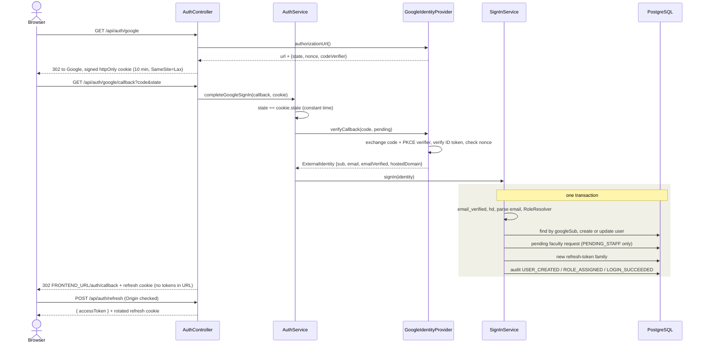
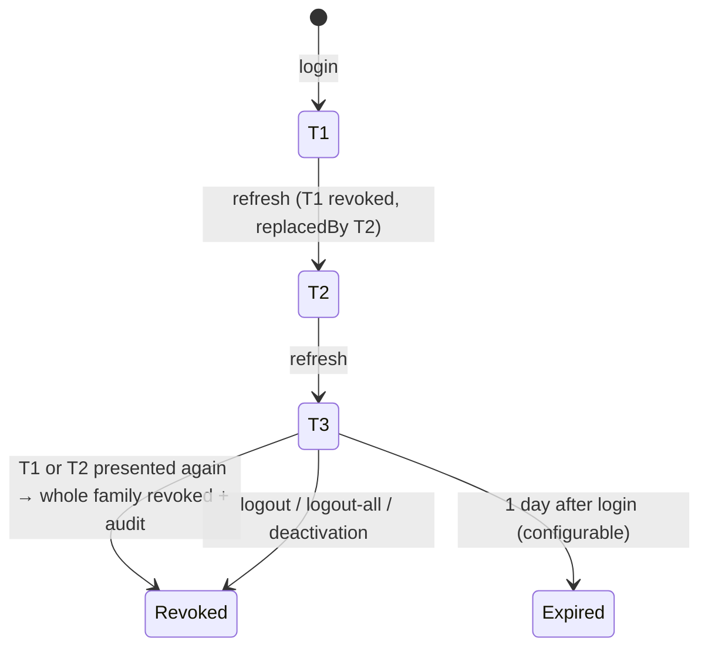

# Authentication, roles and sessions (Phase 3)

Google Sign-In restricted to `nst.rishihood.edu.in`, four server-side roles, refresh-token
sessions with reuse detection, and an append-only audit log. The decisions behind it are in
[docs/decisions](../decisions/).

## Modules and layers

```mermaid
flowchart TB
  subgraph auth
    direction TB
    P[presentation<br/>AuthController, guards, AccessTokenStrategy, cookies, DTOs]
    A[application<br/>AuthService, SignInService, SessionService, FacultyAccessService, DemoAccountsService<br/>ports: IdentityProvider, DevIdentityProvider, FacultyDirectory, RefreshTokenRepository, TokenSigner]
    D[domain<br/>RoleResolver, BatchYearPolicy, UniversityIdentityParser, roles, errors]
    I[infrastructure<br/>GoogleIdentityProvider, LocalDevIdentityProvider, RishihoodIdentityParser,<br/>JwtTokenSigner, PrismaRefreshTokenRepository, PrismaFacultyDirectory]
    P --> A --> D
    I -. implements .-> A
    I -. implements .-> D
  end
  admin[admin<br/>AdminController, AdminService] --> A
  admin --> users
  A --> users[users<br/>UsersService → UsersRepository]
  A --> audit[audit<br/>AuditService.record(tx, event)]
  cycles[course-cycles] -. "@Roles, @CurrentUser" .-> P
  common[common<br/>Clock, TransactionRunner, DomainError, error filter, OriginGuard]
```

Rules this layout enforces:

- The domain layer is plain TypeScript, with no Nest, Prisma or Google imports. Application code
  depends on ports, never on infrastructure (`grep -rn infrastructure src/auth/application` is
  empty).
- Only repositories touch Prisma. Services in other modules are reached through their exported
  services (`UsersService`, `AuditService`, `SessionService`, `FacultyAccessService`).
- A multi-module change shares one database transaction through the `TransactionRunner` port;
  the `Transaction` handle is opaque outside the Prisma layer.

| Module | Owns | Exports |
| --- | --- | --- |
| `users` | `User` table; every role, status or batch change bumps `tokenVersion` | `UsersService` |
| `audit` | `AuditLog` (append-only, enforced by a database trigger) | `AuditService` |
| `auth` | identity rules, login, `RefreshToken`, faculty allowlist and access requests | `FacultyAccessService`, `SessionService`, `BatchYearPolicy` |
| `admin` | admin HTTP routes and user administration | – |
| `common` | `Clock`, `TransactionRunner`, `DomainError`, global error filter, `OriginGuard` | global |
| `config` | `parseEnvironment()` (boot-time validation) and typed `AppConfig` | global |

## Sign-in sequence



Every denial (bad state, invalid ID token, wrong `hd`, unverified email, ineligible email,
deactivated, conflict) is audited as `LOGIN_DENIED` with its reason, and the browser goes to
`/login?error=CODE`.

## Every authenticated request

```mermaid
flowchart LR
  R[Request] --> J{JwtAuthGuard<br/>@Public?}
  J -- yes --> H[Handler]
  J -- no --> V[verify JWT HS256, iss, aud]
  V --> L[read id, role, status, tokenVersion, batchYear by PK]
  L --> C{deactivated? ver != tokenVersion?}
  C -- yes --> E401[401 ACCOUNT_DEACTIVATED / TOKEN_REVOKED]
  C -- no --> G2{RolesGuard<br/>role in @Roles?}
  G2 -- no --> E403[403 FORBIDDEN_ROLE or FACULTY_APPROVAL_PENDING]
  G2 -- yes --> Pol[Policy objects: ownership, batch → 404 if not visible] --> H
```

Both guards are global, and `RolesGuard` fails closed: a non-public route without `@Roles()` is
denied.

## Refresh-token family



## Roles and permissions

| Permission | STUDENT | FACULTY | ADMIN | PENDING_STAFF |
| --- | --- | --- | --- | --- |
| `GET /course-cycles` | own batch, published | 403 | all published or closed | 403 |
| `GET /course-cycles/my`, create, edit, publish, close | 403 | own cycles (others: 404) | 403 | 403 |
| `GET /course-cycles/:id` | own batch, published (else 404) | own (else 404) | non-draft (drafts 404) | 403 |
| `/admin/*` | 403 | 403 | yes | 403 |
| `/auth/me`, `/auth/logout`, `/auth/logout-all` | yes | yes | yes | yes |

PENDING_STAFF receives `403 FACULTY_APPROVAL_PENDING` everywhere except the last row.

## Errors

Every error has the shape `{ code, message }` (`ApiExceptionFilter`). The code → HTTP table is
`common/errors/error-status.ts`; it is type-checked so a new code cannot ship without a status.

| HTTP | Codes |
| --- | --- |
| 400 | `VALIDATION_FAILED`, `INVALID_BATCH_YEAR`, `STUDENT_EMAIL_CANNOT_BE_ELEVATED`, `INVALID_STAFF_EMAIL`, `INVALID_DEADLINE`, `INVALID_ACADEMIC_YEAR` |
| 401 | `UNAUTHENTICATED`, `INVALID_OAUTH_STATE`, `SIGN_IN_CANCELLED`, `INVALID_ID_TOKEN`, `INVALID_REFRESH_TOKEN`, `REFRESH_TOKEN_REUSED`, `TOKEN_REVOKED`, `ACCOUNT_DEACTIVATED` |
| 403 | `EMAIL_NOT_VERIFIED`, `WRONG_HOSTED_DOMAIN`, `EMAIL_NOT_ELIGIBLE`, `FORBIDDEN_ROLE`, `FACULTY_APPROVAL_PENDING`, `ORIGIN_NOT_ALLOWED`, `NOT_CYCLE_OWNER` |
| 404 | `NOT_FOUND`, `CYCLE_NOT_FOUND`, `USER_NOT_FOUND`, `ALLOWLIST_ENTRY_NOT_FOUND`, `FACULTY_REQUEST_NOT_FOUND`, `DEV_LOGIN_DISABLED` |
| 409 | `IDENTITY_CONFLICT`, `ALLOWLIST_ENTRY_EXISTS`, `FACULTY_REQUEST_ALREADY_DECIDED`, `USER_NOT_A_STUDENT`, `CANNOT_DEACTIVATE_SELF`, cycle state conflicts |
| 429 | `TOO_MANY_REQUESTS` |

## Security baseline

- `helmet` (HSTS and `upgrade-insecure-requests` only in production), CORS limited to
  `FRONTEND_URL` with credentials.
- Rate limits, keyed by what they protect ([ADR 023](../decisions/023-campus-limits-and-sessions.md)), with counters
  in PostgreSQL (`RateLimitCounter`, UNLOGGED) so every API process shares them:
  - sign-in routes (`google`, `google/callback`, `dev-login`): 600 per minute per client IP, sized
    for a campus behind one NAT; each route has its own count;
  - Google sign-in: 10 per minute per Google account, checked once Google has vouched for it;
  - refresh: 10 per minute per refresh-token family, never per IP; a limited refresh is 429 and
    keeps its cookie.
- `TRUST_PROXY` (off by default) names the proxy whose `X-Forwarded-For` gives the client IP;
  without it the header is ignored, so a client cannot change its own IP. `true` is refused.
- A rotated refresh token presented again within `REFRESH_REUSE_GRACE_SECONDS` (10) gets a token in
  the same family (two tabs at once); after that, reuse still ends the family.
- Refresh clears its cookie only for an answer about the session (`INVALID_REFRESH_TOKEN`,
  `TOKEN_REVOKED`, `REFRESH_TOKEN_REUSED`, `ACCOUNT_DEACTIVATED`, `UNAUTHENTICATED`). A database
  outage is `503 SERVICE_UNAVAILABLE` and the browser keeps its session, retrying with backoff.
- Cookie-authenticated routes (`refresh`, `logout`, `dev-login`) require `Origin == FRONTEND_URL`.
- Tokens, codes and cookie values are never logged. `AuditService` refuses metadata keys that look
  like secrets.
- The audit log rejects `UPDATE` and `DELETE` at the database level (trigger in the migration).

## Design defense

| Question | Answer | Code |
| --- | --- | --- |
| Where are the role rules? | One pure class, applied in order on every login | `auth/domain/role-resolver.ts` |
| How can a student never become faculty? | Every elevation path calls `assertCanBeElevated`; the bootstrap list is checked at boot | `role-resolver.ts`, `faculty-access.service.ts`, `config/env.validation.ts` |
| Why does a demotion take effect immediately? | Role is read per request, and `tokenVersion` moves on every access change | `access-token.strategy.ts`, `users.service.ts` |
| How is the login atomic? | `TransactionRunner.run` wraps user, request, refresh family and audit | `sign-in.service.ts` |
| How are denials audited if the request fails? | The transaction returns the denial, commits the audit row, then throws | `sign-in.service.ts`, `session.service.ts` |
| Where is DIP? | Services depend on ports (`IdentityProvider`, `TokenSigner`, `FacultyDirectory`, `RefreshTokenRepository`, `Clock`, `TransactionRunner`) | `auth/application/ports/*` |
| How would the CSV import fit? | One `FacultyAccessService.importCsv` method writing `source = CSV_IMPORT` | `faculty-access.service.ts` |
| How would another identity provider fit? | Implement `IdentityProvider`; `SignInService` is unchanged | `ports/identity-provider.ts` |

## Demo accounts (development)

`DemoAccountsService` creates the accounts listed in `application/demo-accounts.ts` ahead of their
first dev login (`npm run seed:demo`, which boots the app context and calls `seed()`), and lists
them for the login page (`GET /auth/dev-login/accounts`). Both check
`DevIdentityProvider.assertEnabled()` first, so they refuse exactly when dev login does. Both routes
also pass `DevLoginGuard`: dev login answers only with `NODE_ENV=test`, or in development to a
request from this machine (a loopback peer and no forwarding header); anything else is 404
`DEV_LOGIN_DISABLED`. Boot is refused with `AUTH_DEV_LOGIN_ENABLED=true` in any other environment.

- Users get the provider sub `dev|<email>` (`devSubject`), so the later dev login finds them
  instead of hitting `IDENTITY_CONFLICT`. Their `lastLoginAt` stays empty until then.
- Each account is checked against the configured email rules first; one that does not fit (for
  example with another university's patterns) is skipped, never forced.
- Faculty go onto the allowlist through `FacultyAccessService.addToAllowlist`, with a demo admin as
  the actor, because the role resolver demotes faculty who are not on it at their next login.
- Every write is audited with `reason: "DEMO_SEED"` and no actor; the allowlist entries carry the
  demo admin as actor like any manual entry.

## Testing

- Unit (Jest): parser, pattern overlap, `RoleResolver`, `BatchYearPolicy` with a fake `Clock`,
  `SessionService` rotation, reuse and family expiry, env validation, Google provider (PKCE, nonce)
  and real RS256 verification with local keys.
- Integration (`node:test`, real PostgreSQL `flowforge_test`): the Google flow with Google's network
  calls faked, faculty access, sessions, user administration, a full RBAC matrix, boot-time checks
  in a child process, and the Phase 2 scenario. Jest cannot load NestJS 12's ES modules on
  Node 22, so integration tests run on Node's built-in runner, which loads them like the real app.
