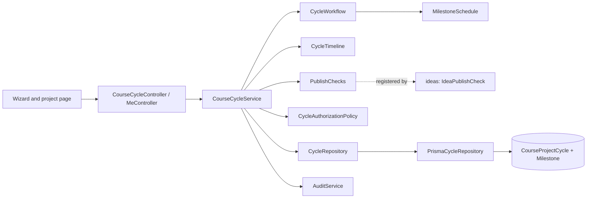
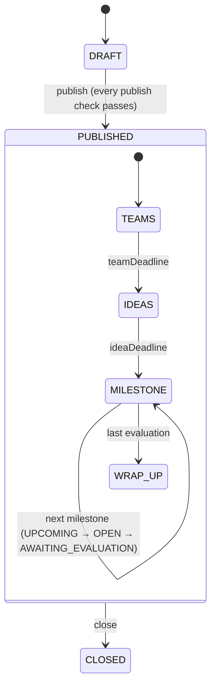

# Course / Project Cycle Management

A cycle (a "project" on screen) is the faculty-owned academic context that teams, ideas and
submissions attach to. Since Phase 8 it is an aggregate of the cycle and its **milestones**
(M1…Mn), created in one guided flow and checked as a whole before it is published
([ADR 016](../decisions/016-milestones-replace-the-submission-window.md)).

## Layout

```
backend/src/course-cycles/
  domain/          cycle.types, cycle.errors, cycle-workflow, milestone, milestone-schedule,
                   cycle-timeline, cycle-authorization-policy, cycle-roster
  application/     course-cycle.service, cycle-enrollment.service, publish-checks,
                   cycle-publish-checks, enrollment-removal-checks, ports/cycle.repository
  infrastructure/  prisma-cycle.repository (the only file that touches Prisma)
  presentation/    course-cycle, cycle-enrollment, cycle-batch and me controllers; dto/
  testing/         in-memory-cycle.repository
backend/src/common/links/   link-type, link-requirement, link-validators (ADR 018)
```

Dependencies point inward: presentation → application → domain. `CourseCycleService` takes plain
commands (`cycle-commands.ts`, dates as ISO strings) and returns read models (`cycle-views.ts`:
the cycle with its `currentStage` and `nextEvents`, a published cycle with its warnings, a
student's upcoming events). The request DTOs implement the commands, and the controllers map the
views to response DTOs, so nothing HTTP-shaped (Swagger or class-transformer decorators) reaches
the use cases or their unit tests.

## Component flow



## Saving a cycle

Every change runs in one transaction: lock the cycle row (`SELECT … FOR UPDATE`), check the
owner, check the state's editable fields, apply A3 on a published cycle, check the whole
schedule, save the cycle and its milestones, and write the audit row (`CYCLE_CREATED`,
`CYCLE_UPDATED` with the changed field names, `CYCLE_PUBLISHED` with any warnings,
`CYCLE_CLOSED`). If the audit row fails, nothing is saved.

```mermaid
sequenceDiagram
  actor Faculty
  Faculty->>Controller: PATCH /course-cycles/:id { …, milestones: [...] }
  Controller->>Service: actor + DTO
  Service->>Repository: lockById (FOR UPDATE)
  Service->>Workflow: assertEditable, A3, assertValidSchedule
  Service->>Repository: update(fields, milestone plan)
  Repository->>PostgreSQL: UPDATE cycle; delete, re-place, update, create milestones
  Service->>Audit: record(tx, CYCLE_UPDATED)
  PostgreSQL-->>Faculty: the cycle with its milestones, stage and next events
```

`milestones` in a request is the full list in order: an item with `id` keeps that milestone, an
item without one is new, a left-out milestone is removed. Ids stay stable because submissions
reference them; positions are moved out of the way first so a reordered list never collides
with `@@unique([cycleId, position])`.

## The schedule

```
teamDeadline <= ideaDeadline <= M1.opens < M1.due <= M1.evaluation
                               M1.due <= M2.opens < M2.due <= M2.evaluation …
```

- Students change their own teams until `teamDeadline`; the owning faculty place the rest from
  then until `ideaDeadline` (A1, [teams.md](teams.md)).
- First ideas are due by `ideaDeadline`; feedback rounds continue after it ([ideas.md](ideas.md)).
- Each milestone takes versions from its `submissionOpensAt` until its `submissionDueAt`
  ([submissions.md](submissions.md)).
- 1 to 10 milestones to publish (a draft may have none), names unique within the cycle.
- `MilestoneSchedule` checks all of it and can report every problem at once; the database
  checks `teamDeadline <= ideaDeadline` (strict in the domain, because older rows had equal
  deadlines) and each milestone's own order.

## State machine and timeline



The inner stages are not stored: `CycleTimeline` computes them from the dates and the `Clock`
([ADR 017](../decisions/017-computed-dashboard-events.md)). An open milestone wins over one still
waiting for its evaluation. Every cycle response carries `currentStage` and its next three
events; `GET /me/upcoming` lists a student's next ten across their visible cycles.

| State | Editable | Actions |
| --- | --- | --- |
| `DRAFT` | Everything, including the kind, team sizes, `ideaSource`, `ideaLinkRequirement` and the milestone list | Edit, publish |
| `PUBLISHED` | `description`; `teamDeadline` and `ideaDeadline` while their stage is open, only to a future time; milestones under A3 | Limited edit, close |
| `CLOSED` | None | None |

**A3.** After publishing, milestones cannot be added, removed or reordered (`409
MILESTONES_LOCKED`). Only a milestone that has not opened may change, only its dates and
description, only to future times, and the schedule must stay valid; an opened milestone, a new
name or new links are `409 MILESTONE_LOCKED`.

## Publishing

`PublishChecks` is a registry ([ADR 019](../decisions/019-publish-checks-registry.md)). Publishing
runs every check in the publish transaction and reports every blocking one together:

```json
{ "code": "PUBLISH_BLOCKED", "message": "The project cannot be published yet: 3 things need fixing",
  "details": [{ "code": "NO_MILESTONES", "message": "…" }, { "code": "ROSTER_EMPTY", "message": "…" },
              { "code": "IDEA_LIST_EMPTY", "message": "…" }] }
```

| Code | Severity | Registered by |
| --- | --- | --- |
| Schedule codes, `INVALID_TEAM_SIZE`, `NO_MILESTONES` | blocking | course-cycles |
| `ROSTER_EMPTY`: an elective with nobody enrolled | blocking | course-cycles |
| `IDEA_LIST_EMPTY`: `ideaSource = FACULTY_LIST` and no idea in the list | blocking | ideas |
| `NO_STUDENTS_YET`: a core course whose batch has no active student | warning | course-cycles |

`GET /course-cycles/:id/publish-checks` returns `{ blocking, warnings }` without publishing; the
wizard's review step shows them, each linked to the step that fixes it.

## Access matrix

Since Phase 3 the global `RolesGuard` checks the role first; the policy then decides per cycle. A
cycle the caller may not see is `404 CYCLE_NOT_FOUND`, so its existence is not revealed.

| Actor | List | Read | Mutate |
| --- | --- | --- | --- |
| Faculty owner | `/my`, all statuses | Own cycles, publish checks | Create, edit by state, publish, close |
| Other faculty | None for another owner | `404 CYCLE_NOT_FOUND` | `404 CYCLE_NOT_FOUND` |
| Student with batch | Published core cycles of their batch, published electives they are enrolled in; `/me/upcoming` from those only | The same cycles, plus closed ones they were in a team of (S4, ADR 022); else 404 | `403 FORBIDDEN_ROLE` |
| Student without batch | Enrolled electives only | The same | `403 FORBIDDEN_ROLE` |
| Admin | Every published or closed cycle | Non-draft cycles (drafts 404) | `403 FORBIDDEN_ROLE` |
| Pending staff | `403 FACULTY_APPROVAL_PENDING` | `403 FACULTY_APPROVAL_PENDING` | `403 FACULTY_APPROVAL_PENDING` |

## Errors

| Code | HTTP | Meaning |
| --- | ---: | --- |
| `CYCLE_NOT_FOUND` | 404 | Unknown id, or a cycle the caller may not see |
| `NOT_CYCLE_OWNER` | 403 | Defense in depth: a non-faculty actor reached a faculty-only operation |
| `INVALID_STATUS_TRANSITION` | 409 | Illegal transition, or the cycle changed meanwhile |
| `CYCLE_ALREADY_CLOSED` | 409 | Any closed-cycle mutation |
| `CYCLE_FIELD_LOCKED` | 409 | Field not editable in the current state, or a stage deadline that has passed |
| `INVALID_DEADLINE` | 400 | A date is not a valid ISO timestamp |
| `INVALID_ACADEMIC_YEAR` | 400 | Not consecutive `YYYY-YY` |
| `INVALID_TEAM_SIZE` | 400 | Not `1 <= min <= max <= 10` |
| `INVALID_TEAM_DEADLINE` | 400 | A moved team deadline is in the past |
| `INVALID_IDEA_DEADLINE` | 400 | The idea deadline is before the team deadline (equal is allowed since Phase 9, S5, and leaves no placement window), or moved into the past |
| `INVALID_MILESTONE_SCHEDULE` | 400 | A milestone opens before the idea deadline or the previous one is due, opens at or after its due date, is evaluated before it, or moves into the past |
| `INVALID_MILESTONE_COUNT` | 400 | More than 10 milestones |
| `INVALID_MILESTONE` | 400 | An empty or too-long name or description |
| `DUPLICATE_MILESTONE_NAME` | 400 | Two milestones with the same name (any case) |
| `MILESTONE_NOT_FOUND` | 404 | A milestone id that is not the cycle's, or one listed twice |
| `MILESTONES_LOCKED` | 409 | Adding, removing or reordering milestones after publish |
| `MILESTONE_LOCKED` | 409 | Changing an opened milestone, or a milestone's name or links after publish |
| `PUBLISH_BLOCKED` | 409 | At least one blocking publish check; every one is in `details` |
| `INVALID_LINK_REQUIREMENT` | 400 | A requirement with unknown types, a repeat, or a type both required and optional |
| `CYCLE_NOT_ELECTIVE`, `CYCLE_NOT_CORE`, `ENROLLMENT_NOT_FOUND` | 409/409/404 | Roster operations ([teams.md](teams.md)) |

## Defaults applied

- Course name and title are required, at most 120 characters; the description at most 2000.
- `teamDeadline` and `ideaDeadline` are required (the wizard sends its defaults when it saves
  the draft after step 1). `ideaSource` defaults to `BOTH`; the idea link requirement to
  "GitHub and Drive optional"; a milestone's to "GitHub required, demo and report optional".
- Semester 1–12 (the wizard offers 1–8). The wizard prefills it from the batch and today:
  January–June is semester `2·(year − batch)`, July–December `2·(year − batch) + 1`, and the
  academic year follows (editable).
- Closed cycles are hidden from students; drafts from everyone but their owner.
- PostgreSQL `RESTRICT` protects the owner and milestone relations.
- `npm run seed:demo` creates and publishes "AIML demo project" for the first demo faculty
  member: M1 and M2 require GitHub, "Final" requires a Drive link.

## Design defense

| Question | Answer | Code reference |
| --- | --- | --- |
| Why are milestones part of the cycle? | One schedule invariant spans the cycle and every milestone; one lock and one transaction keep it whole | `prisma-cycle.repository.ts: update`, ADR 016 |
| Where is each rule? | State and editability: `CycleWorkflow`; order: `MilestoneSchedule`; stage and events: `CycleTimeline`; links: `LinkRequirement`; who may: `CycleAuthorizationPolicy` | `domain/` |
| Why can status not be set directly? | Transitions need rules, timestamps, checks and an audit row | `cycle-workflow.ts: transition`, `course-cycle.service.ts: publish` |
| How do other modules add publish rules? | They register a check; course-cycles never imports them | `publish-checks.ts`, `ideas/application/idea-publish-check.ts` |
| Why compute stages instead of storing them? | Always right, nothing to sync | `cycle-timeline.ts`, ADR 017 |
| Where are SOLID and patterns? | SRP per layer, with commands in and views out of the application layer; OCP in the link validator and publish-check registries; DIP through `CycleRepository`; Strategy for link validators; Value Object for `LinkRequirement` | `common/links`, `application/ports` |
| What happens on a race? | The cycle row lock serializes edits and publishes; the second publish sees `PUBLISHED` and gets `409` | `lockById` |

## Limitations

Swagger is served at `/api/docs` outside production. Evaluations, grading and email
notifications are later phases; `evaluationAt` is a date only (A2).
