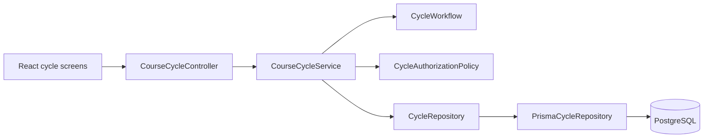
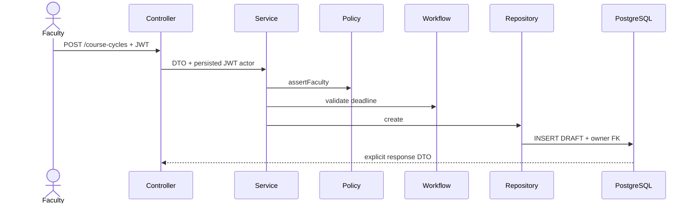
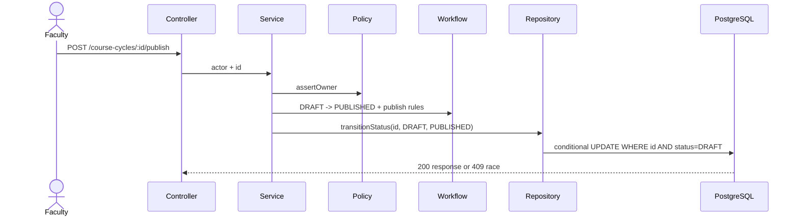
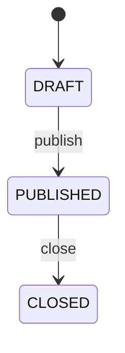

# Course / Project Cycle Management

Phase 2 adds the faculty-owned academic context that later project features attach to. It is intentionally a modular-monolith slice: one Nest application, one PostgreSQL database, and a React client.

## Component flow

## Create sequence

## Publish sequence

There is no audit model in the existing foundation, so Phase 2 does not invent one. A future audit model should be written in the same transaction as the cycle change.

## State machine

| State       | Editable fields                     | Actions             |
| ----------- | ----------------------------------- | ------------------- |
| `DRAFT`     | All request fields                  | Edit, publish       |
| `PUBLISHED` | `description`, `submissionDeadline` | Limited edit, close |
| `CLOSED`    | None                                | None                |

`CycleWorkflow` owns a declarative transition table and the publish rule list. `status` is never accepted by a DTO and is only changed through `transitionStatus` with an observed status in the database `WHERE` clause.

## Access matrix

| Actor                 | List                                            | Read                       | Mutate                                |
| --------------------- | ----------------------------------------------- | -------------------------- | ------------------------------------- |
| Faculty owner         | `/my`, all statuses                             | Own cycles                 | Create, edit by state, publish, close |
| Other faculty         | None for another owner                          | `NOT_CYCLE_OWNER`          | `NOT_CYCLE_OWNER`                     |
| Student with batch    | Published cycles for persisted `User.batchYear` | Published same-batch cycle | None                                  |
| Student without batch | Empty list                                      | No cycle                   | None                                  |

Batch filtering occurs in `PrismaCycleRepository.listPublishedForBatch`; email parsing is not repeated.

## Errors

| Code                        | HTTP | Meaning                                |
| --------------------------- | ---: | -------------------------------------- |
| `CYCLE_NOT_FOUND`           |  404 | Unknown id or unpublished student read |
| `NOT_CYCLE_OWNER`           |  403 | Faculty is not the owner               |
| `UNAUTHORIZED_BATCH_ACCESS` |  403 | Student requests another batch         |
| `INVALID_STATUS_TRANSITION` |  409 | Illegal transition or CAS race         |
| `CYCLE_ALREADY_CLOSED`      |  409 | Any closed-cycle mutation              |
| `CYCLE_FIELD_LOCKED`        |  409 | Field is not editable in current state |
| `INVALID_DEADLINE`          |  400 | Start is not before deadline           |

## Defaults applied

- Course name and title are required and limited to 120 characters.
- Description is optional and limited to 2000 characters.
- Semester is an integer from 1 through 12.
- Academic year uses consecutive `YYYY-YY` values.
- Closed cycles are hidden from students.
- PostgreSQL `RESTRICT` protects the faculty ownership relation.
- The student list is unpaginated and ordered by newest publication.
- No automatic close, archive, delete, duplicate, or scheduled transition exists.

## Design defense

| Question                                | Answer                                                                                                                    | Code reference                                                                                      |
| --------------------------------------- | ------------------------------------------------------------------------------------------------------------------------- | --------------------------------------------------------------------------------------------------- |
| Why is this its own concept?            | A cycle is the faculty-owned academic boundary shared by later teams, ideas, submissions, and evaluations.                | `schema.prisma: CourseProjectCycle`                                                                 |
| Why can status not be set directly?     | Lifecycle changes need transition rules, timestamps, and compare-and-set protection.                                      | `cycle-workflow.ts: CycleWorkflow`, `cycle-repository.ts: transitionStatus`                         |
| Why store batch in the database?        | The cycle targets a persisted cohort; letting a client choose access would be insecure.                                   | `prisma-cycle.repository.ts: listPublishedForBatch`                                                 |
| Why filter students by batch?           | Students should see only published academic contexts assigned to their persisted batch.                                   | `course-cycle.service.ts: listForStudent`                                                           |
| Why only the owner can modify?          | Ownership keeps faculty changes scoped to the cycle they created.                                                         | `cycle-authorization-policy.ts: assertOwner`                                                        |
| Why a modular monolith?                 | The current domain is small and transactional; modules preserve boundaries without distributed-system cost.               | `course-cycles.module.ts: CourseCyclesModule`                                                       |
| Where are SRP, OCP, DIP, and State?     | Controller maps HTTP, service orchestrates, workflow owns state, and service depends on the repository abstraction.       | `course-cycle.controller.ts`, `course-cycle.service.ts`, `cycle-workflow.ts`, `cycle-repository.ts` |
| Where are transactions used?            | No transaction wraps a single-row CAS update; PostgreSQL atomicity is sufficient. No audit transaction exists yet.        | `prisma-cycle.repository.ts: updateFields/transitionStatus`                                         |
| What happens to another faculty member? | The role guard permits faculty, then the ownership policy returns `NOT_CYCLE_OWNER` with HTTP 403.                        | `course-cycle.controller.ts`, `cycle-authorization-policy.ts`                                       |
| How would another state be added?       | Add one transition-table entry, editable-field list, and focused workflow tests; service and controller remain unchanged. | `cycle-workflow.ts: transitions/editableFields`                                                     |

## Extension check

- `ARCHIVED`: touches the `CycleStatus` enum, `CycleWorkflow` transition/editability tables, response typing, and focused tests; controller and service orchestration stay unchanged.
- Deadline less than 24 hours away: adds one publish rule in `CycleWorkflow.validatePublishRules`; no controller change.
- Faculty draft duplication: adds a repository `createFromCycle` operation and service orchestration; lifecycle and controller boundaries remain localized.

## Limitations

Swagger is not installed in the foundation, so endpoint, role, ownership, error, and request/response behavior is documented here instead of adding a new dependency. There is no audit infrastructure, so no audit rows are written in this phase. Frontend tests remain out of scope; frontend build and lint are the verification gates.
