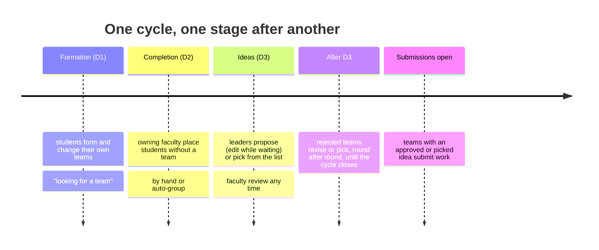
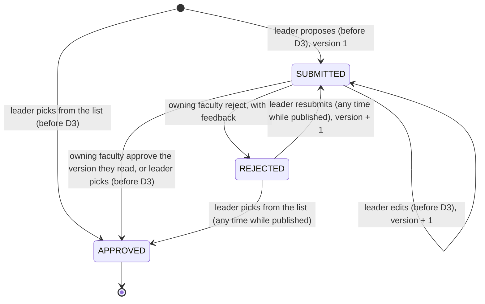
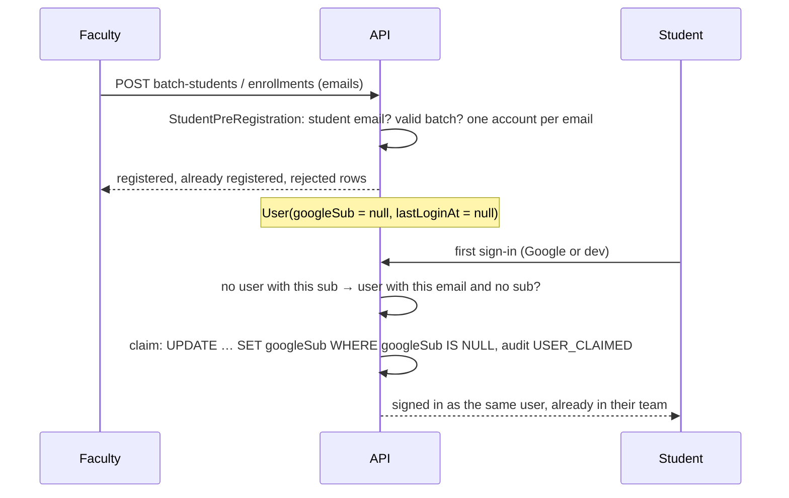

# Project ideas and pre-registered students (Phases 6 and 7)

Each team has one project idea. It either **proposes** its own, which the faculty who own the cycle
approve or reject, or **picks** one from the faculty's idea list, which is approved at once. A
rejected idea goes back to the team, which revises and resubmits it (or picks instead) for as many
rounds as it takes. The team never changes because of its idea. Decisions:
[ADR 013](../decisions/013-project-ideas.md) (ideas),
[ADR 014](../decisions/014-idea-catalog-and-open-ended-rounds.md) (the idea list and open-ended
rounds) and [ADR 012](../decisions/012-pre-registered-students.md) (students registered before
they sign in). Approved ideas unlock [submissions](submissions.md).

## The stages of a cycle



`D1 <= D2 <= D3 <= submissionStartAt < submissionDeadline`, checked on every save and by a
database CHECK. D2 defaults to D1 and D3 to D2; a later stage that ends together with a moved one
moves with it. On a published cycle a stage deadline moves only while that stage is open, and
only into the future.

## An idea's life



| Who | Read the idea | Propose or pick | Review | List the cycle's ideas | Read the idea list | Change the idea list |
| --- | --- | --- | --- | --- | --- | --- |
| Team leader | yes | yes | – | – | yes | – |
| Team member | yes | `403 NOT_TEAM_LEADER` | – | – | yes | – |
| Other students of the cycle | `404` | `404` | – | `403` | yes | `403` |
| Owning faculty | yes | – | yes | yes | yes | yes, until the cycle closes |
| Other faculty | `404` | – | `404` | `404` | `404` | `404` |
| Admin | yes | – | `403` | yes | yes | `403` |

## Modules and layers

```mermaid
flowchart TB
  subgraph ideas
    P[presentation<br/>IdeasController (teams/:id/idea, /pick, /review), CycleIdeasController,<br/>IdeaCatalogController (course-cycles/:id/idea-catalog), DTOs]
    A[application<br/>IdeaService, IdeaCatalogService<br/>ports: IdeaRepository, IdeaCatalogRepository, IdeaTeams]
    D[domain<br/>IdeaRules, idea types, IdeaDomainError]
    I[infrastructure<br/>PrismaIdeaRepository, PrismaIdeaCatalogRepository, TeamsIdeaTeams]
    P --> A --> D
    I -. implements .-> A
  end
  I --> teams[teams<br/>TeamQueryService: who may see a team]
  I --> cycles[course-cycles<br/>CourseCycleService: visible cycles]
  A --> audit[audit]
  sub[submissions] --> A
```

- `IdeaRules` is plain TypeScript and holds every window and transition; `IdeaService` only loads,
  locks, asks the rules and saves.
- A write locks the team row `FOR SHARE` (so a disband waits) and the idea row `FOR UPDATE`, then
  re-reads the idea. Two saves of one idea run one after the other.
- The version goes up with every content change. A review names the version it read; a newer one
  is refused (`409 IDEA_CHANGED`). Reviews are kept (`IdeaReview`, one per version).
- A pick copies the catalog idea (`source = CATALOG`, its description as the problem, no
  solution) and is approved at once. The pick locks the catalog row `FOR SHARE`, and a composite
  foreign key to `CatalogIdea (id, cycleId)` keeps picks inside the team's cycle and stops a picked
  idea from being removed (`409 CATALOG_IDEA_PICKED`). A CHECK ties `source`, `catalogIdeaId`,
  `solution` and `status` together.
- `IdeaService` is exported: the submissions module reads a team, its cycle and its idea through
  `getTeamIdea` and `listForCycle`, so visibility stays decided here.

## Pre-registered students



Until then the student is an ordinary active student with `signedIn: false`: listed in the batch
and enrollment lists, found by leaders' search, and placed by the faculty.

## Design defense

| Question | Answer | Where |
| --- | --- | --- |
| Why its own idea deadline? | Teams the faculty create late in their window still get time to write an idea. | ADR 013, `cycle-workflow.ts: assertValidSchedule` |
| Why version every edit? | A review must decide exactly the text the faculty member read. | `idea-rules.ts: assertCanReview` |
| Why may the faculty review before D3? | An early decision helps the team; a rejected team can resubmit for as many rounds as it takes. | `idea-rules.ts: submissionAction` |
| Why is a pick approved at once? | The faculty chose the idea by listing it; another approval would add a round for nothing. | `idea.service.ts: pick` |
| Why copy a picked idea instead of pointing to it? | A later edit of the list must not change a project a team already works on. | `idea-rules.ts: pickContent` |
| Why no deadline for rounds after a rejection? | Feedback rounds take as long as they take; only the first idea is due at D3 (ADR 014). | `idea-rules.ts: isResubmissionOpen` |
| Why claim by email only without a sub? | A signed-in account keeps ADR 003's protection; an unclaimed one was vouched for by the faculty. | `sign-in.service.ts: claim` |
| Why derive names from emails? | A readable list before the first sign-in, replaced by Google's name at sign-in. | `student-pre-registration.ts: nameFromEmail` |
