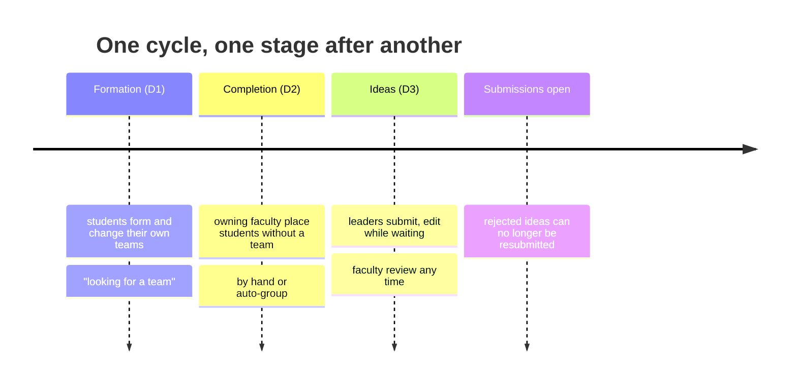
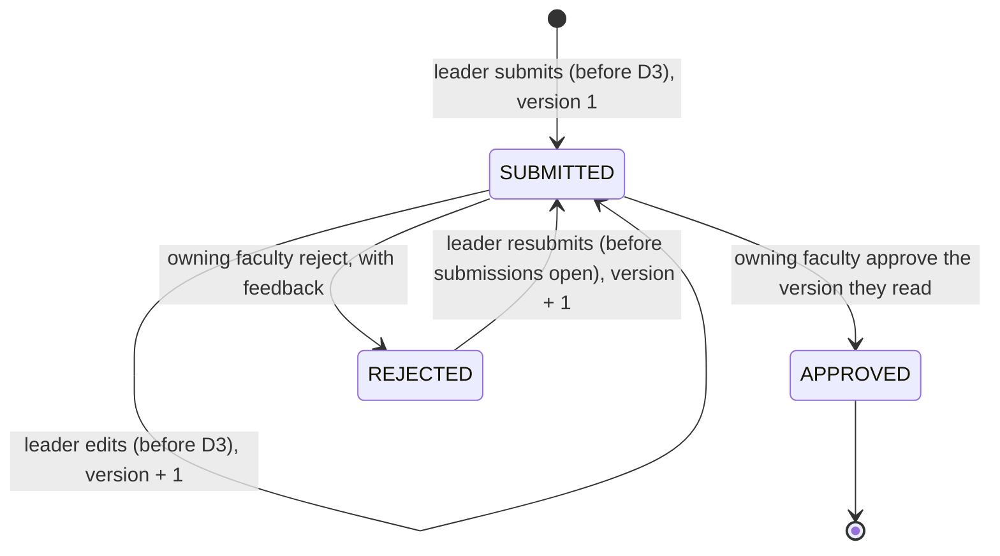
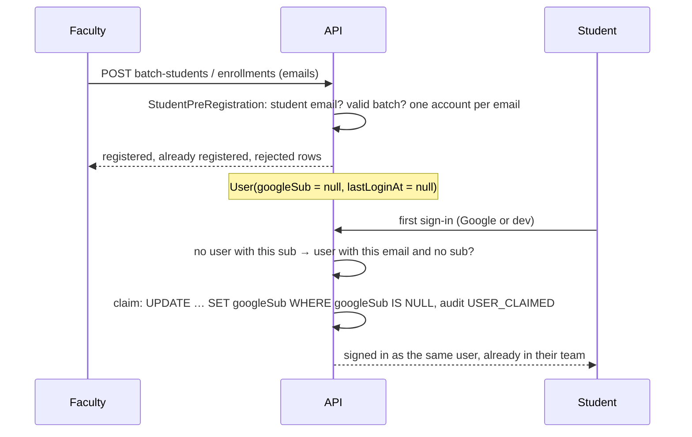

# Project ideas and pre-registered students (Phase 6)

Each team proposes one project idea; the faculty who own the cycle approve or reject it. A
rejected idea goes back to the team, which revises and resubmits it. The team never changes
because of its idea. Decisions: [ADR 013](../decisions/013-project-ideas.md) (ideas) and
[ADR 012](../decisions/012-pre-registered-students.md) (students registered before they sign in).

## The stages of a cycle



`D1 <= D2 <= D3 <= submissionStartAt < submissionDeadline`, checked on every save and by a
database CHECK. D2 defaults to D1 and D3 to D2; a later stage that ends together with a moved one
moves with it. On a published cycle a stage deadline moves only while that stage is open, and
only into the future.

## An idea's life



| Who | Read the idea | Submit, edit, resubmit | Review | List the cycle's ideas |
| --- | --- | --- | --- | --- |
| Team leader | yes | yes | – | – |
| Team member | yes | `403 NOT_TEAM_LEADER` | – | – |
| Other students | `404` | `404` | – | `403` |
| Owning faculty | yes | – | yes | yes |
| Other faculty | `404` | – | `404` | `404` |
| Admin | yes | – | `403` | yes |

## Modules and layers

```mermaid
flowchart TB
  subgraph ideas
    P[presentation<br/>IdeasController (teams/:id/idea), CycleIdeasController (course-cycles/:id/ideas), DTOs]
    A[application<br/>IdeaService<br/>ports: IdeaRepository, IdeaTeams]
    D[domain<br/>IdeaRules, idea types, IdeaDomainError]
    I[infrastructure<br/>PrismaIdeaRepository, TeamsIdeaTeams]
    P --> A --> D
    I -. implements .-> A
  end
  I --> teams[teams<br/>TeamQueryService: who may see a team]
  I --> cycles[course-cycles<br/>CourseCycleService: visible cycles]
  A --> audit[audit]
```

- `IdeaRules` is plain TypeScript and holds every window and transition; `IdeaService` only loads,
  locks, asks the rules and saves.
- A write locks the team row `FOR SHARE` (so a disband waits) and the idea row `FOR UPDATE`, then
  re-reads the idea. Two saves of one idea run one after the other.
- The version goes up with every content change. A review names the version it read; a newer one
  is refused (`409 IDEA_CHANGED`). Reviews are kept (`IdeaReview`, one per version).

## Pre-registered students



Until then the student is an ordinary active student with `signedIn: false`: listed in the batch
and enrollment lists, found by leaders' search, and placed by the faculty.

## Design defense

| Question | Answer | Where |
| --- | --- | --- |
| Why its own idea deadline? | Teams the faculty create late in their window still get time to write an idea. | ADR 013, `cycle-workflow.ts: assertValidSchedule` |
| Why version every edit? | A review must decide exactly the text the faculty member read. | `idea-rules.ts: assertCanReview` |
| Why may the faculty review before D3? | An early decision helps the team; a rejected team can resubmit until submissions open. | `idea-rules.ts: submissionAction` |
| Why claim by email only without a sub? | A signed-in account keeps ADR 003's protection; an unclaimed one was vouched for by the faculty. | `sign-in.service.ts: claim` |
| Why derive names from emails? | A readable list before the first sign-in, replaced by Google's name at sign-in. | `student-pre-registration.ts: nameFromEmail` |
