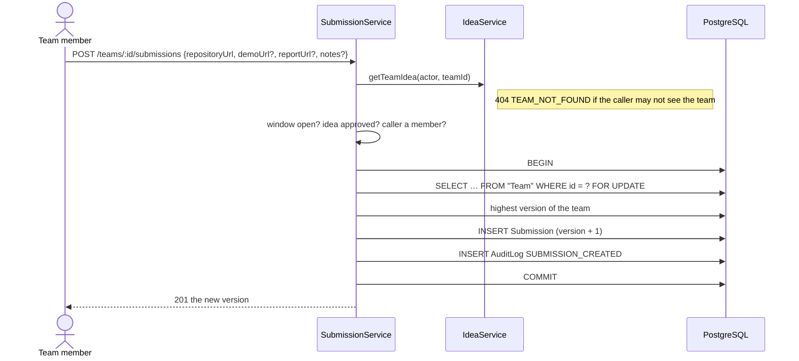

# Submissions (Phase 7)

A team hands in its work as links and notes. Any member can submit while submissions are open,
once the team's idea is approved or picked from the faculty's list. Every submission is a new,
unchangeable version; the newest one before the deadline is the team's final work. Decision:
[ADR 015](../decisions/015-versioned-submissions.md).

## Phase 8: one card per milestone

Submissions now belong to a **milestone** ([ADR 016](../decisions/016-milestones-replace-the-submission-window.md)),
and the sections below read "the window" as **that milestone's window**:

- A member adds a version for a milestone while the cycle is published and
  `milestone.submissionOpensAt <= now < milestone.submissionDueAt`. M1 can be open while M2 is
  still to come; at M1's due date it closes and M2 may open.
- Versions are numbered **per team and milestone** (`@@unique([teamId, milestoneId, version])`),
  still under the team's `FOR UPDATE` lock; M2's versions start again at 1.
- `repositoryUrl`, `demoUrl` and `reportUrl` became `links: { type, url }[]`, checked against the
  milestone's link requirement ([ADR 018](../decisions/018-configurable-link-requirements.md)):
  `400 MISSING_REQUIRED_LINK`, `LINK_NOT_ALLOWED` or `INVALID_LINK`.
- A composite foreign key `(milestoneId, cycleId)` keeps a version inside the team's own cycle;
  a milestone of another cycle is `404 MILESTONE_NOT_FOUND`.
- Routes: `GET/POST /teams/:teamId/milestones/:milestoneId/submissions` and
  `GET /course-cycles/:cycleId/milestones/:milestoneId/submissions` (owning faculty and admins;
  each team with its idea, latest version and every version). The cycle-wide routes are gone.
- `IdeasSubmissionTeams` reads the team and idea through `IdeaService`, and the cycle with its
  milestones through `CourseCycleService`.

## Rules

| Rule | Where it is enforced |
| --- | --- |
| Open from `submissionStartAt` until `submissionDeadline`, while the cycle is published | `SubmissionRules.window` with the injected `Clock` (`409 SUBMISSION_NOT_OPEN` / `SUBMISSION_CLOSED`) |
| Only teams with an approved or picked idea | `SubmissionRules.assertCanSubmit` (`409 IDEA_NOT_APPROVED`) |
| Any member submits; members, the owning faculty and admins read | `SubmissionRules.assertCanSubmit`; visibility through `IdeaService.getTeamIdea` |
| Repository URL required; demo and report links optional (http or https, at most 500 characters); notes at most 4000 | `SubmitWorkDto` |
| Versions 1, 2, 3… per team, even when two members save at once | Team row `FOR UPDATE`, then the next number; unique `(teamId, version)`; CHECK `version >= 1` |
| A submission stays in its team's cycle | Composite foreign key `(teamId, cycleId)` → `Team (id, cycleId)` |
| Every version is audited | `SUBMISSION_CREATED` in the same transaction |
| At most 10 versions per member per milestone per minute (`429 TOO_MANY_REQUESTS`) | `SubmissionService`, through the shared `RateLimiter` (ADR 023) |
| At most 50 versions per team per milestone (`409 VERSION_LIMIT_REACHED`, `SUBMISSION_VERSION_LIMIT`) | `SubmissionRules.assertBelowVersionLimit`, under the team's lock |
| The faculty list and grading read each team's latest version only; a team's history is paged | `listLatestByMilestone` (`DISTINCT ON`); `GET …/submissions?limit&before` (ADR 024) |

## Module structure

```mermaid
flowchart LR
  subgraph submissions
    P[presentation<br/>SubmissionsController (teams/:id/submissions)<br/>CycleSubmissionsController (course-cycles/:id/submissions)]
    A[application<br/>SubmissionService<br/>ports: SubmissionRepository, SubmissionTeams]
    D[domain<br/>SubmissionRules, submission types]
    I[infrastructure<br/>PrismaSubmissionRepository, IdeasSubmissionTeams]
    P --> A --> D
    I -. implements .-> A
  end
  I --> ideas[ideas<br/>IdeaService: team, cycle and idea]
  ideas --> teams[teams] & cycles[course-cycles]
  A --> audit[audit]
```

The module never reads teams, cycles or ideas itself. `IdeasSubmissionTeams` asks `IdeaService`,
which applies the team and cycle visibility rules, so "who may see this team" is decided in one
place.

## Submit sequence



## Access

| Actor | Read a team's versions | Submit | List the cycle's submissions |
| --- | --- | --- | --- |
| Team member (leader included) | yes | yes, while open and with an approved idea | `403` |
| Other students | `404` | `404` | `403` |
| Owning faculty | yes | `403` | yes |
| Other faculty | `404` | `403` | `404` |
| Admin | yes | `403` | yes |

## Design defense

| Question | Answer | Where |
| --- | --- | --- |
| Why links instead of files? | No storage, size limits or download access control to build; teams already host code online. | ADR 015 |
| Why may any member submit? | The team decided; each version records who submitted it. | `submission-rules.ts` |
| Why no "final" flag? | The newest version before the deadline is final by definition, so nothing can disagree. | `submission.service.ts: listForCycle` |
| Why lock the team row? | Two members saving at once would both read version 2 and both write 3; the lock makes the second wait and read 3. | `prisma-submission.repository.ts: lockLatestVersion` |
| Why read teams through the ideas module? | Visibility and the idea's status come from one place. | `ideas-submission-teams.ts` |

## Reads (Phase 10)

- `GET /course-cycles/:id/milestones/:m/submissions` (faculty): every team with its idea, its
  `latest` version and `versionCount`. Versions are numbered without gaps, so the count is the
  latest version number. The list no longer carries every version.
- `GET /teams/:teamId/milestones/:m/submissions?limit=&before=`: the team's versions, newest first.
  Without `limit`, a page holds 50 (as many as a team may submit); with `before`, only versions
  older than that one. The faculty screen reads ten at a time when a team's history is opened.
- A submission reads a summary of the team's idea (title, status, source), and saves with one
  `INSERT … RETURNING`.

## Limitations

- Links can change after the deadline (for example a repository's default branch). Teams should
  link to a release or commit.
- There is no admin screen; admins read submissions through the API.
- Evaluations are in [evaluations.md](evaluations.md).
