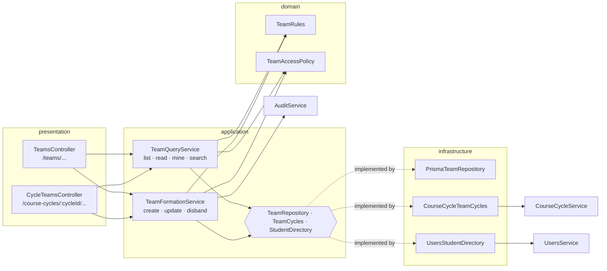
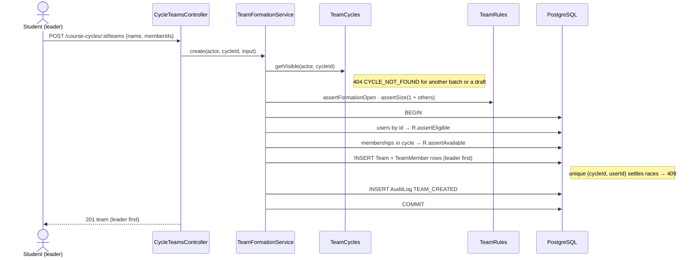
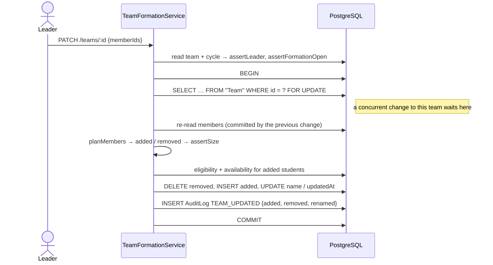
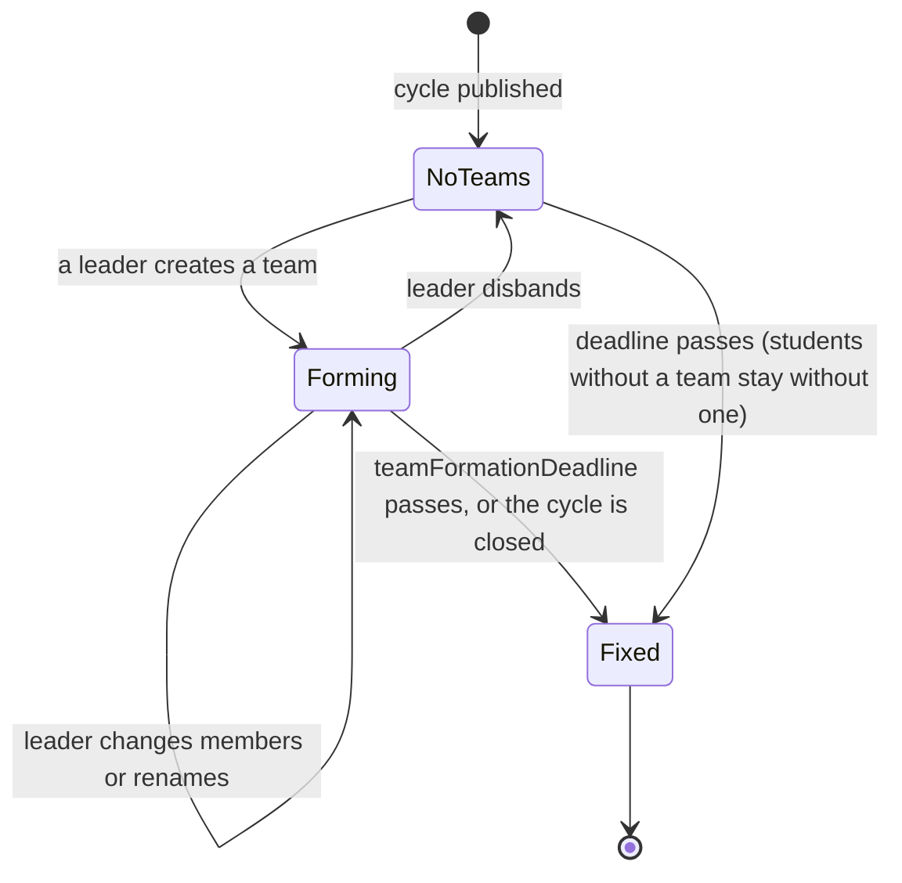

# Teams

Phase 4 lets students form teams inside a published course/project cycle. A team is the unit that
later phases build on: Phase 5 attaches the project idea to it, and submissions and evaluations
follow. The rules and decisions are in ADRs [007](../decisions/007-leader-forms-team-without-invitations.md),
[008](../decisions/008-one-team-per-student-enforced-by-database.md) and
[009](../decisions/009-team-rules-and-formation-deadline.md).

## Rules in one place

| Rule | Where it is enforced |
| --- | --- |
| Faculty set `minTeamSize`, `maxTeamSize` and `teamFormationDeadline` per cycle (defaults 1, 4, `submissionStartAt`) | `CycleWorkflow.assertValidSchedule`; DB CHECK on sizes |
| Sizes are fixed once the cycle is published; the deadline moves only while formation is open, never into the past | `CycleWorkflow` editable fields and `assertTeamDeadlineChange` |
| The student who creates the team is its leader, for good | `Team.leaderId`; `TeamRules.planMembers` never removes the leader |
| The leader adds members directly; they are members at once | `TeamFormationService.create/update` (no invitation state) |
| Only active students of the cycle's batch can be members | `TeamRules.assertEligible` |
| One team per student per cycle | `TeamRules.assertAvailable` for the message; `TeamMember @@unique([cycleId, userId])` for the guarantee |
| Size within `[min, max]`, leader included, after every change | `TeamRules.assertSize` under the team's row lock |
| Changes only while the cycle is `PUBLISHED` and before the deadline | `TeamRules.assertFormationOpen` with the injected `Clock` |
| Only the leader changes or disbands the team | `TeamAccessPolicy.assertLeader` |
| Members, the owning faculty and admins can read a team; anyone else gets 404 | `TeamAccessPolicy.canRead` |

## Module structure

The module follows the layering of the `auth` module. The domain is free of I/O, the application
depends only on ports, and infrastructure implements the ports.

- **`TeamCycles`** reads cycles through `CourseCycleService.getVisibleCycle` (the cycle module's
  own visibility rules: batch, owner, draft) and `getById` (for a team's own cycle). Teams never
  query the cycle table themselves.
- **`StudentDirectory`** finds users through `UsersService.findByIds` and `searchActiveStudents`.
  The team rules, not the users module, decide who may join.
- **`TeamRepository`** is the only code that touches `Team` and `TeamMember`. It reads member names
  through the relation in the same query, so a list never makes one query per member.
- Commands and queries are separate services. Commands own transactions, locks and audit rows;
  queries are plain reads with visibility checks.

## Create sequence

## Change sequence (leader edits members)

## Formation window

The window is computed on every request (`status === "PUBLISHED" && now < teamFormationDeadline`).
Nothing is stored or scheduled. Exactly at the deadline counts as closed.

## Access matrix

The global `RolesGuard` checks the role first, then the policies decide per cycle and per team.

| Actor | List a cycle's teams | Read a team | Create / change / disband | Search candidates |
| --- | --- | --- | --- | --- |
| Student of the cycle's batch | Own team only (0 or 1) | If a member, else `404 TEAM_NOT_FOUND` | Create; change or disband only as leader (`403 NOT_TEAM_LEADER` for members) | Yes, while open |
| Student of another batch | `404 CYCLE_NOT_FOUND` | `404` unless a member | `404 CYCLE_NOT_FOUND` | `404 CYCLE_NOT_FOUND` |
| Owning faculty | Every team | Yes | `403 FORBIDDEN_ROLE` | `403 FORBIDDEN_ROLE` |
| Other faculty | `404 CYCLE_NOT_FOUND` | `404 TEAM_NOT_FOUND` | `403 FORBIDDEN_ROLE` | `403 FORBIDDEN_ROLE` |
| Admin | Every team (non-draft cycles) | Yes | `403 FORBIDDEN_ROLE` | `403 FORBIDDEN_ROLE` |
| Pending staff | `403 FACULTY_APPROVAL_PENDING` | same | same | same |

`GET /teams/mine` is for students and lists their teams across cycles. A student added by a leader
sees it there, and as a tag on the cycle card, with no action of their own.

## API

| Method | Path | Access | Notes |
| --- | --- | --- | --- |
| POST | `/course-cycles/:cycleId/teams` | STUDENT | `{ name, memberIds }`; caller becomes leader; `201` |
| GET | `/course-cycles/:cycleId/teams` | STUDENT, FACULTY, ADMIN | See the access matrix |
| GET | `/course-cycles/:cycleId/team-candidates?q=` | STUDENT | 2–100 characters; letters, digits, spaces, `. @ ' -`; up to 20 results |
| GET | `/teams/mine` | STUDENT | Across cycles, newest first |
| GET | `/teams/:teamId` | STUDENT, FACULTY, ADMIN | Members, owning faculty, admins |
| PATCH | `/teams/:teamId` | STUDENT (leader) | `{ name?, memberIds? }`; `memberIds` is the complete list of other members |
| DELETE | `/teams/:teamId` | STUDENT (leader) | `204`; frees every member |

Team responses list members leader first, with `isLeader`, `name`, `email` and `addedAt`.

## Errors

| Code | HTTP | Meaning |
| --- | ---: | --- |
| `TEAM_NOT_FOUND` | 404 | Unknown team, or one the caller may not see |
| `NOT_TEAM_LEADER` | 403 | A member tried to change or disband the team |
| `TEAM_FORMATION_CLOSED` | 409 | Deadline passed or cycle not published |
| `TEAM_SIZE_OUT_OF_RANGE` | 400 | Size (leader included) outside the cycle's range; the message gives the numbers |
| `INELIGIBLE_TEAM_MEMBER` | 400 | Not an active student of the cycle's batch, or an unknown id (same answer) |
| `STUDENT_ALREADY_IN_TEAM` | 409 | Someone, possibly the caller, is in another team of the cycle; the message names them |
| `INVALID_TEAM_SIZE` | 400 | Cycle sizes are not `1 <= min <= max <= 10` |
| `INVALID_TEAM_FORMATION_DEADLINE` | 400 | Not before the submission deadline, or moved into the past |
| `CYCLE_FIELD_LOCKED` | 409 | Sizes after publish, or a formation deadline that has already passed |

## Design defense

| Question | Answer | Code reference |
| --- | --- | --- |
| Why is "one team per student" a database key? | Two leaders can add the same student at the same moment; only a unique key decides that race. The service check exists for a clear message. | `schema.prisma: TeamMember @@unique([cycleId, userId])`, `prisma-team.repository.ts: mapConflict` |
| Why copy `cycleId` onto member rows? | The unique key needs it; the composite FK to `Team (id, cycleId)` stops it drifting. | `migration.sql: TeamMember_teamId_cycleId_fkey` |
| Why lock the team row? | Each concurrent change alone respects the size limit; applied together they would not. The lock makes the second see the first's result. | `team.repository.ts: findByIdForUpdate`, `team-formation.service.ts: lock` |
| Why ports for cycles and users? | Teams depend on what they need (DIP, ISP). Unit tests run the real `CourseCycleService` and in-memory doubles without Nest or a database. | `application/ports/*`, `team.services.spec.ts` |
| Why split formation and query services? | Commands own transactions, locks and audit; queries only apply visibility (SRP). | `team-formation.service.ts`, `team-query.service.ts` |
| Why is the leader also a member row? | One uniqueness rule then covers leaders and members, and "members" always means everyone in the team. | `prisma-team.repository.ts: create` |
| Why must a team always be within the size range? | Later phases never meet an incomplete team; sizes are frozen at publish so a valid team stays valid. | `team-rules.ts: assertSize`, `cycle-workflow.ts: editableFields` |
| Why 404 rather than 403 for other people's teams? | The same rule as cycles: existence is not revealed (decided in Phase 3). | `team-access.policy.ts: assertCanRead` |
| Why no background job for the deadline? | The window is a pure function of the cycle and the clock; tests drive it with `FixedClock`. | `team-rules.ts: isFormationOpen` |

## Extension check

- **Ideas (built in Phase 6):** a `ProjectIdea` belongs to a `Team` (one current idea per team)
  with its own deadline; see [ideas.md](ideas.md). The leader submits, and a rejected idea changes
  only the idea; the team stays fixed.
- **Faculty fix-ups** (move or remove a student after the deadline): one new command in
  `TeamFormationService` with `assertOwner`-style checks, using the same lock and audit. No schema
  change.
- **Invitations** (if consent is ever required): a `TeamInvitation` table and an accept use case in
  front of `repository.update`. The rules and keys stay as they are.
- **Students without a team:** a query joining the batch's students with `TeamMember`, for a faculty
  "unassigned" list.

## Limitations

- Members cannot leave on their own; the leader removes them.
- A deactivated student stays in their team and still counts toward its size. A deactivated leader's
  team can no longer change.
- An admin batch correction does not move a student out of a team in their old batch's cycle.
  They keep seeing it under `/teams/mine`, but not the cycle itself.
- Admins can read teams through the API; the admin console has no team screen yet.
