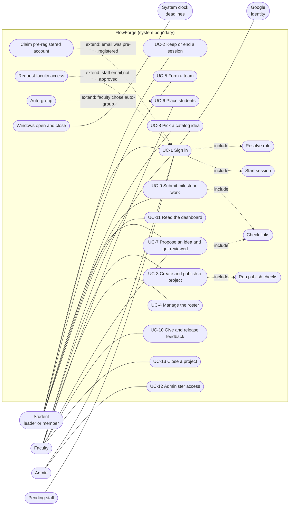

# 1 · Requirements

## 1.1 Problem statement

A university course runs its projects across email, spreadsheets and chat groups. Students form teams by word of
mouth, ideas are approved in threads, work is handed in as links in a sheet, and feedback comes back informally.
Faculty can't see at a glance who has no team, whose idea is waiting, or who has submitted, and a student can't see
what is due next. At a deadline, about 3,000 students may be active at once, most of them behind one campus IP.

**FlowForge** is one place for a course project's whole life at `nst.rishihood.edu.in`: a faculty member sets up a
project with milestones, students form teams and agree an idea, teams hand in versioned work for each milestone, and
faculty give private feedback that reaches every team at the same moment.

## 1.2 Scope of V1

### In scope

| Capability | Why |
| --- | --- |
| Google sign-in for one university domain, with roles decided on the server | The university's own accounts already identify everyone (ADRs 001, 002) |
| Project cycles with a draft → published → closed lifecycle and 1–10 milestones | Courses are run in stages, each with its own dates and required links (ADR 016) |
| Teams with a size range, a deadline and faculty placement afterwards | Everyone must end up in a team (ADRs 009, 011) |
| Ideas: proposed and reviewed, or picked from a faculty list | Faculty differ in how they run projects (ADRs 013, 014) |
| Versioned submissions as links and notes | Work lives in GitHub, Drive and hosted demos already (ADR 015) |
| Private feedback, released to all teams at once | Results must be fair and private (ADRs 020, 025) |
| A student dashboard computed from existing data | Students need "what's next" without anything new to keep in sync (ADRs 017, 021) |
| An admin console: faculty access, batch correction, deactivation | Someone must decide who is faculty, and fix mistakes (ADRs 002, 012) |

### Out of scope, and why

| Left out | Why | Evidence |
| --- | --- | --- |
| Marks and grades | The version going live gives feedback only. The columns and rules remain behind `EVALUATION_MARKS_ENABLED` | ADR 025 |
| File uploads | Links are enough, and storing files would add storage, scanning and quotas | ADR 015 |
| Team invitations | The leader adds members directly; an invitation flow adds states and no value in one batch | ADR 007 |
| Late submissions | The newest version before the due time is final; the window closes at that exact moment | `backend/src/submissions/domain/submission-rules.ts` |
| Email or push notifications | Delivery needs stored "sent" state and retries. V1 computes what's next on the dashboard instead | ADR 017 |
| Passwords and other identity providers | Google is the only way in, and it's restricted to one domain | ADR 001 |
| Moving team leadership | "Never transferred": it would complicate who may act | `backend/prisma/schema.prisma` |
| Account merges | A deliberate admin operation, if ever needed | ADR 003 |
| Keeping an idea's earlier text | Reviews record each version number and decision; only the current text is kept | [Doc 8](08-database.md#85-normalization) |
| Reading the audit log in the app | It's written and protected, but no route reads it | `backend/src/audit/domain/audit.repository.ts` |

## 1.3 Actors

| Actor | Kind | Goals | Permissions, as the code enforces them |
| --- | --- | --- | --- |
| **Student: team leader** | Primary | Form a team, agree an idea | Everything a member can do, plus: change or disband their team before the deadline; propose, edit, resubmit or pick the idea (`TeamAccessPolicy.assertLeader`, `IdeaRules.assertLeader`) |
| **Student: team member** | Primary | Hand in work, read feedback | See visible projects and their own team, add a submission version, read released feedback for their team. A student with no team can create one, or mark "looking for a team" |
| **Faculty** | Primary | Run a project and give feedback | Only on cycles they own (`CycleAuthorizationPolicy.assertOwner`): create, edit, publish, close; manage the roster; place students; review ideas; grade and release. Anything else returns 404 |
| **Admin** | Primary | Control access | Faculty allowlist and requests, batch correction, deactivation. Read-only on every published or closed cycle. Admins can't grade (`EvaluationPolicy.assertCanGrade`) |
| **Pending staff** | Primary | Be approved as faculty | A staff email not yet on the allowlist. Only `GET /auth/me` and `POST /auth/logout-all`; anything else is `403 FACULTY_APPROVAL_PENDING` (`RolesGuard`) |
| **Google** | External | Vouch for identity | Issues the authorization code and ID token. FlowForge verifies state, nonce, PKCE, signature, audience and hosted domain |
| **System clock** | External | Mark time | Passive. **No job runs at a deadline.** Every request compares `Clock.now()` with the stored dates, so a window closes at its exact moment. The only timer is the rate-limit sweep each minute |

**Where in the code:** `backend/src/auth/domain/role-resolver.ts`, `backend/src/auth/presentation/guards/roles.guard.ts`,
`backend/src/auth/presentation/decorators/roles.decorator.ts`, `backend/src/common/clock.ts`

## 1.4 Use cases

### Use-case diagram

Actors outside the system boundary, the use cases inside it, and the two real kinds of dependency between them.
`include` means the use case always runs the other; `extend` means it runs only under the stated condition.

**Where in the code:** `backend/src/auth/application/sign-in.service.ts` (`resolve`, `startFamily`, `claim`,
`createRequestIfAbsent`), `backend/src/course-cycles/application/course-cycle.service.ts` (`publishChecks.run`),
`backend/src/teams/application/team-completion.service.ts` (`previewAutoGroup`, `applyAutoGroup`),
`backend/src/common/links/link-requirement.ts` (`check`)

### UC-1 Sign in

| | |
| --- | --- |
| **Actors** | Any person (primary); Google (external) |
| **Preconditions** | A Google account. No FlowForge account is needed: the first sign-in creates one |
| **Main flow** | 1. The user chooses "Sign in with Google". 2. The API sets a 10-minute signed cookie with `state`, `nonce` and a PKCE verifier, and redirects to Google. 3. Google redirects back with a code. 4. The API checks `state`, exchanges the code, verifies the ID token and its `nonce`. 5. It checks the verified email and hosted domain, and resolves the role. 6. It creates or updates the user, starts a refresh-token family and writes the audit rows, in one transaction. 7. It sets the refresh cookie and redirects to the app, which refreshes to get its first access token |
| **Alternative flows** | **A1, pre-registered student:** the first sign-in with that email claims the account and keeps its id. **A2, staff not yet approved:** the role is `PENDING_STAFF`, a faculty request is created, and the user waits. **A3, allowlisted staff:** the role becomes `FACULTY`. **A4, test login:** `POST /auth/dev-login`, with the same role and session code, only with `NODE_ENV=test` or from this machine in development |
| **Exceptions** | The browser is redirected to `/login?error=CODE`. `SIGN_IN_CANCELLED`, `INVALID_OAUTH_STATE`, `INVALID_ID_TOKEN`, `EMAIL_NOT_VERIFIED`, `WRONG_HOSTED_DOMAIN`, `EMAIL_NOT_ELIGIBLE`, `INVALID_BATCH_YEAR`, `ACCOUNT_DEACTIVATED`, `IDENTITY_CONFLICT`, `TOO_MANY_REQUESTS`. Denials are audited as `LOGIN_DENIED` |
| **Postconditions** | One `User` row keyed by Google `sub`, the role set by the server, one new refresh-token family with only its hash stored, and `LOGIN_SUCCEEDED` audited |

### UC-3 Create and publish a project

| | |
| --- | --- |
| **Actors** | Faculty |
| **Preconditions** | Signed in as `FACULTY`. For an elective, its students are enrolled before publishing |
| **Main flow** | 1. The faculty member fills in the wizard; the first save creates a draft with its milestones. 2. They edit the draft, set milestones, and add ideas to the list. 3. The review step shows `GET /course-cycles/:id/publish-checks`. 4. They publish. The cycle row is locked, every publish check runs, and the status and audit row commit together |
| **Alternative flows** | **A1, warnings only:** a core course with no students yet publishes and returns `warnings` (`NO_STUDENTS_YET`). **A2, edit after publishing:** only the description, open stage deadlines and milestones that haven't opened may change |
| **Exceptions** | `409 PUBLISH_BLOCKED` with every problem in `details` (for example `ROSTER_EMPTY`, `IDEA_LIST_EMPTY`, `NO_MILESTONES`, `INVALID_TEAM_SIZE`). `400 INVALID_TEAM_DEADLINE`, `INVALID_IDEA_DEADLINE`, `INVALID_MILESTONE_SCHEDULE`, `INVALID_ACADEMIC_YEAR`. `409 CYCLE_FIELD_LOCKED`, `MILESTONE_LOCKED`, `MILESTONES_LOCKED`, `INVALID_STATUS_TRANSITION`, `CYCLE_ALREADY_CLOSED`. `404 CYCLE_NOT_FOUND` for someone else's cycle |
| **Postconditions** | Status `PUBLISHED`, `publishedAt` set, `CYCLE_PUBLISHED` audited in the same transaction. Students see it as soon as it commits |

### UC-5 Form a team

| | |
| --- | --- |
| **Actors** | Student (becomes the leader); other students are added |
| **Preconditions** | The student can see the published cycle, it's before `teamDeadline`, and they're in no team of that cycle |
| **Main flow** | 1. The student searches classmates by name or email start. 2. They name the team and choose members. 3. The API checks the window, the size (leader included), each person's eligibility and that nobody already has a team. 4. It creates the team and member rows, clears those students' "looking" entries and writes the audit row in one transaction. Members are in the team at once, without accepting anything |
| **Alternative flows** | **A1, change:** the leader changes the name or members; the team row is locked. **A2, disband:** the leader disbands; everyone is free. **A3, after the deadline:** the faculty place remaining students until `ideaDeadline` (UC-6) |
| **Exceptions** | `409 TEAM_FORMATION_CLOSED`, `400 TEAM_SIZE_OUT_OF_RANGE`, `400 INELIGIBLE_TEAM_MEMBER`, `409 STUDENT_ALREADY_IN_TEAM` (also from the database when two leaders race), `403 NOT_TEAM_LEADER`, `404 CYCLE_NOT_FOUND`, `404 TEAM_NOT_FOUND`, `429 TOO_MANY_REQUESTS` |
| **Postconditions** | A team within the size range, one `TeamMember` per person, and at most one team per student in the cycle (`TeamMember_cycleId_userId_key`), with `TEAM_CREATED` audited |

### UC-7 Propose an idea and get reviewed

| | |
| --- | --- |
| **Actors** | Team leader, owning faculty |
| **Preconditions** | The team exists in a published cycle whose idea source allows proposals. The first idea is before `ideaDeadline` |
| **Main flow** | 1. The leader submits a title, problem, solution and links. 2. The idea is `SUBMITTED`, version 1. 3. The faculty member reads it and approves it, naming the version they read. 4. The idea is `APPROVED` and final |
| **Alternative flows** | **A1, edit while waiting:** before the deadline, each edit is a new version. **A2, rejection:** the faculty member rejects with feedback; the idea is `REJECTED`; the leader revises or picks instead, as a new version, for as many rounds as it takes while the cycle is published. **A3, pick:** see UC-8 |
| **Exceptions** | `409 PROPOSALS_NOT_ALLOWED`, `403 NOT_TEAM_LEADER`, `409 IDEA_SUBMISSION_CLOSED`, `409 IDEA_RESUBMISSION_CLOSED`, `409 IDEA_ALREADY_APPROVED`, `409 IDEA_CHANGED` (the team edited after the faculty opened it), `409 IDEA_NOT_AWAITING_REVIEW`, `409 IDEA_REVIEW_CLOSED`, `400 IDEA_FEEDBACK_REQUIRED`, `400 MISSING_REQUIRED_LINK`, `400 LINK_NOT_ALLOWED`, `400 INVALID_LINK`, `404 TEAM_NOT_FOUND` |
| **Postconditions** | One idea per team. Each decision is an `IdeaReview` row for a named version. An approved idea never changes, and every step is audited |

### UC-9 Submit milestone work

| | |
| --- | --- |
| **Actors** | Any member of the team |
| **Preconditions** | The team's idea is `APPROVED`, the cycle is `PUBLISHED`, and `submissionOpensAt <= now < submissionDueAt` |
| **Main flow** | 1. A member enters links and notes. 2. The API checks membership, the window and the idea, then the links against the milestone's requirement. 3. It counts the member's submissions this minute. 4. In one transaction it locks the team row, reads the latest version, checks the version limit, inserts the next version and audits it |
| **Alternative flows** | **A1, another version:** any member can add a new version while the window is open; the newest one before the due time is final. **A2, two members at once:** they take turns on the row lock and get consecutive versions |
| **Exceptions** | `409 SUBMISSION_NOT_OPEN`, `409 SUBMISSION_CLOSED`, `409 IDEA_NOT_APPROVED`, `409 VERSION_LIMIT_REACHED` (50), `409 SUBMISSION_CHANGED`, `400 MISSING_REQUIRED_LINK`, `400 LINK_NOT_ALLOWED`, `400 INVALID_LINK`, `429 TOO_MANY_REQUESTS` (10 per member per milestone per minute), `404 TEAM_NOT_FOUND`, `404 MILESTONE_NOT_FOUND` |
| **Postconditions** | One new immutable `Submission` row with a gap-free version number, and `SUBMISSION_CREATED` audited |

### UC-10 Give and release feedback

| | |
| --- | --- |
| **Actors** | Owning faculty; team members read |
| **Preconditions** | The cycle is `PUBLISHED` and `submissionDueAt <= now`. A team needn't have submitted anything |
| **Main flow** | 1. The faculty member opens the grading table. 2. They save feedback per team; each save is a new version naming the version it was based on. 3. They release the milestone: all teams at once, one-way. 4. A member reads their own team's result |
| **Alternative flows** | **A1, correction after release:** a later save is visible at once and marked `updatedAfterRelease`. **A2, marks on:** with `EVALUATION_MARKS_ENABLED=true`, a scale and marks are also accepted and returned |
| **Exceptions** | `409 GRADING_NOT_OPEN`, `409 GRADING_CLOSED`, `400 EMPTY_EVALUATION`, `400 MARKS_DISABLED`, `409 EVALUATION_CHANGED`, `409 ALREADY_RELEASED`, `409 NOTHING_TO_RELEASE`, `404 TEAM_NOT_FOUND` for anyone but the owner, a member or an admin, `404 MILESTONE_NOT_FOUND` |
| **Postconditions** | One current `Evaluation` per team and milestone, one append-only `EvaluationRevision` per save, and `releasedAt` set once. Before release, a student gets an empty list, from a query that only returns released rows for teams they belong to |

## 1.5 Functional requirements

Priority: **P0** is needed to run a project, **P1** is needed at campus scale or for a correct experience, **P2** is
useful but the project can run without it. Test paths are under `backend/test/` unless stated otherwise.

### Authentication and sessions

| ID | Requirement | Priority | Proved by |
| --- | --- | --- | --- |
| FR-AUTH-1 | Sign in with Google using PKCE, `state` and `nonce`, and keep tokens out of URLs | P0 | `auth.e2e.ts` |
| FR-AUTH-2 | Refuse an unverified email, another domain or an ineligible address, and audit the denial | P0 | `auth.e2e.ts` |
| FR-AUTH-3 | Decide the role on the server at every login: a student email is always `STUDENT`; staff are `ADMIN`, `FACULTY` or `PENDING_STAFF` | P0 | `backend/src/auth/domain/role-resolver.spec.ts`, `faculty-access.e2e.ts` |
| FR-AUTH-4 | Identify users by Google `sub`; the same email under a new `sub` is a conflict | P0 | `auth.e2e.ts` |
| FR-AUTH-5 | Read the batch from a student's email once; a later login never overwrites an admin's correction | P0 | `auth.e2e.ts` |
| FR-AUTH-6 | A pre-registered student's first sign-in claims the account and keeps its id | P1 | `auth.e2e.ts` |
| FR-AUTH-7 | The refresh cookie is `HttpOnly`, `SameSite=Strict`, scoped to `/api/auth`, and only its hash is stored | P0 | `sessions.e2e.ts` |
| FR-AUTH-8 | Rotate on each refresh; replaying a token after the grace window ends the family | P0 | `sessions.e2e.ts` |
| FR-AUTH-9 | Two refreshes with one cookie within 10 seconds keep the session | P1 | `sessions.e2e.ts` |
| FR-AUTH-10 | Sign out ends this session; sign out everywhere ends every session and access token | P0 | `sessions.e2e.ts` |
| FR-AUTH-11 | A role change, deactivation or `tokenVersion` bump takes effect on the next request | P0 | `admin-users.e2e.ts`, `faculty-access.e2e.ts` |
| FR-AUTH-12 | Every route needs a token and a role unless it's `@Public()`; a route without `@Roles()` is denied | P0 | `rbac.e2e.ts` |
| FR-AUTH-13 | Cookie-authenticated routes need `Origin` to equal the frontend's URL | P0 | `sessions.e2e.ts` |
| FR-AUTH-14 | The test login works only with `NODE_ENV=test`, or in development from this machine | P0 | `dev-login.e2e.ts`, `boot.e2e.ts` |

### Project cycles

| ID | Requirement | Priority | Proved by |
| --- | --- | --- | --- |
| FR-CYCLE-1 | Faculty create a draft with its milestones in one request | P0 | `course-cycles.e2e.ts` |
| FR-CYCLE-2 | Save nothing when the schedule is out of order: `teamDeadline < ideaDeadline <= M1.opens < M1.due <= M1.evaluation <= …` | P0 | `course-cycles.e2e.ts`, `backend/src/course-cycles/domain/milestone-schedule.spec.ts` |
| FR-CYCLE-3 | Publishing reports every blocking problem at once, and returns warnings | P0 | `course-cycles.e2e.ts` |
| FR-CYCLE-4 | The lifecycle is one-way, draft → published → closed; one of two concurrent publishes wins | P0 | `course-cycles.e2e.ts`, `backend/src/course-cycles/domain/cycle-workflow.spec.ts` |
| FR-CYCLE-5 | After publishing, only a milestone that hasn't opened may move, and none are added or removed | P0 | `course-cycles.e2e.ts` |
| FR-CYCLE-6 | Visibility: core for the batch, elective for those enrolled, closed for former members, others get 404 | P0 | `course-cycles.e2e.ts`, `team-completion.e2e.ts`, `dashboard.e2e.ts` |
| FR-CYCLE-7 | Faculty enroll students by paste or CSV, rows that can't be used are reported, and a student in a team can't be removed | P1 | `team-completion.e2e.ts` |
| FR-CYCLE-8 | Stage and upcoming events are computed from dates, never stored | P1 | `upcoming.e2e.ts`, `backend/src/course-cycles/domain/cycle-timeline.spec.ts` |
| FR-CYCLE-9 | A change and its audit row commit or roll back together | P0 | `course-cycles.e2e.ts` |

### Teams

| ID | Requirement | Priority | Proved by |
| --- | --- | --- | --- |
| FR-TEAM-1 | A student creates a team and leads it; chosen members are in at once | P0 | `teams.e2e.ts` |
| FR-TEAM-2 | Team size stays in the cycle's range, counting the leader | P0 | `teams.e2e.ts` |
| FR-TEAM-3 | One team per student per cycle, settled by the database when two leaders race | P0 | `teams.e2e.ts` |
| FR-TEAM-4 | Leaders find classmates by name or email start, and see who is taken | P0 | `teams.e2e.ts` |
| FR-TEAM-5 | Only the leader changes a team; concurrent changes run one at a time | P0 | `teams.e2e.ts` |
| FR-TEAM-6 | Disbanding frees every member | P1 | `teams.e2e.ts` |
| FR-TEAM-7 | Teams are fixed at the team deadline, and stay readable | P0 | `teams.e2e.ts` |
| FR-TEAM-8 | A student can mark "looking for a team"; it clears when they join one | P2 | `team-completion.e2e.ts` |
| FR-TEAM-9 | Owning faculty place students from the team deadline until the idea deadline | P0 | `team-completion.e2e.ts` |
| FR-TEAM-10 | Auto-group previews random teams, then creates all of them or none | P1 | `team-completion.e2e.ts`, `backend/src/teams/domain/team-allocator.spec.ts` |
| FR-TEAM-11 | Adding to a full team answers `409 TEAM_FULL` | P1 | `team-completion.e2e.ts` |
| FR-TEAM-12 | Members see their team, the owner and admins see all, others get 404 | P0 | `teams.e2e.ts` |

### Ideas

| ID | Requirement | Priority | Proved by |
| --- | --- | --- | --- |
| FR-IDEA-1 | The leader proposes an idea and may edit it, as new versions, until the idea deadline | P0 | `ideas.e2e.ts` |
| FR-IDEA-2 | The owning faculty decide on the version they read; a rejection needs feedback | P0 | `ideas.e2e.ts` |
| FR-IDEA-3 | After a rejection, the team revises for as many rounds as it takes while the cycle is published | P0 | `ideas.e2e.ts` |
| FR-IDEA-4 | An approved idea is final | P0 | `ideas.e2e.ts` |
| FR-IDEA-5 | The owner maintains a catalog; a picked idea can't be removed; it freezes when the cycle closes | P1 | `ideas.e2e.ts` |
| FR-IDEA-6 | Any number of teams can pick a catalog idea, approved at once | P1 | `ideas.e2e.ts` |
| FR-IDEA-7 | The cycle's idea source allows proposals, picks or both | P1 | `ideas.e2e.ts` |
| FR-IDEA-8 | A proposal's links are checked against the cycle's requirement | P1 | `ideas.e2e.ts`, `backend/src/common/links/link-requirement.spec.ts` |

### Submissions

| ID | Requirement | Priority | Proved by |
| --- | --- | --- | --- |
| FR-SUB-1 | Any member adds a version while the milestone is open | P0 | `submissions.e2e.ts` |
| FR-SUB-2 | Submitting needs an approved or picked idea | P0 | `submissions.e2e.ts` |
| FR-SUB-3 | Each milestone checks its own required links | P0 | `submissions.e2e.ts`, `backend/src/common/links/link-requirement.spec.ts` |
| FR-SUB-4 | Versions are numbered without gaps when members submit at once | P0 | `submissions.e2e.ts`, `tests/concurrency/races.spec.ts` |
| FR-SUB-5 | Nothing is accepted at or after the due time, or once the cycle closes | P0 | `submissions.e2e.ts`, `tests/concurrency/races.spec.ts` |
| FR-SUB-6 | Members, the owner and admins read the history a page at a time | P1 | `submissions.e2e.ts` |
| FR-SUB-7 | Faculty see every team with its latest work per milestone | P0 | `submissions.e2e.ts` |
| FR-SUB-8 | Limits: 10 submissions per member, milestone and minute; 50 versions per team and milestone | P1 | `write-limits.e2e.ts` |

### Evaluations

| ID | Requirement | Priority | Proved by |
| --- | --- | --- | --- |
| FR-EVAL-1 | Grading opens at the milestone's due time, and only for the owner | P0 | `evaluations.e2e.ts` |
| FR-EVAL-2 | Each save is a new version; a save based on an old one is refused | P0 | `evaluations.e2e.ts`, `tests/concurrency/races.spec.ts` |
| FR-EVAL-3 | Nothing reaches students before release; release reaches all teams at once | P0 | `evaluations.e2e.ts` |
| FR-EVAL-4 | Release is one-way; a later correction shows as updated | P0 | `evaluations.e2e.ts` |
| FR-EVAL-5 | Members read their own team only; strangers get 404 | P0 | `evaluations.e2e.ts` |
| FR-EVAL-6 | Marks are refused and never returned while `EVALUATION_MARKS_ENABLED` is off | P0 | `evaluations-feedback-only.e2e.ts` |
| FR-EVAL-7 | A save and its audit row commit or roll back together | P0 | `evaluations.e2e.ts` |

### Dashboard

| ID | Requirement | Priority | Proved by |
| --- | --- | --- | --- |
| FR-DASH-1 | Tell a student what to do next in each project, and whether it's theirs or their leader's to do | P1 | `dashboard.e2e.ts`, `backend/src/dashboard/domain/student-todo-rules.spec.ts` |
| FR-DASH-2 | Show recent updates from the student's own teams | P1 | `dashboard.e2e.ts` |
| FR-DASH-3 | Keep closed projects for former members only, read-only | P1 | `dashboard.e2e.ts` |
| FR-DASH-4 | The number of queries doesn't grow with the number of projects | P1 | `dashboard.e2e.ts`, `query-budget.e2e.ts` |
| FR-DASH-5 | The dashboard is for students only | P1 | `dashboard.e2e.ts` |

### Administration

| ID | Requirement | Priority | Proved by |
| --- | --- | --- | --- |
| FR-ADMIN-1 | Add or remove faculty on the allowlist; a student email can never be elevated | P0 | `faculty-access.e2e.ts` |
| FR-ADMIN-2 | Approve or reject a staff request; a rejected person can be approved later | P0 | `faculty-access.e2e.ts` |
| FR-ADMIN-3 | List users with filters and cursor pagination | P1 | `admin-users.e2e.ts` |
| FR-ADMIN-4 | Correct a student's batch, audited | P1 | `admin-users.e2e.ts` |
| FR-ADMIN-5 | Deactivate at once, ending sessions; an admin can't deactivate themselves | P0 | `admin-users.e2e.ts` |

## 1.6 Non-functional requirements

Numbers come from `docs/testing/report.md` and the final regression in [doc 10](10-implementation.md). **Load numbers
are indicative:** k6, the API and PostgreSQL shared one M2 laptop (8 cores, 8 GB).

| Quality | Target | Mechanism | Measured | Evidence |
| --- | --- | --- | --- | --- |
| **Scalability** | 3,000 active users at a deadline, within the latency target below | `src/cluster.ts` runs `API_WORKERS` processes behind one port; a checked connection budget; query budgets; shared counters in PostgreSQL | **Before (one process):** 3,000 users, 1,045,601 requests, p95 5.94 s, latency climbing from about 1,250 users and 650 req/s; 0 5xx. **After (4 workers, real limits):** 1,244,459 requests, p95 4.64 s, climbing from about 1,550–1,850 users and 900 req/s; 25 5xx. **The p95 target is still missed at 3,000 users on this laptop.** See [doc 10](10-implementation.md#load) | `docs/testing/report.md`, `backend/src/cluster.ts`, `backend/test/cluster.e2e.ts` |
| **Latency** | p95 under 500 ms for reads and 1 s for writes, within capacity | One read per request of a shared cycle or team (`RequestScope`), `DISTINCT ON` for latest work, a `KeyObject` made once for JWTs | At 500 users, before Phase 10: reads p95 10 ms, writes 20 ms. Statements per request, before → after: grading 23→9, submit 21→14, a team's submissions 16→8. JWT verify 241→4 µs. A 1,500-user spike after Phase 10: reads p95 10 ms, writes 20 ms. At 3,000 users: reads p95 4.65 s, writes 6.07 s, which **misses the target** | `docs/testing/report.md`, `backend/test/query-budget.e2e.ts` |
| **Availability** | A short database outage signs nobody out | `503 SERVICE_UNAVAILABLE`, the cookie kept unless the session really ended, a browser retry banner, a replaced worker on crash, `GET /api/health` | Database restart: 503s, banner, still signed in (RES-1). Soak before Phase 10: 661,439 requests in 1 hour, 0 failed | `backend/test/database-outage.e2e.ts`, `tests/e2e/resilience.spec.ts` |
| **Security** | No Critical or High finding | Google-only sign-in, global guards that fail closed, hashed refresh tokens with rotation, `OriginGuard`, Helmet, CORS to one origin, strict validation | Security suite 58/58, all 8 earlier findings fixed. `npm audit` before Phase 10: 0 critical, high or moderate in production | `tests/security/`, [doc 9](09-errors-edge-cases.md) |
| **Privacy** | No unreleased feedback or other team's data | 404 for hidden resources; released results filtered in the SQL; `EVALUATION_MARKS_ENABLED` views built without the keys | Every swapped id gives 404 across 46 routes. No route returned unreleased results | `tests/security/access.spec.ts`, `backend/test/evaluations.e2e.ts`, `backend/test/evaluations-feedback-only.e2e.ts` |
| **Consistency** | No lost, duplicate or late writes | Row locks, optimistic versions, unique and CHECK constraints, audit in the same transaction ([doc 8](08-database.md#86-locking-per-use-case)) | 10/10 races. Integrity 21/21. At the peak before Phase 10: 2,383 submissions accepted, 2,383 new rows. At the due time: every request before it saved, every one after it refused, none saved late | `tests/concurrency/races.spec.ts`, `tests/support/integrity.cjs` |
| **Accessibility** | WCAG 2.1 AA on main flows | Labels, contrast tokens, skip links, focus management | axe: 0 violations on 22 pages. Keyboard to first grading field: 513→17 presses | `tests/e2e/a11y.spec.ts`, `tests/e2e/keyboard.spec.ts` |
| **Maintainability** | A change stays in one module | Layers with an enforced dependency rule, 27 ports, adapters between modules, one error filter | 27 abstract classes, layering rule in ESLint; test counts in [doc 10](10-implementation.md) | [generated/ports.md](generated/ports.md), `backend/eslint.config.mjs` |
| **Observability** | Know it's up and why it failed | `GET /api/health`, the append-only audit log, a logged one-line 503, a stack for an unexpected 500, the Google failure reason (`LoggingIdentityProvider`), `pg_stat_statements` in the QA stack | Health answers `{"status":"ok","database":"ok"}`. **Limit:** no metrics, tracing or alerting in V1 | `backend/src/health/`, `backend/src/common/errors/api-exception.filter.ts`, `backend/src/auth/infrastructure/logging-identity.provider.ts` |

## 1.7 Traceability

Requirement → use case → module → route → test. Routes are under `/api`. Module folders are under `backend/src/`.

| Requirement | Use case | Module | Route | Test |
| --- | --- | --- | --- | --- |
| FR-AUTH-1, 2, 4, 5 | UC-1 | `auth` | `GET /auth/google`, `GET /auth/google/callback` | `backend/test/auth.e2e.ts` |
| FR-AUTH-3 | UC-1 | `auth` | `GET /auth/google/callback` | `backend/test/faculty-access.e2e.ts` |
| FR-AUTH-6 | UC-1 | `auth` | `GET /auth/google/callback` | `backend/test/auth.e2e.ts` |
| FR-AUTH-7, 8, 9 | UC-2 | `auth` | `POST /auth/refresh` | `backend/test/sessions.e2e.ts` |
| FR-AUTH-10 | UC-2 | `auth` | `POST /auth/logout`, `POST /auth/logout-all` | `backend/test/sessions.e2e.ts` |
| FR-AUTH-11 | UC-12 | `auth`, `admin` | any protected route | `backend/test/admin-users.e2e.ts` |
| FR-AUTH-12 | all | `auth` | all 66 routes | `backend/test/rbac.e2e.ts` |
| FR-AUTH-13 | UC-2 | `common` | `POST /auth/refresh`, `POST /auth/logout`, `POST /auth/dev-login` | `backend/test/sessions.e2e.ts` |
| FR-AUTH-14 | UC-1 | `auth` | `POST /auth/dev-login`, `GET /auth/dev-login/accounts` | `backend/test/dev-login.e2e.ts` |
| FR-CYCLE-1, 2 | UC-3 | `course-cycles` | `POST /course-cycles`, `PATCH /course-cycles/:id` | `backend/test/course-cycles.e2e.ts` |
| FR-CYCLE-3 | UC-3 | `course-cycles`, `ideas` | `GET /course-cycles/:id/publish-checks`, `POST /course-cycles/:id/publish` | `backend/test/course-cycles.e2e.ts` |
| FR-CYCLE-4 | UC-3, UC-13 | `course-cycles` | `POST /course-cycles/:id/publish`, `POST /course-cycles/:id/close` | `backend/test/course-cycles.e2e.ts` |
| FR-CYCLE-5 | UC-3 | `course-cycles` | `PATCH /course-cycles/:id` | `backend/test/course-cycles.e2e.ts` |
| FR-CYCLE-6 | UC-11 | `course-cycles` | `GET /course-cycles`, `GET /course-cycles/:id` | `backend/test/course-cycles.e2e.ts` |
| FR-CYCLE-7 | UC-4 | `course-cycles`, `teams` | `POST /course-cycles/:cycleId/enrollments`, `POST /course-cycles/:cycleId/batch-students`, `DELETE /course-cycles/:cycleId/enrollments/:email` | `backend/test/team-completion.e2e.ts` |
| FR-CYCLE-8 | UC-11 | `course-cycles` | `GET /me/upcoming` | `backend/test/upcoming.e2e.ts` |
| FR-CYCLE-9 | UC-3 | `course-cycles`, `audit` | every cycle write | `backend/test/course-cycles.e2e.ts` |
| FR-TEAM-1, 2, 3 | UC-5 | `teams` | `POST /course-cycles/:cycleId/teams` | `backend/test/teams.e2e.ts` |
| FR-TEAM-4 | UC-5 | `teams` | `GET /course-cycles/:cycleId/team-candidates` | `backend/test/teams.e2e.ts` |
| FR-TEAM-5, 6, 7 | UC-5 | `teams` | `PATCH /teams/:teamId`, `DELETE /teams/:teamId` | `backend/test/teams.e2e.ts` |
| FR-TEAM-8 | UC-5 | `teams` | `PUT`, `GET`, `DELETE /course-cycles/:cycleId/looking-for-team` | `backend/test/team-completion.e2e.ts` |
| FR-TEAM-9, 11 | UC-6 | `teams` | `POST /course-cycles/:cycleId/team-completion/teams`, `POST /teams/:teamId/members` | `backend/test/team-completion.e2e.ts` |
| FR-TEAM-10 | UC-6 | `teams` | `POST /course-cycles/:cycleId/team-completion/auto-group/preview`, `POST /course-cycles/:cycleId/team-completion/auto-group` | `backend/test/team-completion.e2e.ts` |
| FR-TEAM-12 | UC-5 | `teams` | `GET /teams/:teamId`, `GET /course-cycles/:cycleId/teams`, `GET /teams/mine` | `backend/test/teams.e2e.ts` |
| FR-IDEA-1, 3, 4, 8 | UC-7 | `ideas` | `PUT /teams/:teamId/idea` | `backend/test/ideas.e2e.ts` |
| FR-IDEA-2 | UC-7 | `ideas` | `POST /teams/:teamId/idea/review`, `GET /course-cycles/:cycleId/ideas` | `backend/test/ideas.e2e.ts` |
| FR-IDEA-5 | UC-8 | `ideas` | `POST`, `PUT`, `DELETE /course-cycles/:cycleId/idea-catalog` | `backend/test/ideas.e2e.ts` |
| FR-IDEA-6, 7 | UC-8 | `ideas` | `POST /teams/:teamId/idea/pick` | `backend/test/ideas.e2e.ts` |
| FR-SUB-1 to 5 | UC-9 | `submissions` | `POST /teams/:teamId/milestones/:milestoneId/submissions` | `backend/test/submissions.e2e.ts` |
| FR-SUB-6 | UC-9 | `submissions` | `GET /teams/:teamId/milestones/:milestoneId/submissions` | `backend/test/submissions.e2e.ts` |
| FR-SUB-7 | UC-10 | `submissions` | `GET /course-cycles/:cycleId/milestones/:milestoneId/submissions` | `backend/test/submissions.e2e.ts` |
| FR-SUB-8 | UC-9 | `submissions`, `auth` | `POST /teams/:teamId/milestones/:milestoneId/submissions` | `backend/test/write-limits.e2e.ts` |
| FR-EVAL-1, 2, 7 | UC-10 | `evaluations` | `PUT /course-cycles/:cycleId/milestones/:milestoneId/teams/:teamId/evaluation` | `backend/test/evaluations.e2e.ts` |
| FR-EVAL-3, 4 | UC-10 | `evaluations` | `POST /course-cycles/:cycleId/milestones/:milestoneId/grading/release` | `backend/test/evaluations.e2e.ts` |
| FR-EVAL-5 | UC-10 | `evaluations` | `GET /course-cycles/:cycleId/milestones/:milestoneId/teams/:teamId/evaluations` | `backend/test/evaluations.e2e.ts` |
| FR-EVAL-6 | UC-10 | `evaluations` | every evaluation route, `GET /me/dashboard` | `backend/test/evaluations-feedback-only.e2e.ts` |
| FR-DASH-1 to 5 | UC-11 | `dashboard` | `GET /me/dashboard` | `backend/test/dashboard.e2e.ts` |
| FR-ADMIN-1 | UC-12 | `admin`, `auth` | `GET`, `POST`, `DELETE /admin/faculty-allowlist` | `backend/test/faculty-access.e2e.ts` |
| FR-ADMIN-2 | UC-12 | `admin`, `auth` | `POST /admin/faculty-requests/:id/approve`, `POST /admin/faculty-requests/:id/reject` | `backend/test/faculty-access.e2e.ts` |
| FR-ADMIN-3, 4, 5 | UC-12 | `admin` | `GET /admin/users`, `PATCH /admin/users/:id/batch`, `POST /admin/users/:id/deactivate`, `POST /admin/users/:id/reactivate` | `backend/test/admin-users.e2e.ts` |
