# 2 · Class diagrams

These diagrams were checked against the code with `docs/design/scripts/list-ports.ts`, which reads the TypeScript
AST. See [section 2.5](#25-checking-the-diagrams-against-the-code).

**How the model is shaped.** FlowForge's entities are TypeScript **interfaces**: plain data that crosses modules and
comes back from repositories. Their behaviour lives in **pure rule classes** with no I/O (`CycleWorkflow`, `TeamRules`,
`IdeaRules`, `SubmissionRules`, `EvaluationRules`). So the diagrams show entities with attributes and rule classes with
methods. Real value objects with their own behaviour (`LinkRequirement`, `CycleRoster`) are classes.
[Doc 3](03-oop.md#weak-spots-found) discusses the trade-off.

**Types in the diagrams:** async methods show what the promise resolves to, a nullable result is shown without `| null` where it would crowd the box, and `object` means the code declares an inline return type.

**Arrows:** `*--` composition, `o--` aggregation, `-->` association or "uses", `<|--` inheritance (a class `extends`),
`..|>` realization (a class `implements` an interface).

## 2.1 The domain model

### Overview: how the entities connect

Every entity and its multiplicities, without attributes. The figures after it add the attributes, one area at a time.

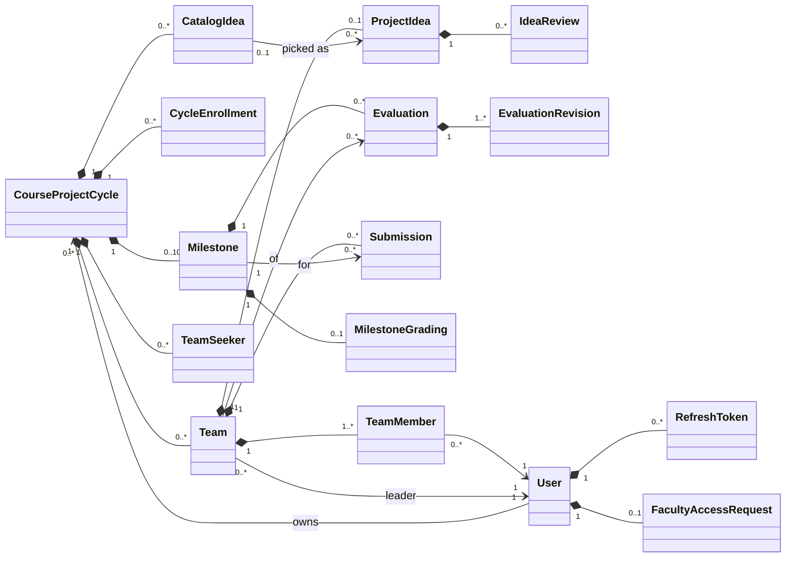

**Where in the code:** `backend/prisma/schema.prisma`, `backend/src/course-cycles/domain/cycle.types.ts`,
`backend/src/teams/domain/team.ts`, `backend/src/ideas/domain/idea.ts`, `backend/src/submissions/domain/submission.ts`,
`backend/src/evaluations/domain/evaluation.ts`

### People and access

Who can use the system, how they stay signed in, and the audit trail.

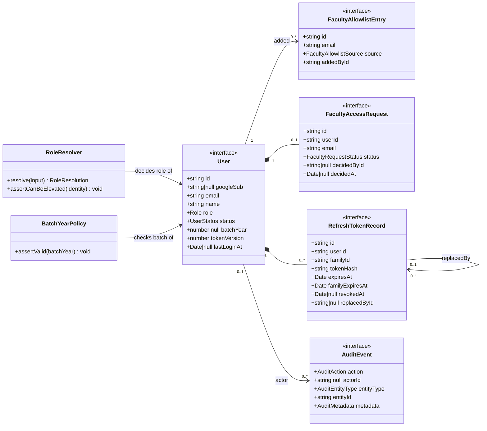

**Where in the code:** `backend/src/users/domain/user.ts`, `backend/src/auth/application/ports/faculty-directory.ts`,
`backend/src/auth/application/ports/refresh-token.repository.ts`, `backend/src/audit/domain/audit-event.ts`,
`backend/src/auth/domain/role-resolver.ts`, `backend/src/auth/domain/batch-year.policy.ts`

### The cycle aggregate

A cycle, its milestones and its roster, saved together, with the state machine and schedule rules.

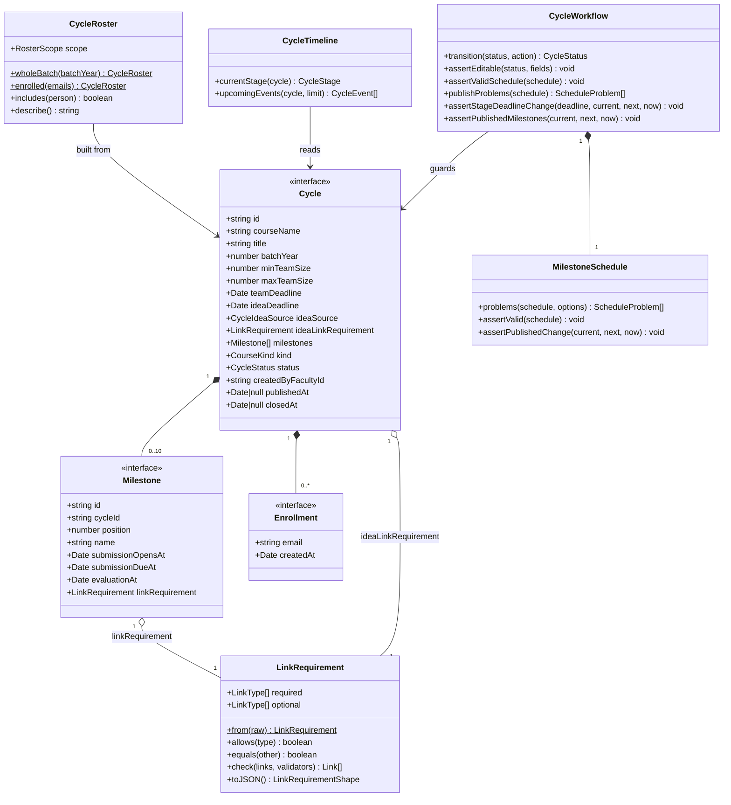

**Where in the code:** `backend/src/course-cycles/domain/cycle.types.ts`, `backend/src/course-cycles/domain/milestone.ts`,
`backend/src/course-cycles/domain/cycle-workflow.ts`, `backend/src/course-cycles/domain/milestone-schedule.ts`,
`backend/src/course-cycles/domain/cycle-timeline.ts`, `backend/src/course-cycles/domain/cycle-roster.ts`,
`backend/src/common/links/link-requirement.ts`

### Teams

A team, its members and its rules.

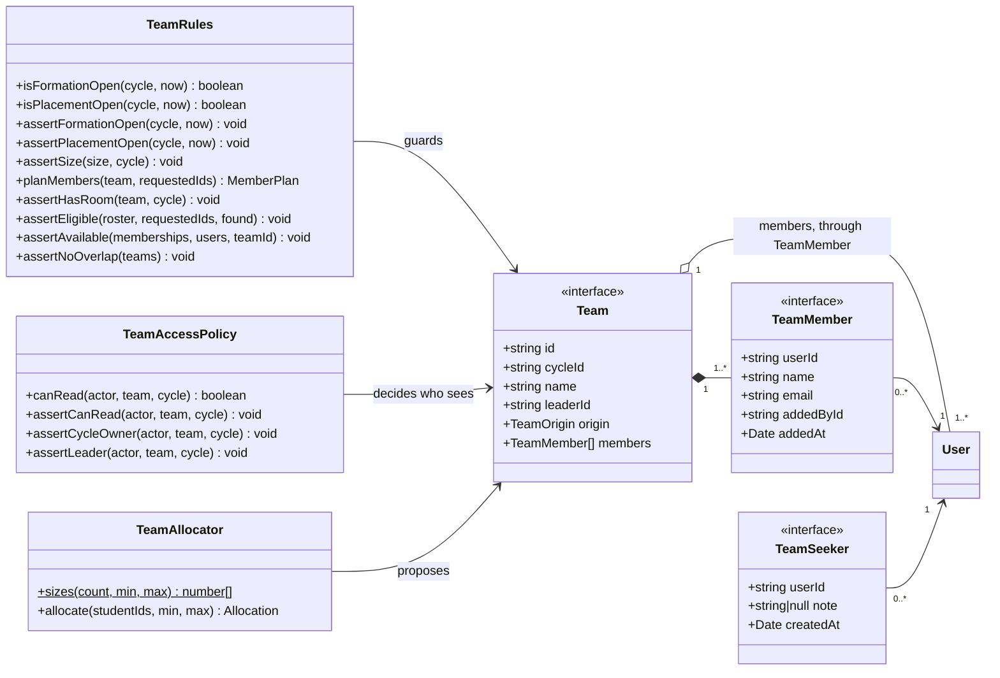

**Where in the code:** `backend/src/teams/domain/team.ts`, `backend/src/teams/domain/team-rules.ts`,
`backend/src/teams/domain/team-access.policy.ts`, `backend/src/teams/domain/team-allocator.ts`

### Ideas

A team's one current idea, its reviews and the faculty's catalog.

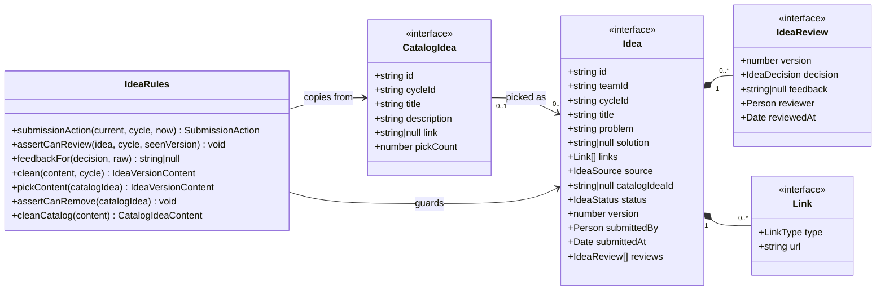

**Where in the code:** `backend/src/ideas/domain/idea.ts`, `backend/src/ideas/domain/idea-rules.ts`,
`backend/src/common/links/link-type.ts`

### Work and evaluations

Versioned submissions, a milestone's grading, and private evaluations with their history.

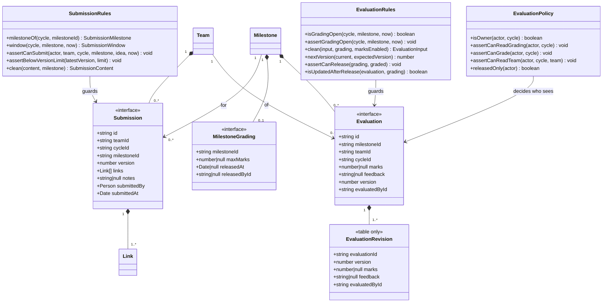

A submission has at least one link only when its milestone requires one, as `MILESTONE_DEFAULT` does; a milestone
requiring no links allows zero. The diagram shows the default.

**Where in the code:** `backend/src/submissions/domain/submission.ts`, `backend/src/submissions/domain/submission-rules.ts`,
`backend/src/evaluations/domain/evaluation.ts`, `backend/src/evaluations/domain/evaluation-rules.ts`,
`backend/src/evaluations/domain/evaluation-policy.ts`, `backend/src/evaluations/infrastructure/prisma-evaluation.repository.ts`

### Value objects

Objects with no identity, compared by value. All of them are immutable in use or built by a factory.

| Value object | Fields | Why it's a value | Where |
| --- | --- | --- | --- |
| `LinkRequirement` | `required`, `optional` | Private constructor, `readonly` fields, `equals`, checked when built | `backend/src/common/links/link-requirement.ts` |
| `CycleRoster` | `scope` | Private constructor, two factories | `backend/src/course-cycles/domain/cycle-roster.ts` |
| `Link` | `type`, `url` | Copied whole into an immutable version | `backend/src/common/links/link-type.ts` |
| `ExternalIdentity` | `sub`, `email`, `emailVerified`, `hostedDomain`, `name`, `picture` | What a provider vouches for, read once | `backend/src/auth/domain/external-identity.ts` |
| `UniversityIdentity` | `kind`, `email`, `batchYear` | A tagged union from parsing an email | `backend/src/auth/domain/university-identity-parser.ts` |
| `PendingAuthorization` | `state`, `nonce`, `codeVerifier` | One login's secrets, kept in a signed cookie | `backend/src/auth/application/ports/identity-provider.ts` |
| `RateLimitDecision` | `allowed`, `hits`, `retryAfterMs` | One outcome of counting | `backend/src/common/rate-limit.ts` |
| `CycleStage`, `CycleEvent` | computed | Computed from dates and the clock, never stored | `backend/src/course-cycles/domain/cycle-timeline.ts` |
| `TodoItem` | `key`, `kind`, `text`, `at`, `tab`, `actionable` | Computed for one dashboard read | `backend/src/dashboard/domain/student-todo-rules.ts` |

### Why each composition and aggregation

| Relationship | Kind | Justification |
| --- | --- | --- |
| `CourseProjectCycle` – `Milestone` | composition | **Aggregate rule:** `CycleRepository` saves them in one transaction ("the cycle aggregate"). `Milestone.cycleId` is a required FK, `onDelete: Restrict`, so a cycle with milestones can't be deleted out from under them |
| `CourseProjectCycle` – `CycleEnrollment` | composition | **Aggregate rule:** `CycleRepository` also owns the roster. `cycleId` is required and part of the primary key |
| `CourseProjectCycle` – `Team` | composition | `Team.cycleId` is required and never changes (`TeamChange` has no `cycleId`). `onDelete: Restrict`; there's no route that deletes a cycle |
| `CourseProjectCycle` – `TeamSeeker` | composition | `cycleId` is required and part of the primary key |
| `CourseProjectCycle` – `CatalogIdea` | composition | `cycleId` is required; a catalog is one cycle's list |
| `Team` – `TeamMember` | composition | Required composite FK, **`onDelete: Cascade`**: the rows go with the team |
| `Team` – `ProjectIdea` | composition | Required composite FK, **`onDelete: Cascade`**, unique `(teamId, cycleId)` |
| `ProjectIdea` – `IdeaReview` | composition | Required FK, **`onDelete: Cascade`** |
| `Team` – `Submission` | composition | Required composite FK. `onDelete: Restrict`: work can't lose its team. It has one owner in the diagram; the required FK to `Milestone` is an association |
| `Milestone` – `MilestoneGrading` | composition | The primary key **is** the FK to the milestone |
| `Milestone` – `Evaluation` | composition | Required composite FK. Results are graded and released per milestone. The required FK to `Team` is an association |
| `Evaluation` – `EvaluationRevision` | composition | Required FK, `onDelete: Restrict`, and append-only by trigger |
| `User` – `RefreshToken` | composition | Required FK. A session means nothing without its user |
| `User` – `FacultyAccessRequest` | composition | Required, unique FK |
| `Idea` or `Submission` – `Link` | composition | Stored inside the row's JSON column, with no life outside it |
| `CycleWorkflow` – `MilestoneSchedule` | composition | Created in the workflow's own field (`private readonly schedule = new MilestoneSchedule()`) |
| `Team` – `User` (through `TeamMember`) | aggregation | The membership row is removed with the team (`Cascade`), but the person remains: `TeamMember.userId` is `onDelete: Restrict` on the `User` side |
| `Cycle` or `Milestone` – `LinkRequirement` | aggregation | Instances are shared: `LinkRequirement.IDEA_DEFAULT` and `MILESTONE_DEFAULT` are static and used by many cycles, and they exist without any cycle |
| `LinkValidatorRegistry` – `LinkValidator` | aggregation | [Below](#shared-ports-and-infrastructure): validators are registered from outside and can be used alone |
| `StudentTodoRules` – `TodoRule` | aggregation | [Below](#dashboard): rules are registered from outside, and each can be tested alone |

A required FK alone doesn't make a composition. `Team.leaderId`, `CourseProjectCycle.createdByFacultyId` and
`FacultyAllowlistEntry.addedById` are required but they only name a person, so they are associations.

## 2.2 Per module

Each diagram runs controller → service → rules and policies → abstract port ← implementations. The `Prisma…` classes
are the ones Nest injects in production; `InMemory…` classes are test doubles in each module's `testing/` folder.

### Auth

Sign-in, sessions and faculty access, in three figures so each fits on a screen. First, the path from the controller to the rules.

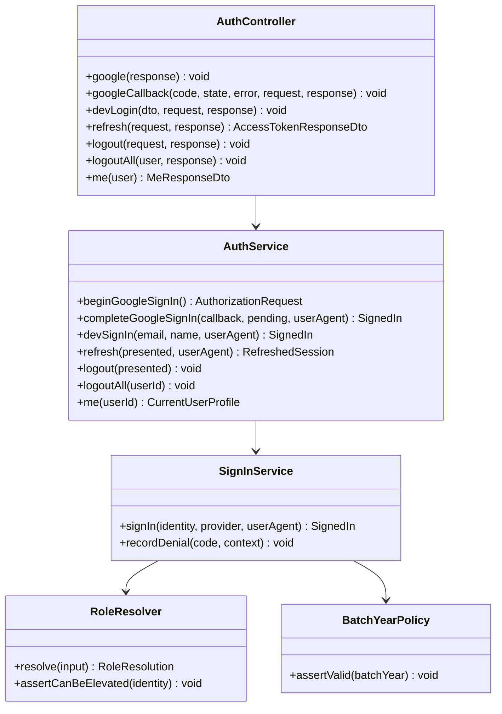

The identity provider, where `LoggingIdentityProvider` is a Decorator ([doc 5](05-design-patterns.md#decorator)):

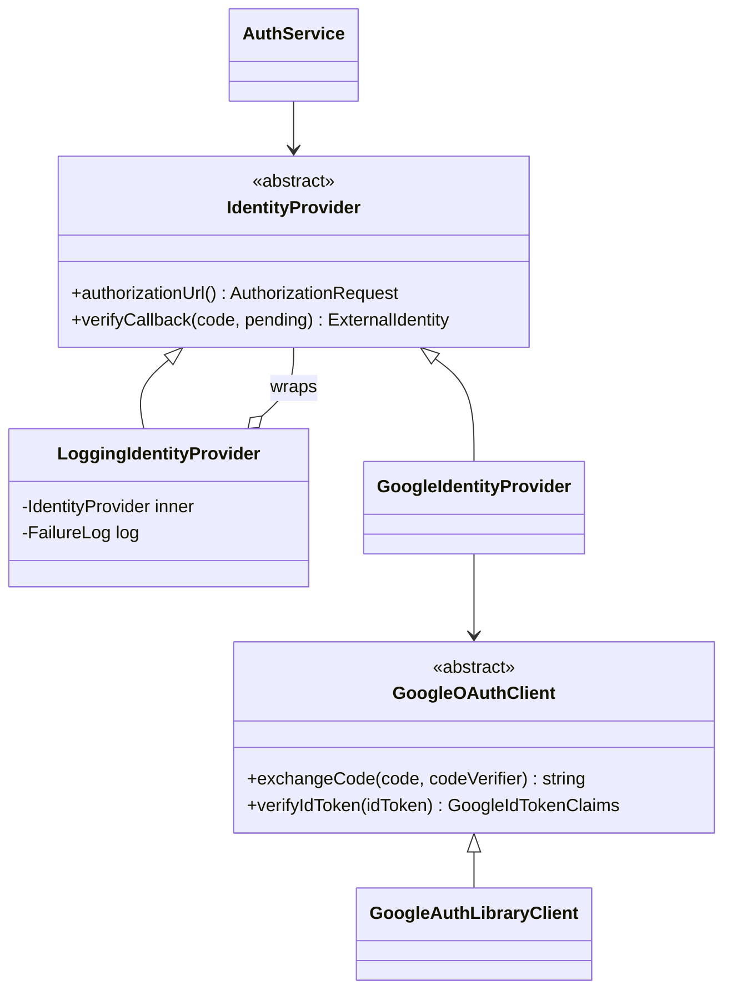

Sessions:

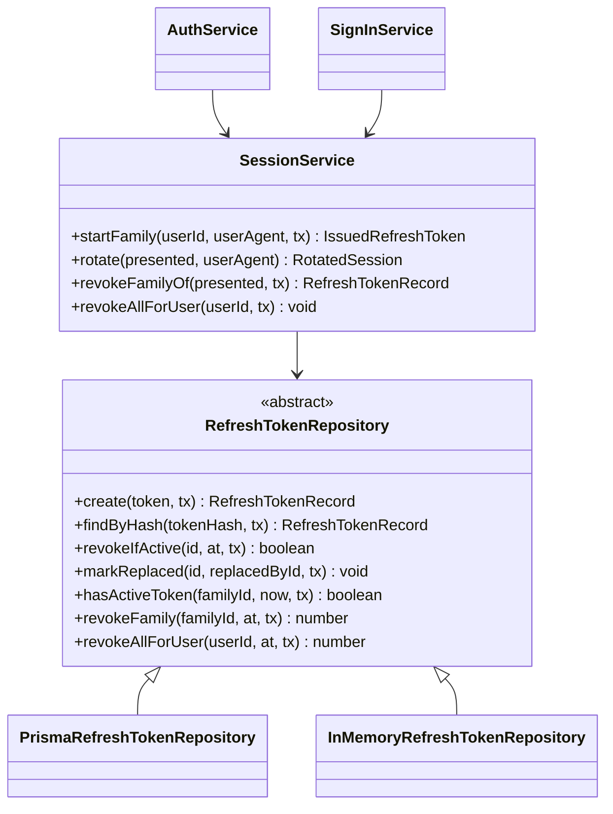

The remaining auth ports:

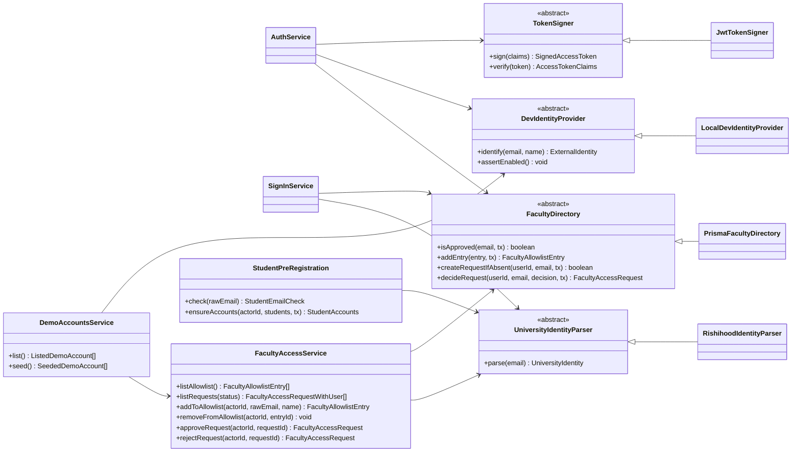

**Where in the code:** `backend/src/auth/auth.module.ts`, `backend/src/auth/presentation/auth.controller.ts`,
`backend/src/auth/application/`, `backend/src/auth/domain/`, `backend/src/auth/infrastructure/`, `backend/src/auth/testing/`

### Course cycles

The cycle aggregate's use cases, and the registries other modules plug into.

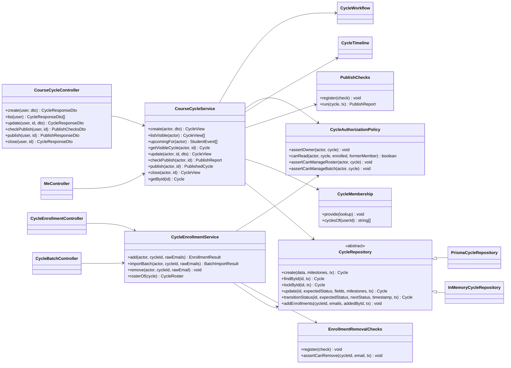

**Where in the code:** `backend/src/course-cycles/course-cycles.module.ts`, `backend/src/course-cycles/presentation/`,
`backend/src/course-cycles/application/`, `backend/src/course-cycles/domain/`, `backend/src/course-cycles/infrastructure/`,
`backend/src/course-cycles/testing/`

### Teams

Formation by students, completion by faculty, and reads. `TeamCycles` and `StudentDirectory` are adapters onto other
modules.

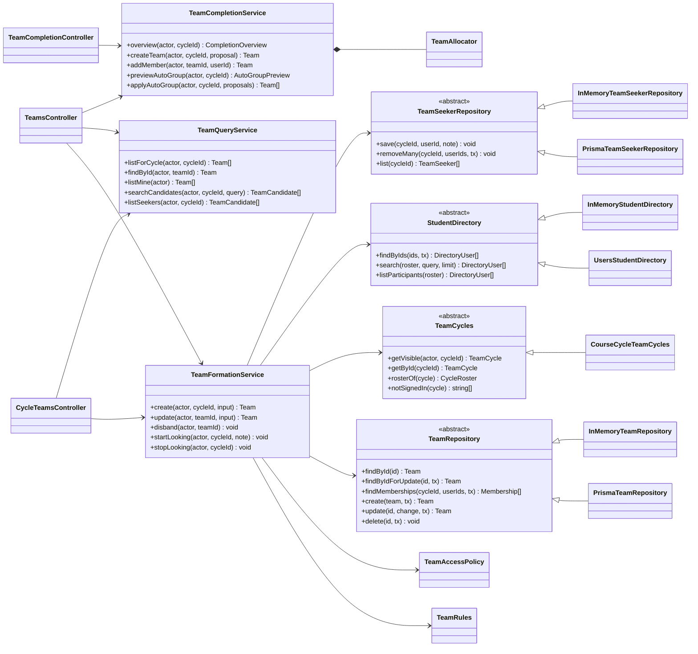

`TeamCompletionService` and `TeamQueryService` use the same four ports and the same rules as `TeamFormationService`;
those arrows are left out so the diagram stays readable.

**Where in the code:** `backend/src/teams/teams.module.ts`, `backend/src/teams/presentation/`, `backend/src/teams/application/`,
`backend/src/teams/domain/`, `backend/src/teams/infrastructure/`, `backend/src/teams/testing/`

### Ideas

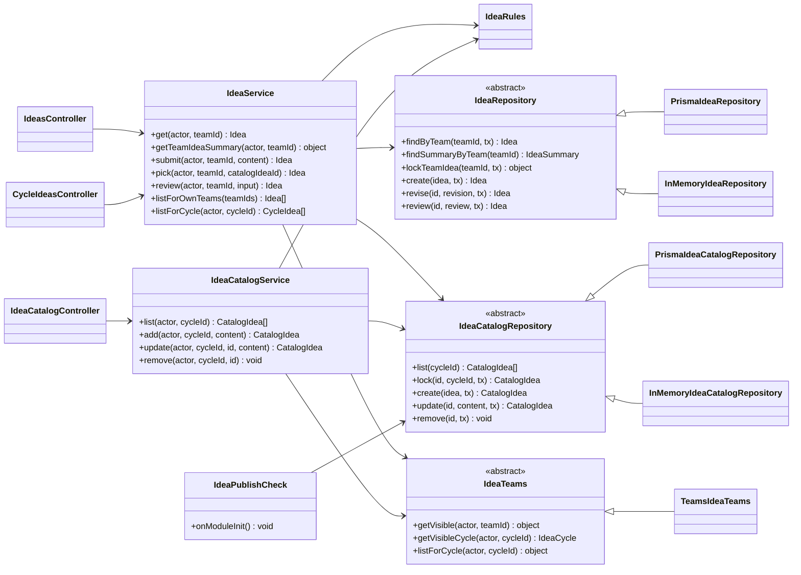

**Where in the code:** `backend/src/ideas/ideas.module.ts`, `backend/src/ideas/presentation/`, `backend/src/ideas/application/`,
`backend/src/ideas/domain/`, `backend/src/ideas/infrastructure/`, `backend/src/ideas/testing/`

### Submissions

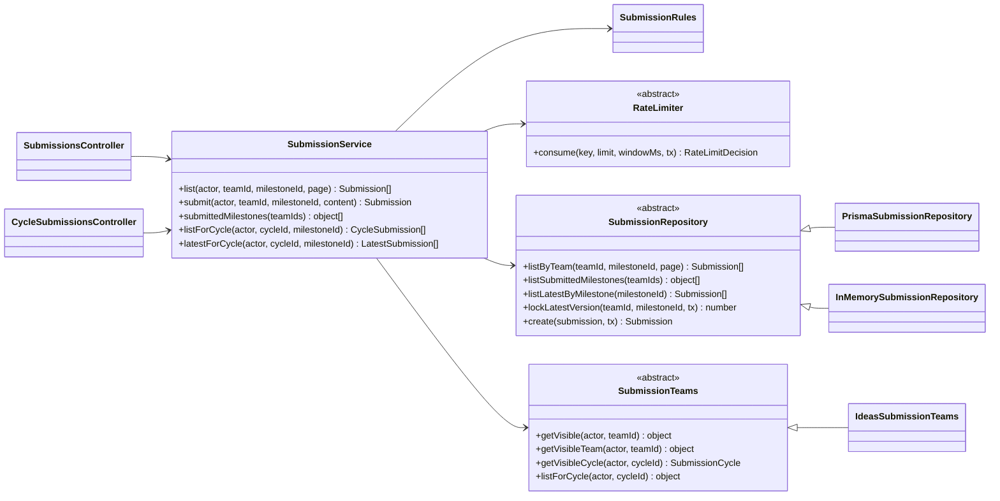

**Where in the code:** `backend/src/submissions/submissions.module.ts`, `backend/src/submissions/presentation/`,
`backend/src/submissions/application/`, `backend/src/submissions/domain/`, `backend/src/submissions/infrastructure/`,
`backend/src/submissions/testing/`

### Evaluations

There's no in-memory evaluation repository: the rules are unit-tested directly, and the repository against the real
database (`backend/test/evaluations.e2e.ts`).

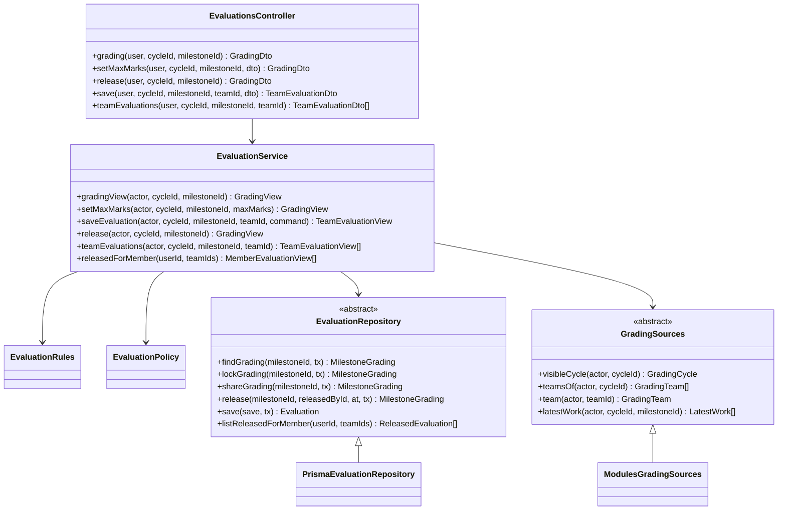

**Where in the code:** `backend/src/evaluations/evaluations.module.ts`, `backend/src/evaluations/presentation/`,
`backend/src/evaluations/application/`, `backend/src/evaluations/domain/`, `backend/src/evaluations/infrastructure/`

### Dashboard

A read model with no tables of its own. It reads only through other modules' services.

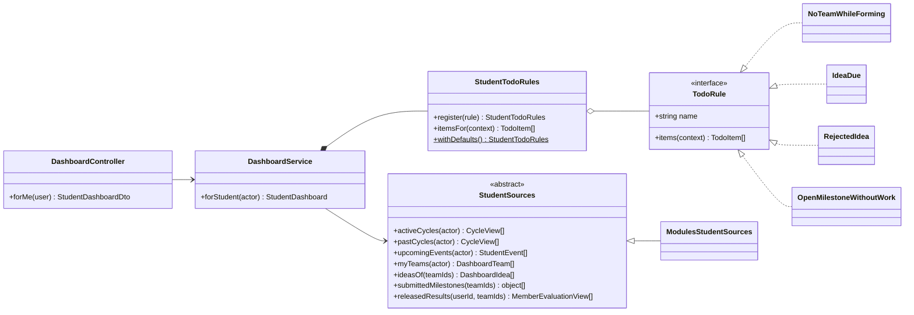

**Where in the code:** `backend/src/dashboard/dashboard.module.ts`, `backend/src/dashboard/presentation/dashboard.controller.ts`,
`backend/src/dashboard/application/`, `backend/src/dashboard/domain/`, `backend/src/dashboard/infrastructure/modules-student-sources.ts`

### Admin

The one flat module: `admin/` has no `application/` or `domain/` folders. It's a small controller and service over
`UsersService`, `SessionService` and `FacultyAccessService`, so it owns no ports. It still depends only inward.

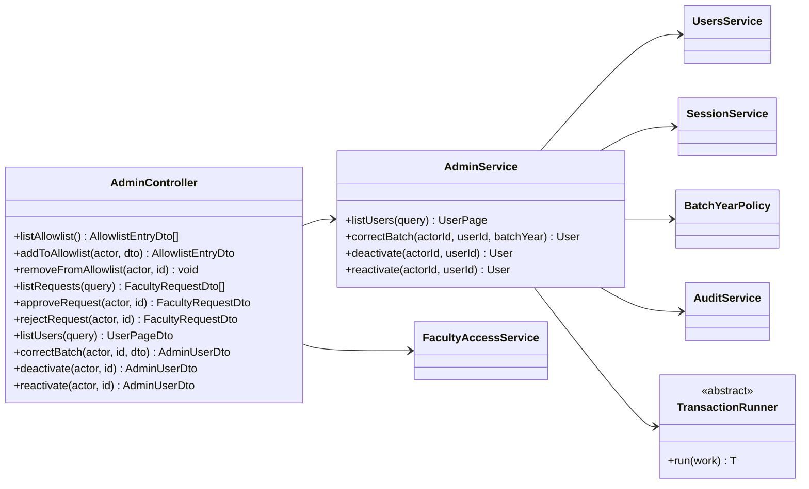

**Where in the code:** `backend/src/admin/admin.controller.ts`, `backend/src/admin/admin.service.ts`, `backend/src/admin/admin.module.ts`

### Shared ports and infrastructure

The ports every module uses: time, randomness, transactions, rate limits, users, audit and the health probe.

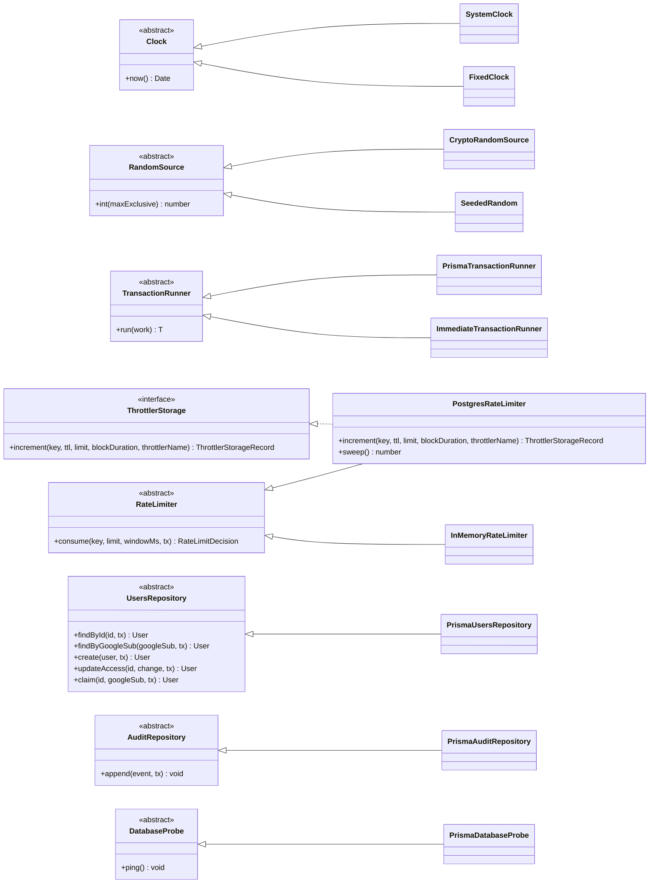

**Where in the code:** `backend/src/common/clock.ts`, `backend/src/common/random.ts`, `backend/src/common/transaction.ts`,
`backend/src/common/rate-limit.ts`, `backend/src/common/testing/`, `backend/src/prisma/`, `backend/src/users/domain/users.repository.ts`,
`backend/src/users/infrastructure/prisma-users.repository.ts`, `backend/src/audit/domain/audit.repository.ts`,
`backend/src/audit/infrastructure/prisma-audit.repository.ts`, `backend/src/health/application/ports/database-probe.ts`,
`backend/src/health/infrastructure/prisma-database-probe.ts`

### Links: Strategy and registry

Each link type's validation is a strategy, found through a registry.

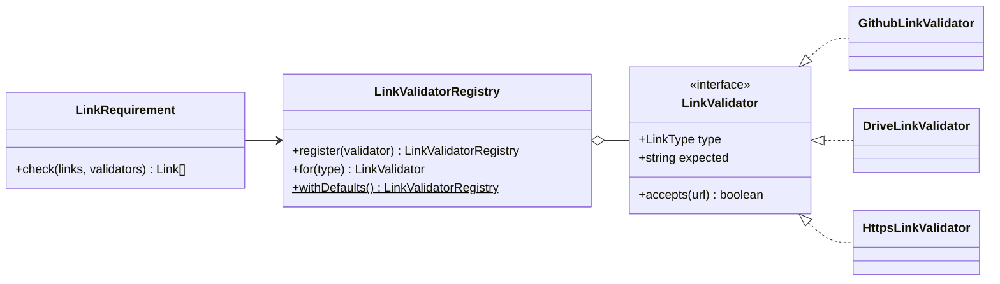

**Where in the code:** `backend/src/common/links/link-validators.ts`, `backend/src/common/links/link-requirement.ts`

## 2.3 The `DomainError` hierarchy and the single filter

Every expected failure is a `DomainError` with a code. One global filter turns any error into the same response body.

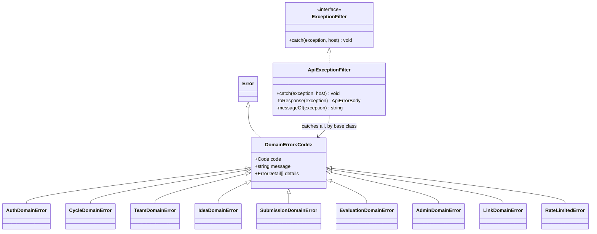

The filter's `instanceof DomainError` branch is the only one for all nine subclasses. `OriginGuard` and
`BodyDepthMiddleware` throw `DomainError` itself with a `CommonErrorCode`. The code decides the HTTP status through
`statusForCode`, and `satisfies Record<DomainErrorCode, HttpStatus>` makes the build fail if a code has no status.

**Where in the code:** `backend/src/common/errors/domain-error.ts`, `backend/src/common/errors/api-exception.filter.ts`,
`backend/src/common/errors/error-status.ts`, `backend/src/common/rate-limit.ts`,
each `*.errors.ts`: `backend/src/auth/domain/auth.errors.ts`, `backend/src/course-cycles/domain/cycle.errors.ts`,
`backend/src/teams/domain/team.errors.ts`, `backend/src/ideas/domain/idea.errors.ts`,
`backend/src/submissions/domain/submission.errors.ts`, `backend/src/evaluations/domain/evaluation.errors.ts`,
`backend/src/admin/admin.errors.ts`, `backend/src/common/links/link.errors.ts`

## 2.4 Test builders

Test data builders live in the testing kits. [Doc 5](05-design-patterns.md#builder) explains why they're for tests only.

```mermaid
classDiagram
  direction LR
  class CycleBuilder {
    +inStatus(status) CycleBuilder
    +published() CycleBuilder
    +closed() CycleBuilder
    +ofKind(kind) CycleBuilder
    +elective() CycleBuilder
    +ownedBy(facultyId) CycleBuilder
    +forBatch(batchYear) CycleBuilder
    +withMilestones(count) CycleBuilder
    +startingAt(start) CycleBuilder
    +build() Cycle
    +buildCreateData() CycleCreateData
    +buildMilestones() PlacedMilestone[]
  }
  class TeamBuilder {
    +inCycle(cycleId) TeamBuilder
    +ledBy(userId) TeamBuilder
    +formedBy(origin) TeamBuilder
    +withMembers(count) TeamBuilder
    +withMemberIds(userIds) TeamBuilder
    +build() Team
  }
  class SubmissionBuilder {
    +forTeam(teamId) SubmissionBuilder
    +inCycle(cycleId) SubmissionBuilder
    +forMilestone(milestoneId) SubmissionBuilder
    +version(version) SubmissionBuilder
    +by(person) SubmissionBuilder
    +at(submittedAt) SubmissionBuilder
    +build() Submission
    +buildNew() NewSubmission
  }
  CycleBuilder --> Cycle : builds
  TeamBuilder --> Team : builds
  SubmissionBuilder --> Submission : builds
```

**Where in the code:** `backend/src/course-cycles/testing/cycle.builder.ts`, `backend/src/teams/testing/team.builder.ts`,
`backend/src/submissions/testing/submission.builder.ts`

## 2.5 Checking the diagrams against the code

`docs/design/scripts/list-ports.ts` reads the TypeScript AST of `backend/src`, and lists every abstract class and every
class that extends it in [generated/ports.md](generated/ports.md). With `--check`, it also fails if this document leaves
out a port or a production implementation.

```bash
cd backend && npm run docs:ports -- --check
```

**Recorded run:** on the `lld-complete` branch, commit `18163ae`, and again after the 503 fix that follows it. The
result is in [doc 10](10-implementation.md#104-confirmations).
