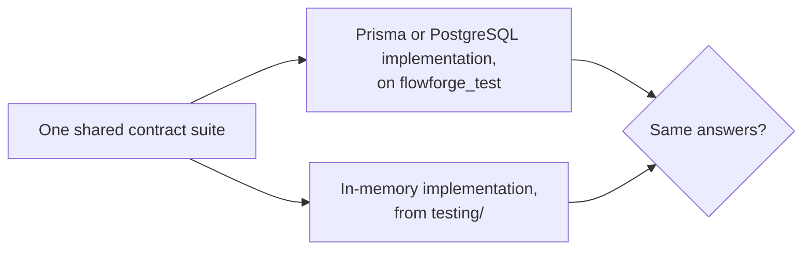

# 4 · SOLID

Excerpts are copied from the file named above them.

## Single Responsibility

**Definition:** a class should have one reason to change.

### Applications

**1. Rules, orchestration and persistence are separate classes.** A team's rules live in `TeamRules`, with no I/O. `TeamFormationService` orders the
steps and owns the transaction. `PrismaTeamRepository` knows SQL. `backend/src/teams/domain/team-rules.ts`:

```ts
  /** Teams change only in a published cycle, strictly before its team deadline. */
  assertFormationOpen(cycle: TeamCycle, now: Date): void {
    if (!this.isFormationOpen(cycle, now)) {
      throw new TeamDomainError(
        "TEAM_FORMATION_CLOSED",
```

**2. Cookies have one owner.** Every name, scope and flag is in `backend/src/auth/presentation/auth-cookies.ts`:

```ts
  private refreshOptions(): CookieOptions {
    return {
      httpOnly: true,
      secure: this.config.isProduction,
      sameSite: "strict",
      path: `/${API_PREFIX}/auth`,
    };
  }
```

### A violation avoided

Services used to take HTTP DTOs. Commit `6b6e1de` ("keep HTTP DTOs out of the application layer") gave them plain command interfaces, so
`CourseCycleService` no longer changes when a request's shape does. `CreateCycleDto implements CreateCycleCommand`, and the service only sees the command.

### The change it makes easy

Changing what a deadline means touches one pure class, and its spec runs in milliseconds with no database. `team-rules.spec.ts` covers
`closes exactly at the deadline` directly.

## Open/Closed

**Definition:** add behaviour by adding code, not by editing what works.

### Applications

**1. Publish checks.** Ideas add a publish rule from their own module. `backend/src/ideas/application/idea-publish-check.ts`:

```ts
  onModuleInit(): void {
    this.checks.register(async (cycle) => {
      if (cycle.ideaSource !== "FACULTY_LIST") return [];
      const ideas = await this.catalog.list(cycle.id);
      return ideas.length > 0
```

**2. Link validators.** `backend/src/common/links/link-validators.ts`:

```ts
  static withDefaults(): LinkValidatorRegistry {
    return new LinkValidatorRegistry()
      .register(new GithubLinkValidator())
      .register(new DriveLinkValidator())
      .register(new HttpsLinkValidator("DEMO"))
      .register(new HttpsLinkValidator("REPORT"));
  }
```

### A violation avoided

`CourseCycleService.publish` doesn't know what's checked: it calls `publishChecks.run`. If it listed the checks itself, it would need to import from
`ideas`, a module that already depends on cycles, creating a cycle of dependencies.

### The change it makes easy

**A new to-do on the dashboard:** one class implementing `TodoRule`, and one `.register(...)` call.

**A new link type, stated honestly:** a name in `LINK_TYPES`, a label in `LABELS` (the compiler insists, through `Record<LinkType, string>`), and a
`register` call. `LinkRequirement.check` doesn't change, and no migration is needed, because links are JSON. The frontend's `frontend/src/links.ts` copies
these rules by hand and also needs updating.

## Liskov Substitution

**Definition:** code using a type must work with any of its implementations, without knowing which.

### Applications

**1. The decorator is an `IdentityProvider`.** `AuthService` can't tell `LoggingIdentityProvider` from the provider inside it. Its success and failure results
are the very same objects (`logging-identity.provider.spec.ts`).

**2. In-memory repositories stand in for Prisma ones in service tests.** For that to mean anything, they must behave alike, which the contract tests prove.

### The proof: contract tests

One shared suite per port runs against both implementations: the real one on `flowforge_test`, and the in-memory one.

| Port | Suite | Tests per implementation | Implementations |
| --- | --- | --- | --- |
| `CycleRepository` | `backend/test/contracts/cycle-repository.e2e.ts` | 11 | `PrismaCycleRepository`, `InMemoryCycleRepository` |
| `RefreshTokenRepository` | `backend/test/contracts/refresh-token-repository.e2e.ts` | 7 | `PrismaRefreshTokenRepository`, `InMemoryRefreshTokenRepository` |
| `RateLimiter` | `backend/test/contracts/rate-limiter.e2e.ts` | 7 | `PostgresRateLimiter`, `InMemoryRateLimiter` |
| `SubmissionRepository` | `backend/test/contracts/submission-repository.e2e.ts` | 6 | `PrismaSubmissionRepository`, `InMemorySubmissionRepository` |

The shape of each, from `backend/test/contracts/rate-limiter.e2e.ts`:

```ts
rateLimiterContract("in memory", () => {
  const clock = startOfAMinute();
  const transactions = new ImmediateTransactionRunner();
  return Promise.resolve({
    limiter: new InMemoryRateLimiter(clock),
```

```ts
rateLimiterContract("PostgreSQL, on the test database", async () => {
  const clock = startOfAMinute();
  const app = await startTestApp({ clock });
```



**Where in the code:** `backend/test/contracts/`

### Violations found, and fixed

**The contract tests found three real differences the first time they ran,** all in the test doubles. Each had let a service test pass on behaviour the real
implementation doesn't have.

| Double | Difference | Fix |
| --- | --- | --- |
| `InMemoryRefreshTokenRepository.markReplaced` | An unknown id silently did nothing; the database's `UPDATE` fails | Throws |
| `InMemoryRateLimiter.consume` | When a clock was a little behind, the window moved back; PostgreSQL keeps the later one (`GREATEST`) | Keeps the later window and the same `retryAfterMs` |
| `InMemorySubmissionRepository.create` | A taken version threw synchronously rather than returning a rejected promise | Now `async` |

### What the contract doesn't cover

- **Rollback.** `ImmediateTransactionRunner` has no transaction to undo, so "a limit counted in a rolled-back transaction disappears" holds only for PostgreSQL.
  The suites don't claim it for both. Rollback is proved separately on the real database (`backend/test/course-cycles.e2e.ts`, `backend/test/evaluations.e2e.ts`).
- **`ThrottlerStorage.increment`** exists only on `PostgresRateLimiter`, so it's tested in `backend/test/rate-limit.e2e.ts`.
- **Real locks.** In-memory `lockById` just reads. Blocking behaviour is proved in `tests/concurrency/races.spec.ts`.

### Every `DomainError` subclass passes through the same filter

`ApiExceptionFilter` has one branch for all of them, with no subclass named. `backend/src/common/errors/api-exception.filter.ts`:

```ts
    if (exception instanceof DomainError) {
      return {
        status: statusForCode(exception.code),
        body: {
          code: exception.code,
          message: exception.message,
          ...(exception.details ? { details: exception.details } : {}),
        },
      };
    }
```

`backend/test/error-filter.e2e.ts` proves it: it runs an instance of each of the nine subclasses, and `DomainError` itself, through the real filter, and checks the
status and body. It also checks that the filter's source names no subclass, and that an error's `cause` never reaches the response.

### The change it makes easy

A new implementation of a port runs the same suite on day one. Moving rate limits to Redis would mean adding one line to `rate-limiter.e2e.ts`.

## Interface Segregation

**Definition:** no client should depend on methods it doesn't use.

### Applications

**1. Each module defines its own small port onto others.** Teams, ideas and submissions all need "a cycle", but each asks for only what it uses, and
`IdeaTeams`, `SubmissionTeams` and `GradingSources` are three separate ports. `backend/src/health/application/ports/database-probe.ts` is the smallest:

```ts
export abstract class DatabaseProbe {
  /** Resolves when a trivial query succeeds; rejects otherwise. */
  abstract ping(): Promise<void>;
}
```

**2. Narrow views of a large type.** A rule sees only the fields it needs. `backend/src/submissions/domain/submission.ts`:

```ts
export type SubmissionCycle = Pick<
  Cycle,
  "id" | "status" | "createdByFacultyId" | "milestones"
>;
```

### A violation avoided

`SubmissionService` could have injected `CourseCycleService` and `TeamQueryService` directly. It would then depend on `publish`, `close`, `createTeam` and everything
else on them. It holds `SubmissionTeams` instead, with four methods.

### The change it makes easy

Adding a field to `Cycle` doesn't touch submissions' test data, because `SubmissionCycle` doesn't include it. Teams, ideas, submissions and evaluations each test against
their own small shape.

## Dependency Inversion

**Definition:** high-level policy shouldn't depend on low-level detail. Both depend on an abstraction, owned by the high-level side.

### Applications

**1. Services depend on ports they own.** The port is in `application/`, its implementation in `infrastructure/`, and the binding in the module.
`backend/src/submissions/submissions.module.ts`:

```ts
    { provide: SubmissionRepository, useClass: PrismaSubmissionRepository },
    { provide: SubmissionTeams, useClass: IdeasSubmissionTeams },
```

**2. Time comes in from outside.** `backend/src/course-cycles/domain/cycle-timeline.ts`:

```ts
export class CycleTimeline {
  constructor(private readonly clock: Clock) {}
```

### A violation avoided

Calling `new Date()` in a rule, or `prisma.$transaction` in a service. The first makes every deadline test a real wait. The second ties the application layer to one ORM. The
ESLint rule in `backend/eslint.config.mjs` also makes `application/`, `domain/` and `infrastructure/` importing `presentation/` a lint error, and `backend/test/layering.e2e.ts`
proves that the rule catches a planted violation.

### The change it makes easy

Swapping an identity provider means changing one provider in `backend/src/auth/auth.module.ts`. Moving rate limits to another store would be one new class and one line in
`backend/src/prisma/prisma.module.ts`, with no change to the services that use them.
