# 5 · Design patterns

Each pattern below was found in the code first. Excerpts are copied from the file named above them. Where a pattern
isn't present, the document says so.

| Pattern | Category | Status | Where |
| --- | --- | --- | --- |
| [Strategy](#strategy) | Behavioural | Present | `LinkValidator`, `TodoRule` |
| [Repository](#repository) | Architectural | Present | 11 repository and directory ports |
| [Adapter](#adapter) | Structural | Present | `IdeasSubmissionTeams`, `GoogleAuthLibraryClient` and others |
| [Factory and factory method](#factory-and-factory-method) | Creational | Present | `CycleRoster`, DTO `from()`, Nest `useFactory` |
| [Singleton](#singleton) | Creational | Present, container-managed | Every `@Injectable()` provider |
| [Registry](#registry) | Structural | Present | `PublishChecks`, `LinkValidatorRegistry`, `EnrollmentRemovalChecks`, `StudentTodoRules` |
| [Value Object](#value-object) | Domain | Present | `LinkRequirement`, `CycleRoster` |
| [Chain of Responsibility](#chain-of-responsibility) | Behavioural | Present, through Nest | Middleware → guards → pipes → filter |
| [State machine](#state-machine) | Behavioural | Present, table-driven | `CycleWorkflow` |
| [Decorator](#decorator) | Structural | Added in this work | `LoggingIdentityProvider` |
| [Builder](#builder) | Creational | Added in this work, for tests | `aCycle()`, `aTeam()`, `aSubmission()` |
| [Observer](#observer) | Behavioural | Three existing uses; no domain events | Cluster, Prisma, frontend session |
| Template Method | Behavioural | **Not present** | See [below](#patterns-not-used-and-why) |

## Strategy

**Category:** behavioural. **Problem:** each kind of link has its own idea of valid, and a to-do has its own rule for when
it applies. A `switch` on the type would grow with every kind and live far from what it describes.

**Paths:** `backend/src/common/links/link-validators.ts`, `backend/src/dashboard/domain/student-todo-rules.ts`

```ts
export interface LinkValidator {
  readonly type: LinkType;
  /** For error messages: "a GitHub repository (https://github.com/owner/repo)". */
  readonly expected: string;
  accepts(url: URL): boolean;
}
```

**Alternative rejected:** a `switch (link.type)` inside `LinkRequirement.check`. A new type would mean editing that method.

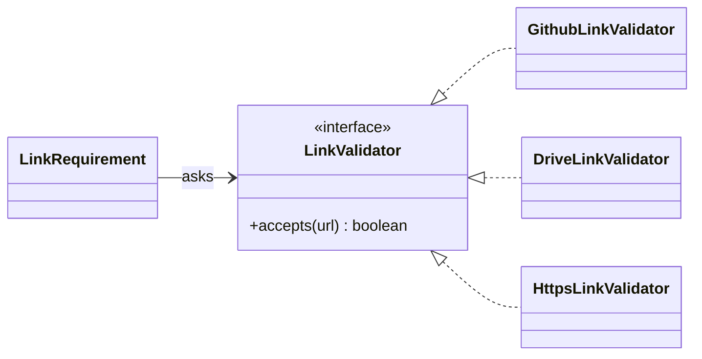

**Where in the code:** `backend/src/common/links/link-validators.ts`, `backend/src/common/links/link-requirement.ts`

## Repository

**Category:** architectural (domain-driven design). **Problem:** services must express rules without knowing SQL, and
tests must run those rules without a database.

**Paths:** each module's `application/ports/*.repository.ts`, and `infrastructure/prisma-*.repository.ts`. Here,
`backend/src/submissions/application/ports/submission.repository.ts`:

```ts
export abstract class SubmissionRepository {
  /** The team's versions for one milestone, newest first, one page at a time. */
  abstract listByTeam(
    teamId: string,
    milestoneId: string,
    page: HistoryPage,
  ): Promise<Submission[]>;
```

**Alternative rejected:** calling Prisma from services. Rules would need a database to test, and raw `FOR UPDATE` queries
would spread through the application layer. Instead each is a named method such as `lockLatestVersion`.

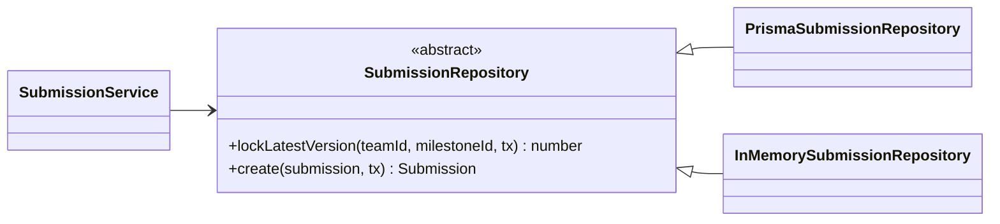

**Where in the code:** `backend/src/submissions/application/submission.service.ts`,
`backend/src/submissions/infrastructure/prisma-submission.repository.ts`,
`backend/src/submissions/testing/in-memory-submission.repository.ts`

## Adapter

**Category:** structural. **Problem:** a module needs something from another module or library, in its own terms. Submissions
need a team, its idea and its cycle, but shouldn't depend on those modules' whole services, tables or visibility rules.

**Paths:** `backend/src/submissions/infrastructure/ideas-submission-teams.ts`. Others:
`backend/src/teams/infrastructure/course-cycle-team-cycles.ts`, `backend/src/teams/infrastructure/users-student-directory.ts`,
`backend/src/ideas/infrastructure/teams-idea-teams.ts`, `backend/src/evaluations/infrastructure/modules-grading-sources.ts`,
`backend/src/dashboard/infrastructure/modules-student-sources.ts`, and `GoogleAuthLibraryClient`, which adapts Google's
library in `backend/src/auth/infrastructure/google-oauth.client.ts`.

```ts
  async getVisible(
    actor: TeamActor,
    teamId: string,
  ): Promise<TeamWithIdea & { cycle: SubmissionCycle }> {
    const { team, idea } = await this.ideas.getTeamIdeaSummary(actor, teamId);
    return {
      team,
      cycle: await this.cycles.getById(team.cycleId),
      idea: idea && toSubmissionIdea(idea),
    };
```

**Alternative rejected:** reading other modules' tables directly. It's faster to write, but it copies the visibility rules,
and they would drift.

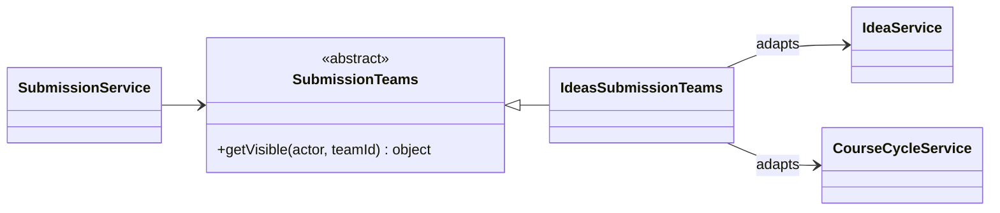

**Where in the code:** `backend/src/submissions/application/ports/submission-teams.ts`,
`backend/src/submissions/infrastructure/ideas-submission-teams.ts`, `backend/src/submissions/submissions.module.ts`

## Factory and factory method

**Category:** creational. **Problem:** building an object correctly needs a decision or several steps, and callers shouldn't
repeat them. FlowForge has three forms.

1. **Static factory methods** with a private constructor: `CycleRoster`, `LinkRequirement.from`, `LinkValidatorRegistry.withDefaults`.
2. **Mapping factories on DTOs:** `CycleResponseDto.from(cycleView)` and the like.
3. **Container factories:** `useFactory` providers, where Nest supplies the dependencies.

**Paths:** `backend/src/course-cycles/domain/cycle-roster.ts`:

```ts
export class CycleRoster {
  private constructor(readonly scope: RosterScope) {}

  static wholeBatch(batchYear: number): CycleRoster {
    return new CycleRoster({ kind: "BATCH", batchYear });
  }

  static enrolled(emails: Iterable<string>): CycleRoster {
    return new CycleRoster({ kind: "ENROLLED", emails: new Set(emails) });
  }
```

**Alternative rejected:** a public constructor taking `{ kind, batchYear?, emails? }`, which would allow a batch roster with no
batch year.

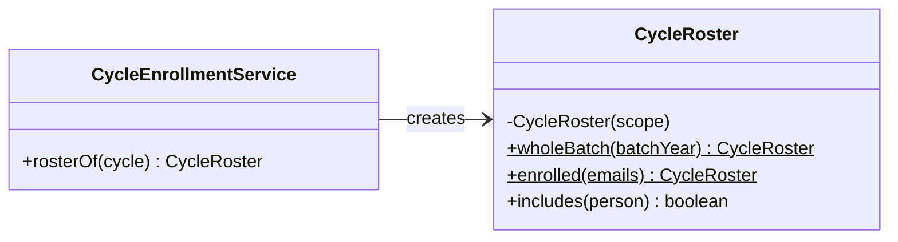

**Where in the code:** `backend/src/course-cycles/domain/cycle-roster.ts`, `backend/src/course-cycles/application/cycle-enrollment.service.ts`,
`backend/src/auth/auth.module.ts`, `backend/src/course-cycles/course-cycles.module.ts`

## Singleton

**Category:** creational. **Problem:** the app needs one connection pool, one clock and one set of registered publish checks.

**Why container-managed and not a static `getInstance()`:** Nest creates one instance of each provider per application by default
and hands it to whoever declares it. Tests can replace any of them, and dependencies stay visible in constructors. A static instance
would be hidden global state.

**Paths:** `backend/src/prisma/prisma.module.ts`:

```ts
  providers: [
    PrismaService,
    { provide: TransactionRunner, useClass: PrismaTransactionRunner },
    PostgresRateLimiter,
    { provide: RateLimiter, useExisting: PostgresRateLimiter },
  ],
```

`useExisting` makes the point: the `RateLimiter` port and Nest's throttler storage share one object.

**One per process, not per deployment.** `src/cluster.ts` runs several processes, each with its own instances, so
**no shared state can live in a singleton**. That's why rate-limit counters moved to PostgreSQL (ADR 023). The per-request read memo
isn't a singleton either: it lives in `AsyncLocalStorage` (`backend/src/common/request-scope.ts`).

**One plain module-level instance:** `export const linkValidators = LinkValidatorRegistry.withDefaults()`. It's used because a value object
has no constructor injection, and it's safe because it's stateless after setup.

**Alternative rejected:** a hand-written `PrismaService.getInstance()`. Integration tests rely on overriding providers, for example
`builder.overrideProvider(Clock).useValue(options.clock)` in `backend/test/support/test-app.ts`.

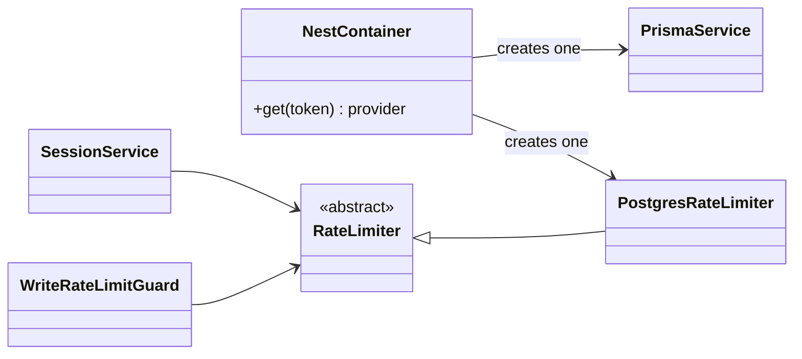

The box named NestContainer stands for Nest's dependency injection, not a FlowForge class.

**Where in the code:** `backend/src/prisma/prisma.module.ts`, `backend/src/common/common.module.ts`, `backend/src/common/links/link-validators.ts`

## Registry

**Category:** structural. **Problem:** `course-cycles` must run checks that belong to modules built on top of it, without importing
them. A list that other modules add to at startup turns the dependency around.

**Paths:** `backend/src/course-cycles/application/publish-checks.ts`:

```ts
@Injectable()
export class PublishChecks {
  private readonly checks: PublishCheck[] = [];

  register(check: PublishCheck): void {
    this.checks.push(check);
  }
```

And from `backend/src/ideas/application/idea-publish-check.ts`, the `ideas` module registering its rule:

```ts
  onModuleInit(): void {
    this.checks.register(async (cycle) => {
      if (cycle.ideaSource !== "FACULTY_LIST") return [];
      const ideas = await this.catalog.list(cycle.id);
```

**Others:** `LinkValidatorRegistry`, `EnrollmentRemovalChecks`, `StudentTodoRules`.

**Alternative rejected:** `CourseCycleService` importing `IdeaCatalogRepository`. Ideas already depend on cycles, so that would be a
circular dependency.

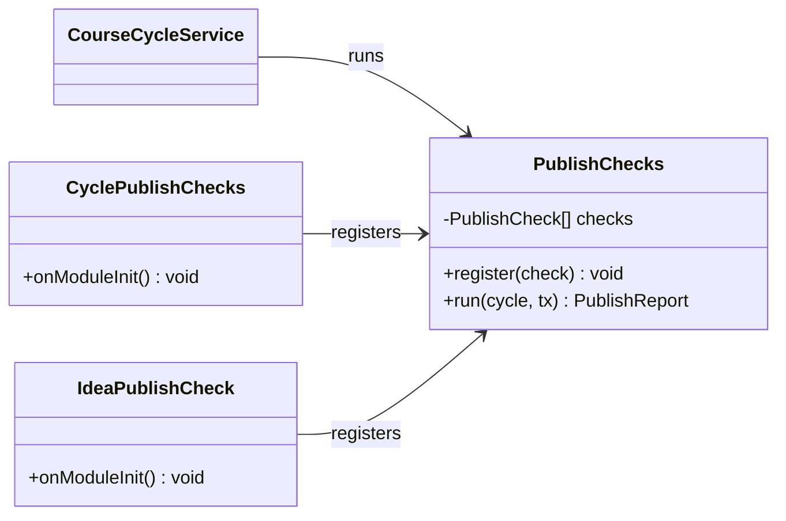

**Where in the code:** `backend/src/course-cycles/application/publish-checks.ts`, `backend/src/course-cycles/application/cycle-publish-checks.ts`,
`backend/src/ideas/application/idea-publish-check.ts`, `backend/src/course-cycles/application/enrollment-removal-checks.ts`

## Value Object

**Category:** domain-driven design. **Problem:** "which links are required" has rules: no type listed twice, none both required and
optional. Passing plain arrays would repeat those checks.

**Paths:** `backend/src/common/links/link-requirement.ts`:

```ts
export class LinkRequirement {
  private constructor(
    readonly required: readonly LinkType[],
    readonly optional: readonly LinkType[],
  ) {}

  /** For an idea: nothing required, a GitHub or Drive link welcome. */
  static readonly IDEA_DEFAULT = new LinkRequirement([], ["GITHUB", "DRIVE"]);
```

It's checked when built, never changed, and compared by value (`equals`). It's stored as JSON and re-validated when read back.

**Alternative rejected:** two join tables. See [doc 8](08-database.md#value-objects-stored-as-json).

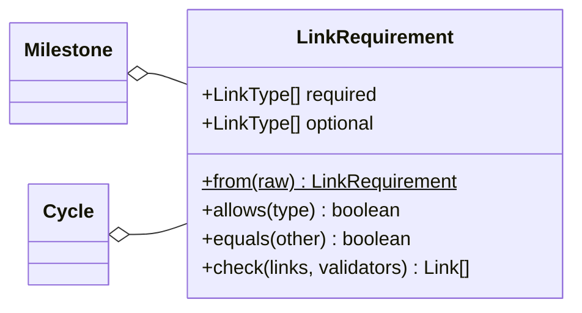

**Where in the code:** `backend/src/common/links/link-requirement.ts`, `backend/src/common/links/link-requirement.spec.ts`

## Chain of Responsibility

**Category:** behavioural. **Problem:** a request must pass many independent checks, and any of them may end it. Each check should know
nothing about the others.

Nest provides the chain; FlowForge provides the links. The order comes from `backend/src/main.ts`, `backend/src/common/common.module.ts`
and `backend/src/auth/auth.module.ts`:

```ts
    // Secure by default, in this order: authenticate, check the role, then count the write.
    { provide: APP_GUARD, useClass: JwtAuthGuard },
    { provide: APP_GUARD, useClass: RolesGuard },
    { provide: APP_GUARD, useClass: WriteRateLimitGuard },
```

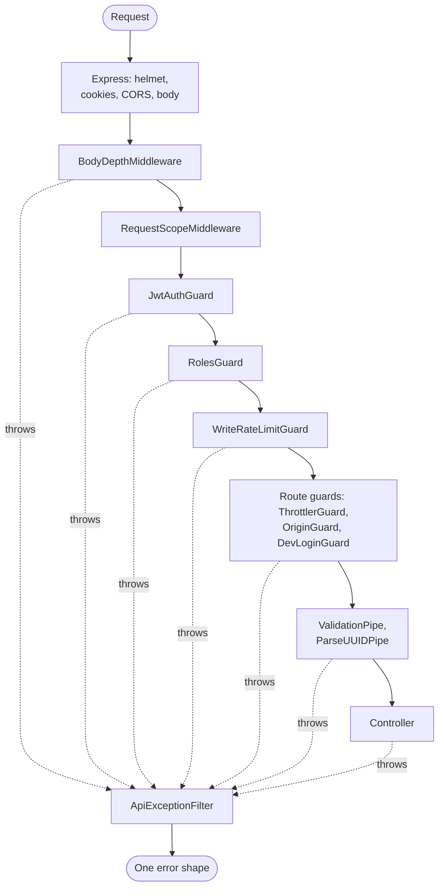

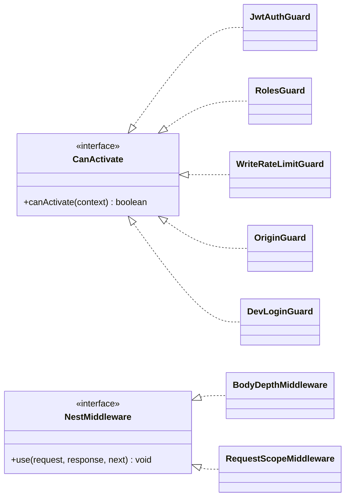

**Alternative rejected:** checks at the top of each controller method. One forgotten check would open a route. Here, `RolesGuard` fails
closed: a route without `@Roles()` is denied.

**Where in the code:** `backend/src/main.ts`, `backend/src/common/common.module.ts`, `backend/src/auth/auth.module.ts`,
`backend/src/auth/presentation/guards/`, `backend/src/common/http/`, `backend/src/common/errors/api-exception.filter.ts`, `backend/test/rbac.e2e.ts`

## State machine

**Category:** behavioural. **Problem:** a cycle moves one way through three states, and each state allows different edits. Scattered `if`
statements would let an impossible move slip through.

**Paths:** `backend/src/course-cycles/domain/cycle-workflow.ts`:

```ts
const transitions: Record<
  CycleStatus,
  Partial<Record<CycleAction, CycleStatus>>
> = {
  DRAFT: { PUBLISH: "PUBLISHED" },
  PUBLISHED: { CLOSE: "CLOSED" },
  CLOSED: {},
};
```

It's table-driven rather than the GoF State pattern with one class per state: three states with one transition each don't justify three
classes. [Doc 6](06-sequence-activity.md#cycle) has the diagram. `editableFields` is a second table, per state.

**Alternative rejected:** a database trigger guarding status. The rule would be invisible to unit tests. The database's part is the
`expectedStatus` compare-and-set in `transitionStatus`.

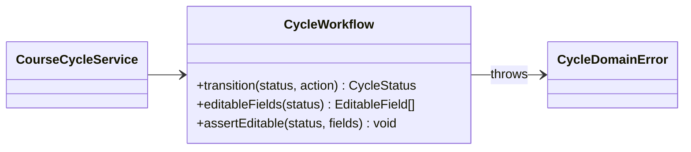

**Where in the code:** `backend/src/course-cycles/domain/cycle-workflow.ts`, `backend/src/course-cycles/domain/cycle-workflow.spec.ts`

## Decorator

**Category:** structural. **Added in this work.** **Problem:** a failed Google exchange or token check always reaches the user as
`INVALID_ID_TOKEN`, and `GoogleIdentityProvider` used to swallow the reason. An operator couldn't tell a wrong client secret from a bad
token. Adding logging to the provider itself would mix two jobs.

`LoggingIdentityProvider` wraps any `IdentityProvider`, delegates every call, and adds one log line on failure.

**Paths:** `backend/src/auth/infrastructure/logging-identity.provider.ts`:

```ts
    try {
      return await this.inner.verifyCallback(code, pending);
    } catch (error) {
      const cause = (error as { cause?: unknown } | null)?.cause ?? error;
      this.log.warn(
        `Google sign-in failed: class=${classOf(cause)} google=${googleCodeOf(cause)}`,
      );
      throw error;
    }
```

It's wired through a Nest provider factory in `backend/src/auth/auth.module.ts`:

```ts
    {
      provide: IdentityProvider,
      inject: [GoogleOAuthClient, AppConfig],
      useFactory: (google: GoogleOAuthClient, config: AppConfig) =>
        new LoggingIdentityProvider(
          new GoogleIdentityProvider(google, config),
          new Logger("GoogleSignIn"),
        ),
    },
```

**What it never logs:** an error's message, which can quote a token's payload, or a code, token or email. Only the class and Google's code
are logged, and a code must match `^[a-z_]{1,64}$`.

**Note:** TypeScript's `@Roles()` and `@IsCleanText()` are language decorators (annotations), not this structural pattern.

**Alternative rejected:** a `try/catch` with logging in `GoogleIdentityProvider`. It would work, but the provider would then have two reasons to
change, and the log couldn't be tested apart from Google's protocol.

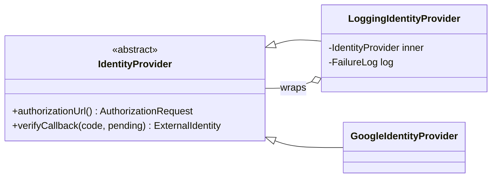

**Where in the code:** `backend/src/auth/infrastructure/logging-identity.provider.ts`, `backend/src/auth/infrastructure/logging-identity.provider.spec.ts`,
`backend/src/auth/infrastructure/google-identity.provider.ts`, `backend/src/auth/auth.module.ts`

## Builder

**Category:** creational. **Added in this work, for tests only.** **Problem:** a valid `Cycle` has more than twenty fields, and its dates must
follow the schedule rule. Tests repeated long literals, or cast a partial object with `as Cycle`, so what mattered to each test was buried.

**Paths:** `backend/src/course-cycles/testing/cycle.builder.ts`, `backend/src/teams/testing/team.builder.ts`,
`backend/src/submissions/testing/submission.builder.ts`. From `backend/test/contracts/cycle-repository.e2e.ts`:

```ts
      const created = await save(aCycle().ownedBy(owner).withMilestones(3));
```

And from `backend/src/course-cycles/domain/cycle-authorization-policy.spec.ts`, replacing an `as Cycle` cast:

```ts
const cycle = (status: CycleStatus, kind: Cycle["kind"] = "CORE") =>
  aCycle()
    .inStatus(status)
    .ofKind(kind)
    .forBatch(2026)
    .ownedBy("owner")
    .build();
```

**Why it fits test data and not production entities:**

- **In a test,** the defaults are the point: a test states only what matters, and everything else is valid and uninteresting.
  `cycle.builder.spec.ts` proves a built cycle passes the workflow's publish problems.
- **In production,** an entity comes from a validated request or from a row. A `Cycle` is only legal after `CycleWorkflow.assertValidSchedule`
  has checked it. A production builder would be a second way to create one, with defaults nobody chose and a `.published()` that skips the
  publish checks. Status there changes only through `transitionStatus`.

**Alternative rejected:** a shared fixture object spread and overridden in each test. It works, but a date override can quietly make a cycle
invalid, while `.startingAt()` moves every date together.

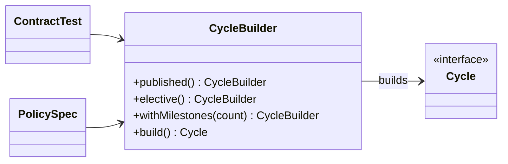

**Where in the code:** `backend/src/course-cycles/testing/cycle.builder.ts`, `backend/src/course-cycles/testing/cycle.builder.spec.ts`,
`backend/src/teams/testing/team.builder.ts`, `backend/src/submissions/testing/submission.builder.ts`,
`backend/src/teams/domain/team-access.policy.spec.ts`

## Observer

**Category:** behavioural. **Problem:** something happens, and others want to know, without the source knowing who they are.

### Existing uses

| Use | Source | Subscriber | Path |
| --- | --- | --- | --- |
| Worker exit and listening | Node's `cluster` | The primary: replaces a dead worker, gives up after 3 failed boots | `backend/src/cluster.ts` |
| Shutdown signals | `process` | The primary: drains the workers | `backend/src/cluster.ts` |
| Prisma query events | `PrismaClient`, only with `DB_QUERY_EVENTS=true` | Tests that count statements | `backend/src/prisma/prisma.service.ts`, `backend/test/query-budget.e2e.ts`, `backend/test/dashboard.e2e.ts` |
| Session ended, API reachable or not | `frontend/src/api/client.ts` | `AuthProvider`, which updates its state | `frontend/src/auth/AuthProvider.tsx` |

From `backend/src/cluster.ts`:

```ts
  cluster.on("listening", (worker) => {
    listening.add(worker);
    failedBoots = 0;
    log(`worker ${worker.process.pid} listening`);
  });
```

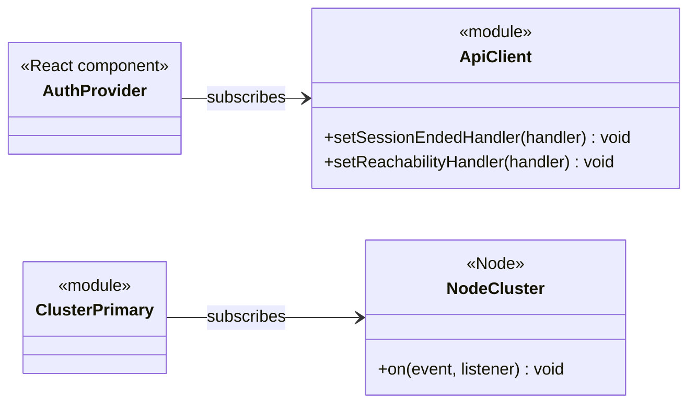

The frontend's two are single-subscriber callbacks rather than a list, which is all it needs.

### No domain-event publisher

The brief allowed one **only for a real subscriber**. **None exists, so none was added.** Each candidate was checked:

| Candidate subscriber | Why it isn't one |
| --- | --- |
| Email or push notifications | Out of scope for V1 (ADR 017) |
| The student dashboard | Computed on each read from existing rows (ADR 021), so nothing needs updating |
| The audit log | Must stay in the same transaction as the change, or a change could commit without its row. It's a direct call by design (`backend/test/course-cycles.e2e.ts`: "rolls the change back when its audit row cannot be written") |
| Cross-module cleanup | `seekers.removeMany` runs inside the same transaction, on purpose |

**When notifications arrive:** a service would publish after `transactions.run(...)` has returned, so a rolled-back change announces
nothing. Audit writes would stay where they are.

**Alternative rejected:** adding an event bus now, for later. It would be code with no reader, and it would invite moving audit writes out of
their transaction.

**Where in the code:** `backend/src/cluster.ts`, `backend/src/prisma/prisma.service.ts`, `frontend/src/api/client.ts`, `frontend/src/auth/AuthProvider.tsx`

## Patterns not used, and why

| Pattern | Why not |
| --- | --- |
| **Template Method** | Not present. Every abstract class is a pure port, with no concrete method calling abstract hooks. Shared steps are composed (`this.record`, policy calls), not inherited |
| **GoF State** (one class per state) | Three states and two transitions fit in a table. See [State machine](#state-machine) |
| **Abstract Factory** | There are no families of related objects to swap together. A module's `providers` list does that job per port |
| **Event Sourcing** | The current state is the row. `AuditLog` records what happened, but nothing is rebuilt from it. `EvaluationRevision` is a history, not the source of truth |
| **CQRS with separate stores** | The dashboard is a small read model over the same tables (ADR 021). A second store would add sync problems at this scale |
| **Unit of Work** (tracking changes) | `TransactionRunner` passes a transaction explicitly. Prisma has no change tracking to build on, and explicit is easier to follow |
| **Saga** | Everything is in one database, so one transaction is enough |
| **Mediator** or a command bus | Controllers call services directly. A bus would hide the call graph with no gain. `CreateCycleCommand` and similar are plain data, not the Command pattern |
| **Service Locator** | Dependencies are declared in constructors. `app.get` appears only at startup (`backend/src/main.ts`) and in tests |
| **Proxy** | `RequestScope` memoizes inside repositories rather than wrapping them, because writes must forget keys there |
