# 6 · Sequence, activity and state diagrams

Participants are real classes. Every request first passes the pipeline in
[doc 5](05-design-patterns.md#chain-of-responsibility): `BodyDepthMiddleware`, `RequestScopeMiddleware`, the global guards
(`JwtAuthGuard`, `RolesGuard`, `WriteRateLimitGuard`) and `ValidationPipe`. The diagrams leave these out unless they
matter. `tx` means one database transaction through `TransactionRunner`.

## 6.1 Sequence diagrams

### 1a. Google sign-in: the redirect

PKCE, `state` and `nonce` are created here, and they tie Google's answer to this browser and this login.

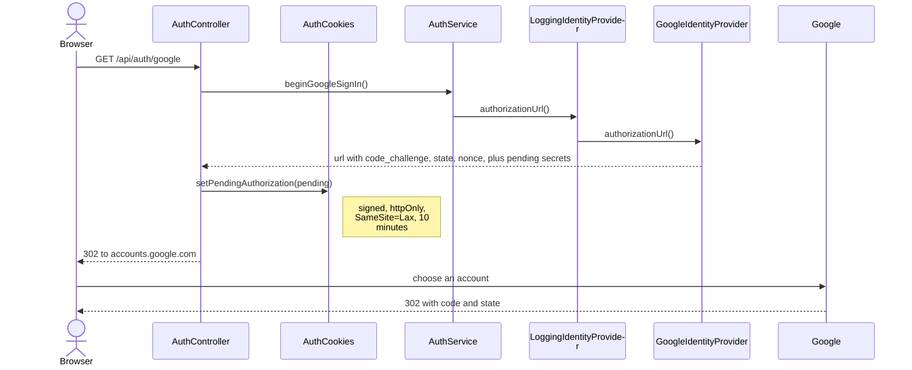

**Where in the code:** `backend/src/auth/presentation/auth.controller.ts`, `backend/src/auth/application/auth.service.ts`,
`backend/src/auth/infrastructure/logging-identity.provider.ts`, `backend/src/auth/infrastructure/google-identity.provider.ts`,
`backend/src/auth/presentation/auth-cookies.ts`

### 1b. Google sign-in: verifying Google's answer

The callback checks `state`, exchanges the code and verifies the ID token. On failure, the decorator logs why, and the browser is told only the code.

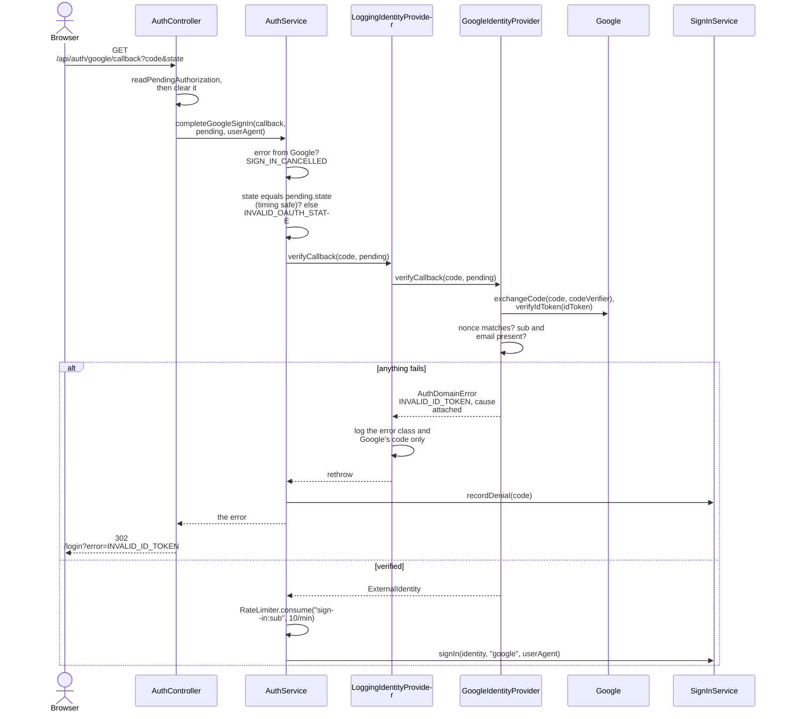

**Where in the code:** `backend/src/auth/application/auth.service.ts`, `backend/src/auth/infrastructure/logging-identity.provider.ts`,
`backend/src/auth/infrastructure/google-identity.provider.ts`, `backend/src/auth/infrastructure/google-oauth.client.ts`

### 1c. Google sign-in: role resolution and the session

One transaction. A denial is returned rather than thrown, so its audit row commits.

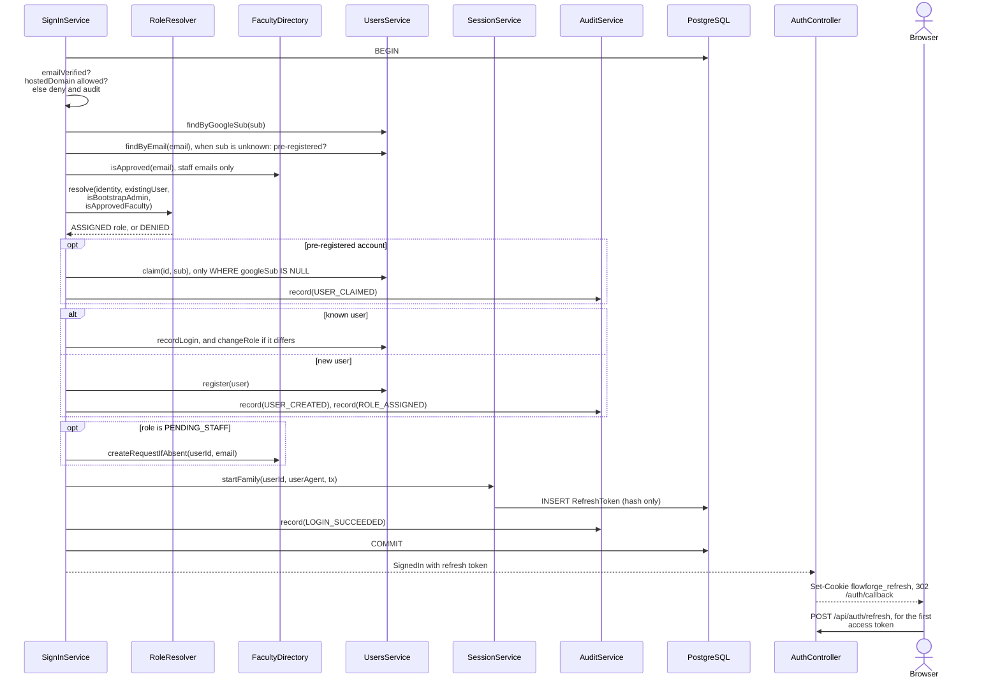

**Where in the code:** `backend/src/auth/application/sign-in.service.ts`, `backend/src/auth/domain/role-resolver.ts`,
`backend/src/auth/application/session.service.ts`, `backend/test/auth.e2e.ts`

### 2a. Refresh: rotation

Each refresh revokes the presented token and issues its successor, in one transaction.

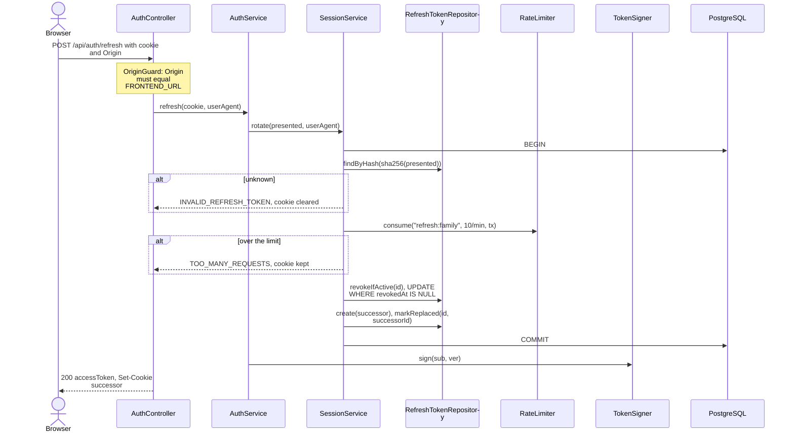

**Where in the code:** `backend/src/auth/application/session.service.ts`, `backend/src/auth/infrastructure/prisma-refresh-token.repository.ts`,
`backend/src/auth/presentation/auth.controller.ts`, `backend/test/sessions.e2e.ts`

### 2b. Refresh: a token presented again

A second use within 10 seconds, while the family has a live token, gets a sibling: that's two tabs or a retry, not theft. Later, it's reuse, and the whole family ends.

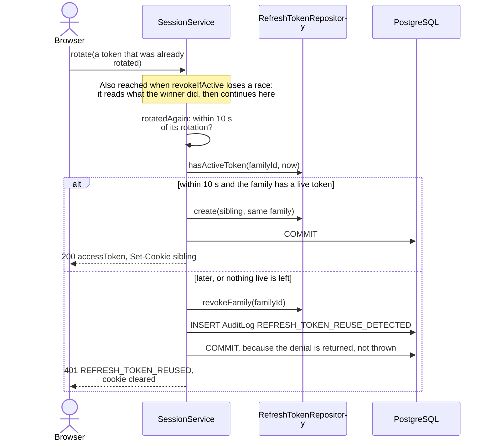

**Where in the code:** `backend/src/auth/application/session.service.ts` (`rotatedAgain`, `handleReuse`), `backend/test/sessions.e2e.ts`

### 2c. Refresh during a database outage: 503, and nobody is signed out

Only an answer about the session clears the cookie. A database failure doesn't.

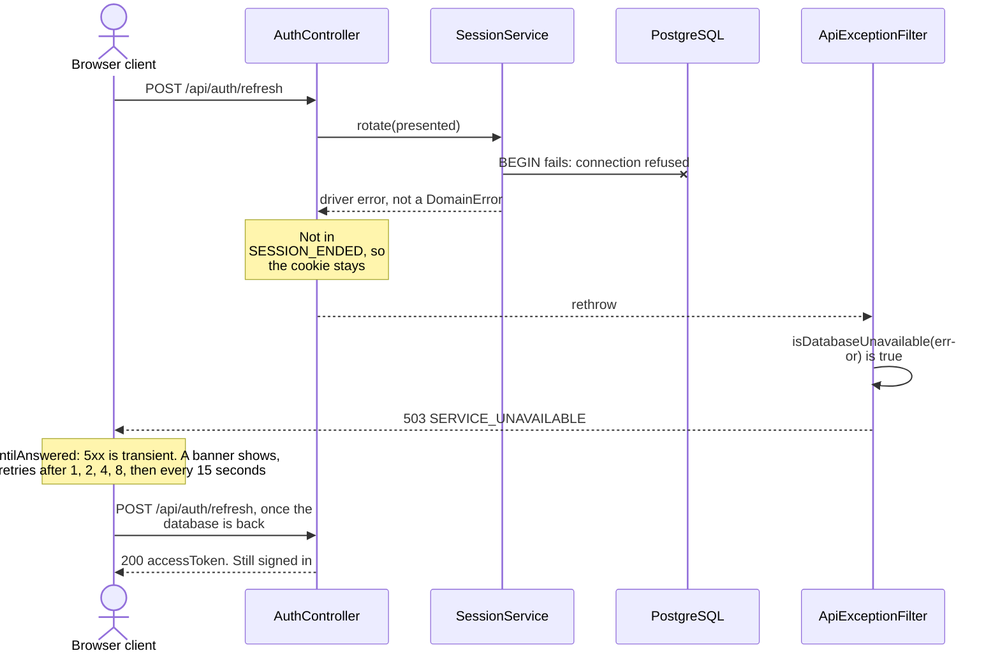

**Where in the code:** `backend/src/auth/presentation/auth.controller.ts` (`SESSION_ENDED`),
`backend/src/common/errors/database-errors.ts`, `backend/src/common/errors/api-exception.filter.ts`, `frontend/src/api/client.ts`,
`frontend/src/auth/AuthProvider.tsx`, `backend/test/database-outage.e2e.ts`, `tests/e2e/resilience.spec.ts`

### 3. Create and publish

Creating saves the cycle and its milestones together. Publishing runs every registered check under the cycle's row lock,
and commits the status and audit row together.

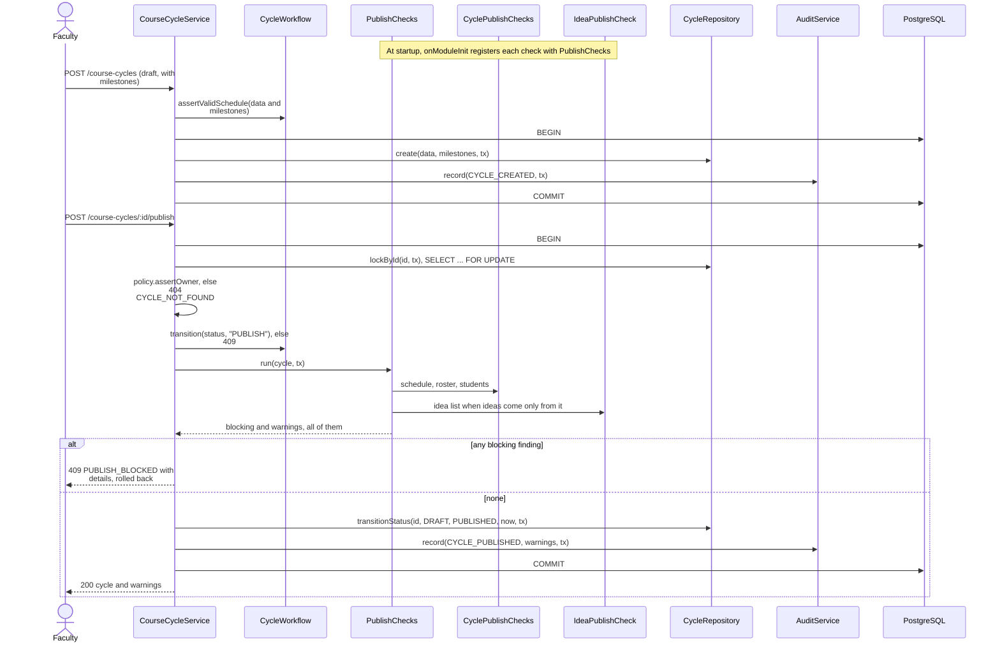

**Where in the code:** `backend/src/course-cycles/application/course-cycle.service.ts`, `backend/src/course-cycles/application/publish-checks.ts`,
`backend/src/course-cycles/application/cycle-publish-checks.ts`, `backend/src/ideas/application/idea-publish-check.ts`,
`backend/src/course-cycles/infrastructure/prisma-cycle.repository.ts`, `backend/test/course-cycles.e2e.ts`

### 4. Form a team, and the deadline lock

Nothing runs at the deadline. Each request compares the clock with `teamDeadline`, and the database settles a race.

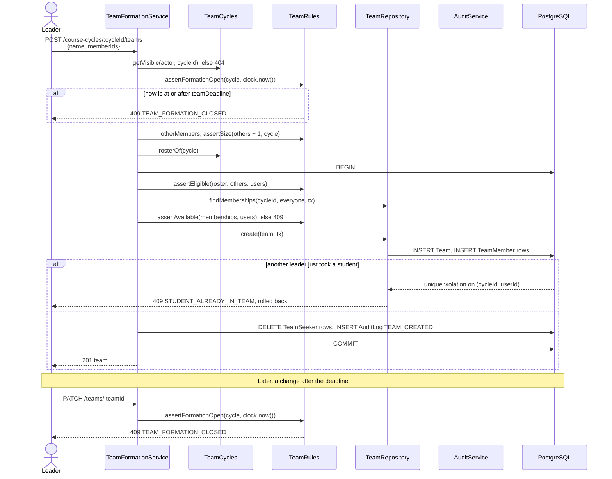

**Where in the code:** `backend/src/teams/application/team-formation.service.ts`, `backend/src/teams/domain/team-rules.ts`,
`backend/src/teams/infrastructure/prisma-team.repository.ts`, `backend/test/teams.e2e.ts`

### 5. Idea: propose, reject, revise, approve

Every change takes the team's and the idea's row locks. A decision names the version the faculty member read.

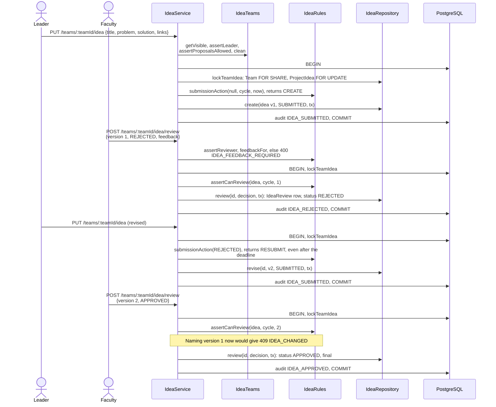

**Where in the code:** `backend/src/ideas/application/idea.service.ts`, `backend/src/ideas/domain/idea-rules.ts`,
`backend/src/ideas/infrastructure/prisma-idea.repository.ts`, `backend/test/ideas.e2e.ts`

### 6. Submit work

Validation first, then a rate limit, then a short transaction under the team's row lock.

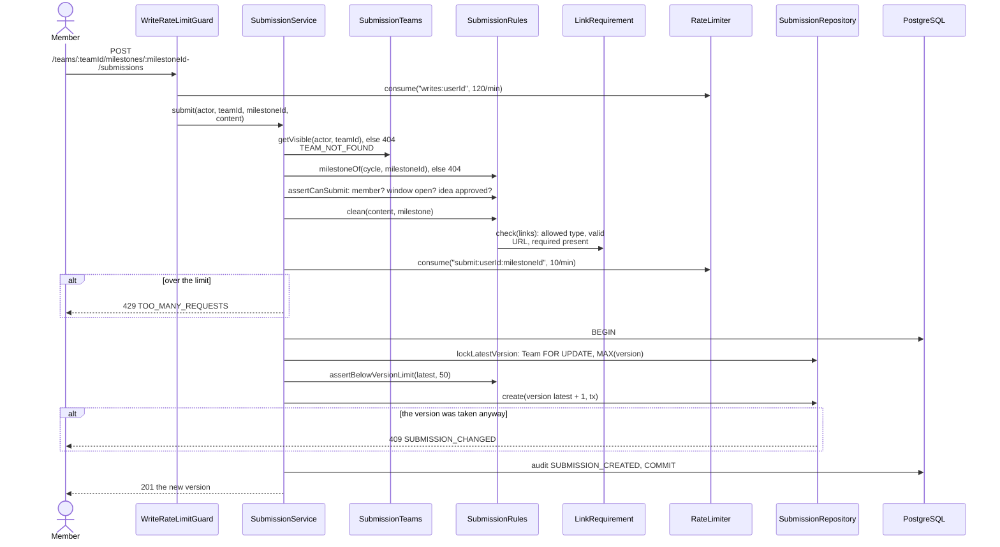

**Where in the code:** `backend/src/submissions/application/submission.service.ts`, `backend/src/submissions/domain/submission-rules.ts`,
`backend/src/common/links/link-requirement.ts`, `backend/src/common/links/link-validators.ts`,
`backend/src/submissions/infrastructure/prisma-submission.repository.ts`,
`backend/src/auth/presentation/guards/write-rate-limit.guard.ts`, `backend/test/submissions.e2e.ts`, `backend/test/write-limits.e2e.ts`

### 7. Feedback: optimistic save, release, student read

Saves don't block each other. A save based on an old version is refused. Students are filtered in the query itself.

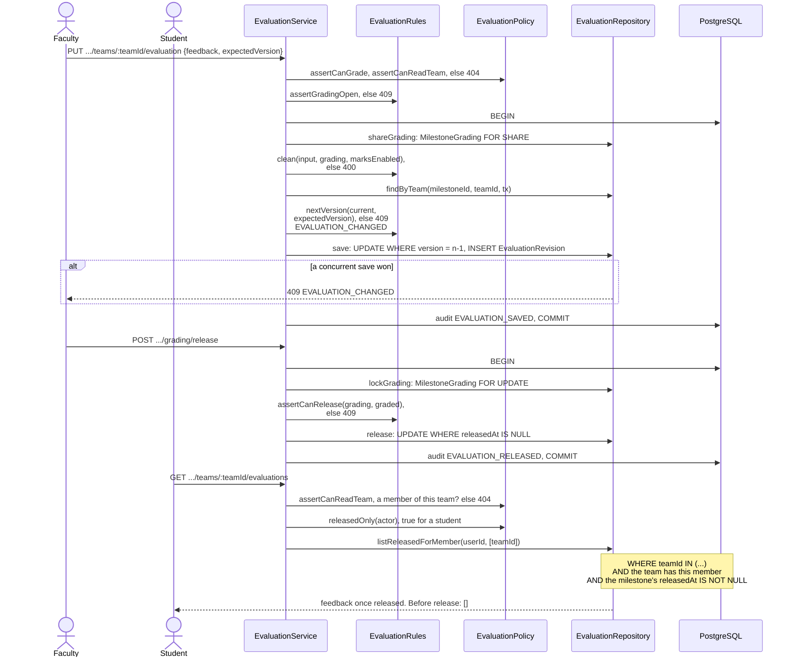

**Where in the code:** `backend/src/evaluations/application/evaluation.service.ts`, `backend/src/evaluations/domain/evaluation-rules.ts`,
`backend/src/evaluations/domain/evaluation-policy.ts`, `backend/src/evaluations/infrastructure/prisma-evaluation.repository.ts`,
`backend/test/evaluations.e2e.ts`, `backend/test/evaluations-feedback-only.e2e.ts`

### 8. The student dashboard

Each source is read once for all of the student's projects, then to-dos and updates are computed in memory. Nothing is stored.

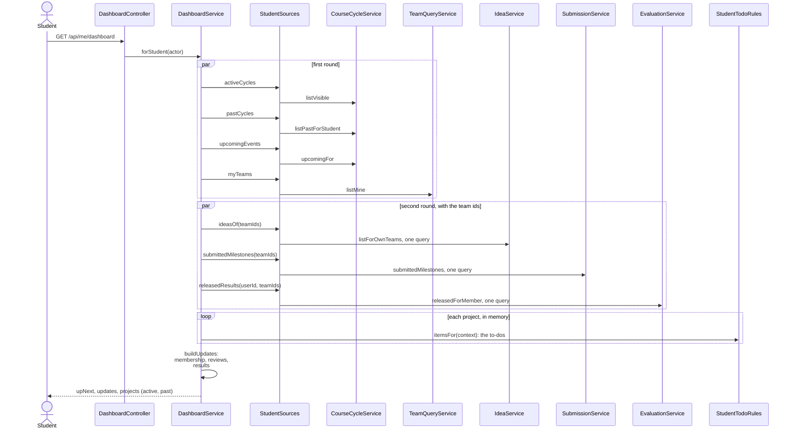

`dashboard.e2e.ts` checks that the number of statements is the same whether the student has 1 project or 5.

**Where in the code:** `backend/src/dashboard/application/dashboard.service.ts`, `backend/src/dashboard/infrastructure/modules-student-sources.ts`,
`backend/src/dashboard/domain/student-todo-rules.ts`, `backend/src/dashboard/domain/dashboard-feed.ts`, `backend/test/dashboard.e2e.ts`

## 6.2 Activity diagrams

### The project lifecycle: setup to teams

Who does what until teams are settled. Time-based steps have no job behind them: each one follows from comparing the clock with a stored date.

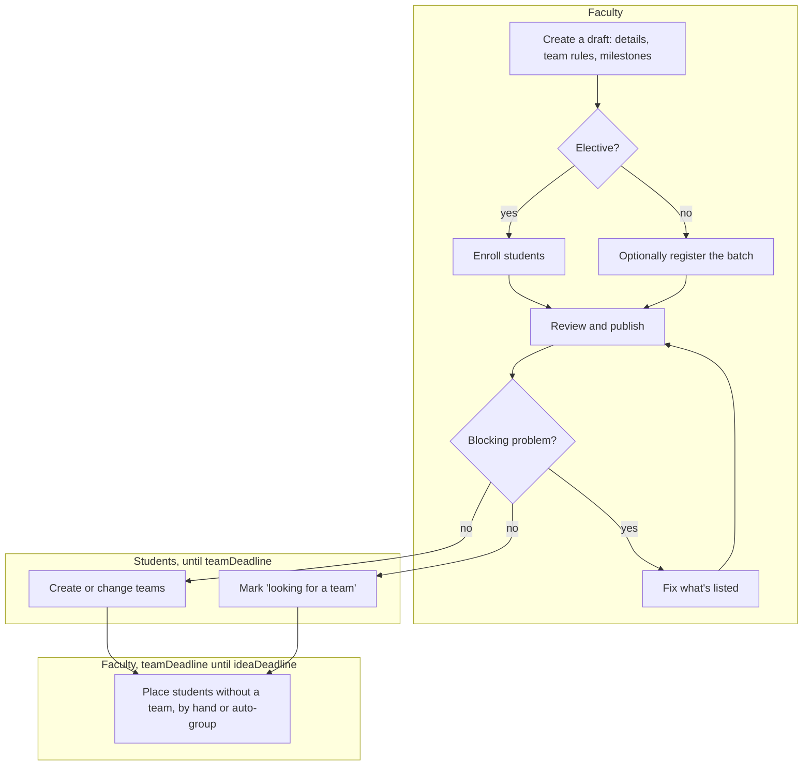

**Where in the code:** `backend/src/course-cycles/application/course-cycle.service.ts`, `backend/src/teams/domain/team-rules.ts`, `tests/e2e/lifecycle.spec.ts`

### The project lifecycle: ideas to closing

From a team's idea to the closed project. The middle part repeats for each milestone.

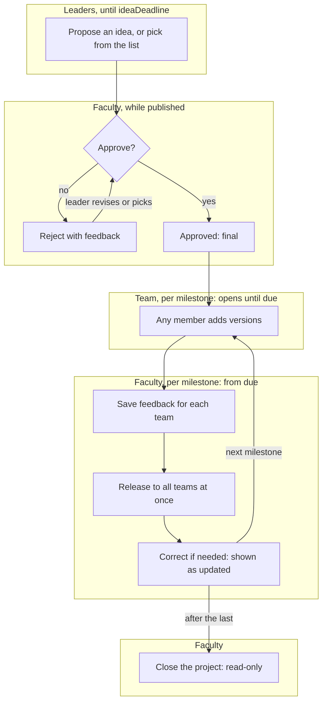

A pick is approved at once and skips the review. **Where in the code:** `backend/src/ideas/domain/idea-rules.ts`, `backend/src/submissions/domain/submission-rules.ts`,
`backend/src/evaluations/domain/evaluation-rules.ts`, `backend/src/course-cycles/domain/cycle-timeline.ts`, `tests/e2e/lifecycle.spec.ts`

### Submit work: the checks before the transaction

Each refusal returns its reason, and nothing has been locked yet. The checks run in this order; the table after the diagram says what each one means.

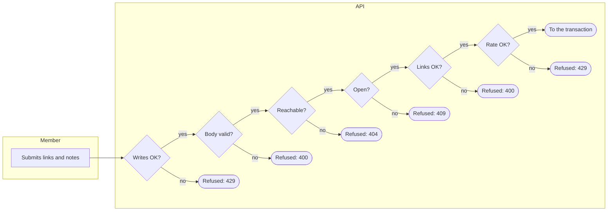

| Decision | What it checks | Refusal |
| --- | --- | --- |
| Writes OK? | Under 120 writes this minute, for this user | `429 TOO_MANY_REQUESTS` |
| Body valid? | The DTO's fields, types and lengths | `400 VALIDATION_FAILED` |
| Reachable? | The team is visible, the milestone belongs to its cycle, and the caller is a member | `404 TEAM_NOT_FOUND`, `404 MILESTONE_NOT_FOUND` |
| Open? | The window is open, and the team's idea is approved | `409 SUBMISSION_NOT_OPEN`, `SUBMISSION_CLOSED`, `IDEA_NOT_APPROVED` |
| Links OK? | The links meet the milestone's requirement | `400 MISSING_REQUIRED_LINK`, `LINK_NOT_ALLOWED`, `INVALID_LINK` |
| Rate OK? | Under 10 submissions this minute, for this member and milestone | `429 TOO_MANY_REQUESTS` |

**Where in the code:** `backend/src/submissions/application/submission.service.ts`, `backend/src/submissions/domain/submission-rules.ts`,
`backend/src/auth/presentation/guards/write-rate-limit.guard.ts`, `backend/src/common/links/link-requirement.ts`

### Submit work: the transaction

The team's row lock makes members take turns, so each gets the next version number.

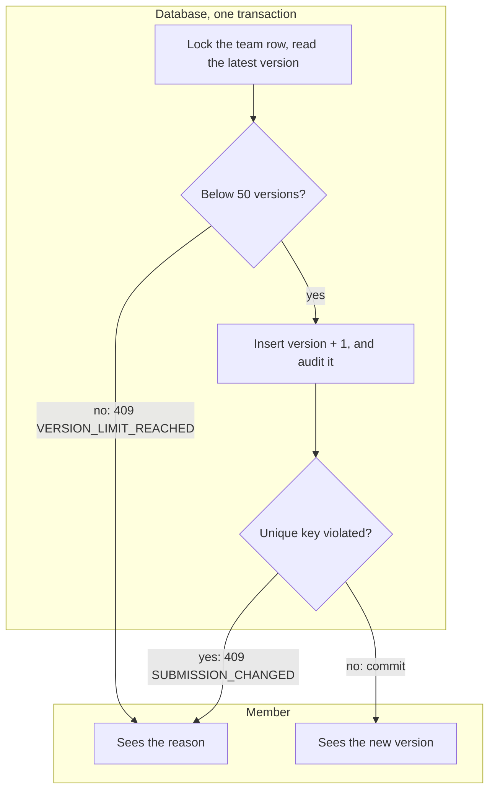

**Where in the code:** `backend/src/submissions/application/submission.service.ts`, `backend/src/submissions/infrastructure/prisma-submission.repository.ts`

### Sign-in: verifying the answer

From the first click to a verified identity.

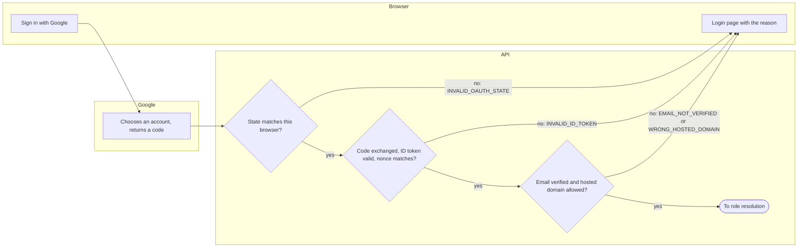

**Where in the code:** `backend/src/auth/application/auth.service.ts`, `backend/src/auth/application/sign-in.service.ts`, `backend/src/auth/infrastructure/google-identity.provider.ts`

### Sign-in: role resolution

The order of the checks in `RoleResolver` is the rule: deactivation first, then a student email is always `STUDENT`, and only a staff-shaped email can become anything else.

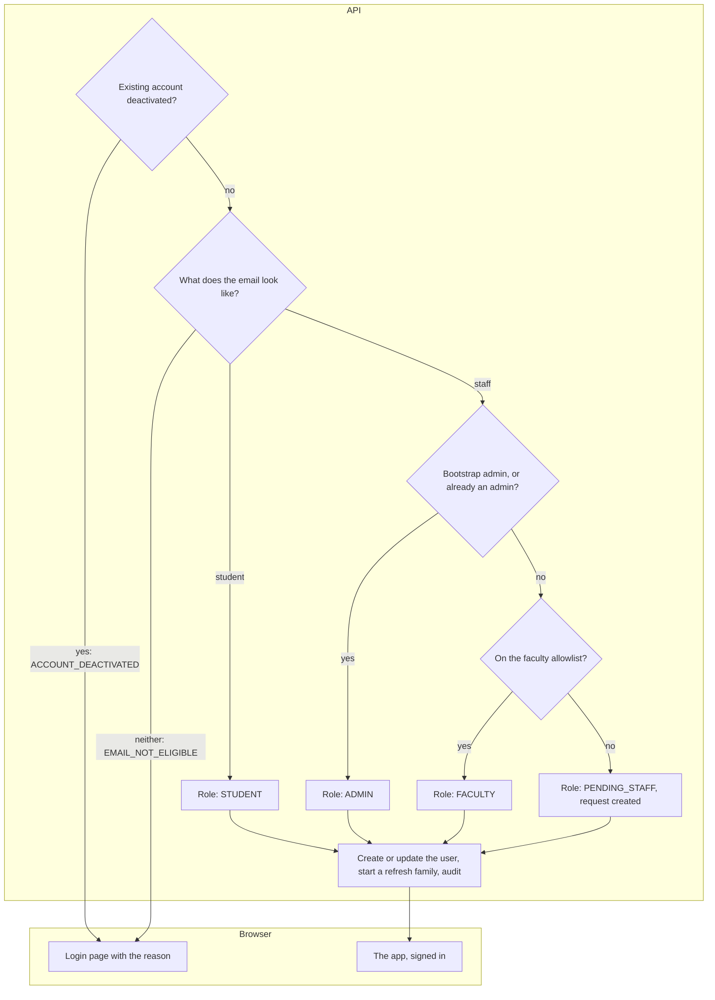

**Where in the code:** `backend/src/auth/application/sign-in.service.ts`, `backend/src/auth/domain/role-resolver.ts`, `backend/src/auth/infrastructure/rishihood-identity-parser.ts`

## 6.3 State diagrams

### Cycle

The stored state is `status`. The stages inside `PUBLISHED` are computed by `CycleTimeline`, and never stored.

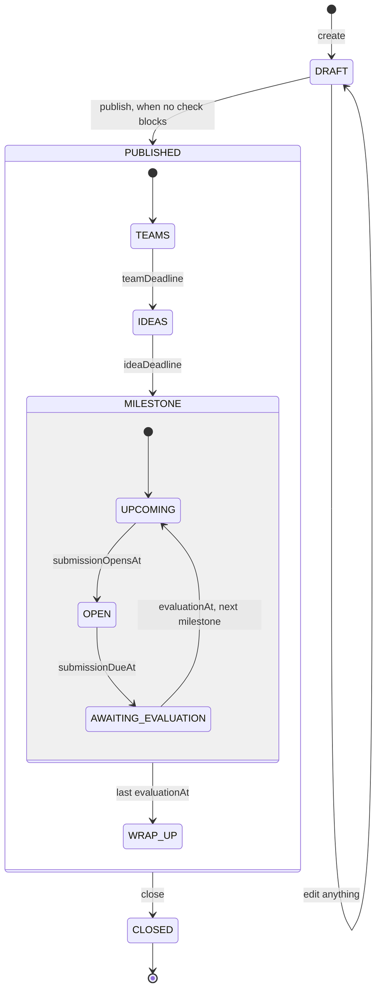

There's no `CLOSED → PUBLISHED` or `PUBLISHED → DRAFT`: `CycleWorkflow.transitions` has no such entry, so they answer
`409 CYCLE_ALREADY_CLOSED` or `409 INVALID_STATUS_TRANSITION`.

**Where in the code:** `backend/src/course-cycles/domain/cycle-workflow.ts`, `backend/src/course-cycles/domain/cycle-timeline.ts`

### Submission

**A submission has no stored state.** Each version is an immutable row, so there's nothing to transition. What changes is
the milestone's window, computed by `SubmissionRules.window`. The newest version before the due time is the team's final
work, with no "final" flag to disagree with it.

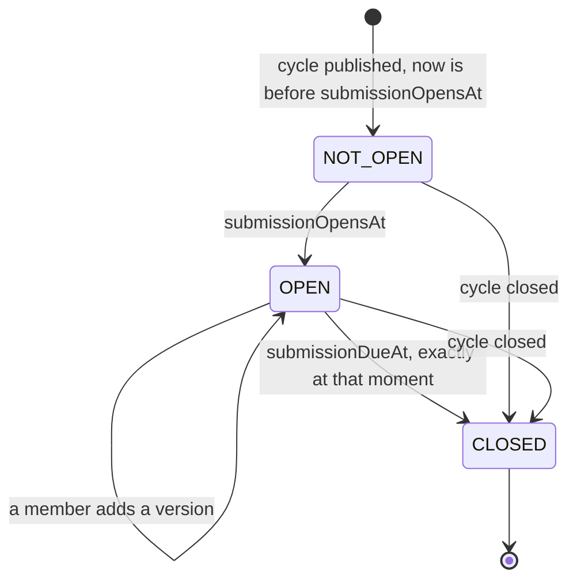

**Where in the code:** `backend/src/submissions/domain/submission-rules.ts` (`window`), `backend/src/submissions/domain/submission.ts`

### Idea

The stored `status` of `ProjectIdea`. Every change of content raises `version`.

```mermaid
stateDiagram-v2
  [*] --> SUBMITTED: leader proposes, before ideaDeadline
  [*] --> APPROVED: leader picks from the list, before ideaDeadline
  SUBMITTED --> SUBMITTED: leader edits, before ideaDeadline
  SUBMITTED --> APPROVED: owner approves the version read
  SUBMITTED --> APPROVED: leader picks instead, before ideaDeadline
  SUBMITTED --> REJECTED: owner rejects, with feedback
  REJECTED --> SUBMITTED: leader revises, any time while published
  REJECTED --> APPROVED: leader picks, any time while published
  APPROVED --> [*]
```

An idea left in `SUBMITTED` when the deadline passes stays there: the leader can't edit it (`IDEA_SUBMISSION_CLOSED`), and
the owner can still review it. Once the cycle is closed, nothing changes (`IDEA_REVIEW_CLOSED`, `IDEA_RESUBMISSION_CLOSED`).

**Where in the code:** `backend/src/ideas/domain/idea-rules.ts` (`submissionAction`, `assertCanReview`), `backend/src/ideas/domain/idea.ts`

### Evaluation

There's no status column. The state is derived from whether a row exists and whether its milestone's `releasedAt` is set.

```mermaid
stateDiagram-v2
  [*] --> NotGraded: milestone due, cycle published
  NotGraded --> Hidden: first save, version 1
  Hidden --> Hidden: save, version + 1, expectedVersion must match
  Hidden --> Released: owner releases the milestone
  NotGraded --> ReleasedWithout: owner releases; this team has no evaluation
  ReleasedWithout --> Updated: first save after release, visible at once
  Released --> Updated: save after release
  Updated --> Updated: another save
  Released --> [*]
  Updated --> [*]
```

`Updated` is `EvaluationRules.isUpdatedAfterRelease`: `updatedAt > releasedAt`. Release is one-way, because no code sets
`releasedAt` back to null. A release needs at least one graded team (`NOTHING_TO_RELEASE`).

**Where in the code:** `backend/src/evaluations/domain/evaluation-rules.ts`, `backend/src/evaluations/infrastructure/prisma-evaluation.repository.ts`,
`backend/test/evaluations.e2e.ts`

### Team (there is no team invite)

**A team invite doesn't exist in FlowForge.** ADR 007 decided that a leader adds members directly, and they're members at
once, so there's no invitation table, status or route (`backend/src/teams/application/team-formation.service.ts`). This
diagram shows the real lifecycle of a team instead. Membership has no stored state either: a `TeamMember` row exists or it
doesn't.

```mermaid
stateDiagram-v2
  [*] --> Forming: leader creates it, before teamDeadline
  [*] --> Placed: faculty create it or auto-group, teamDeadline until ideaDeadline
  Forming --> Forming: leader renames or changes members
  Forming --> [*]: leader disbands; member rows and idea go with it
  Forming --> Fixed: teamDeadline, or the cycle closes
  Placed --> Placed: faculty add a member, while there's room
  Placed --> Fixed: ideaDeadline, or the cycle closes
  Fixed --> Fixed: faculty add a member, until ideaDeadline
  Fixed --> [*]: never deleted
```

**Where in the code:** `backend/src/teams/domain/team-rules.ts`, `backend/src/teams/application/team-formation.service.ts`,
`backend/src/teams/application/team-completion.service.ts`, `docs/decisions/007-leader-forms-team-without-invitations.md`

### Refresh-token family

The session's life, with the grace window from ADR 023.

```mermaid
stateDiagram-v2
  [*] --> Live: sign-in starts a family
  Live --> Live: refresh rotates the token
  Live --> Live: rotated token again within 10 s, a sibling is issued
  Live --> Ended: rotated token again after 10 s, reuse detected
  Live --> Ended: sign out, sign out everywhere, or deactivation
  Live --> Expired: token or family expires
  Ended --> [*]
  Expired --> [*]
```

**Where in the code:** `backend/src/auth/application/session.service.ts`
