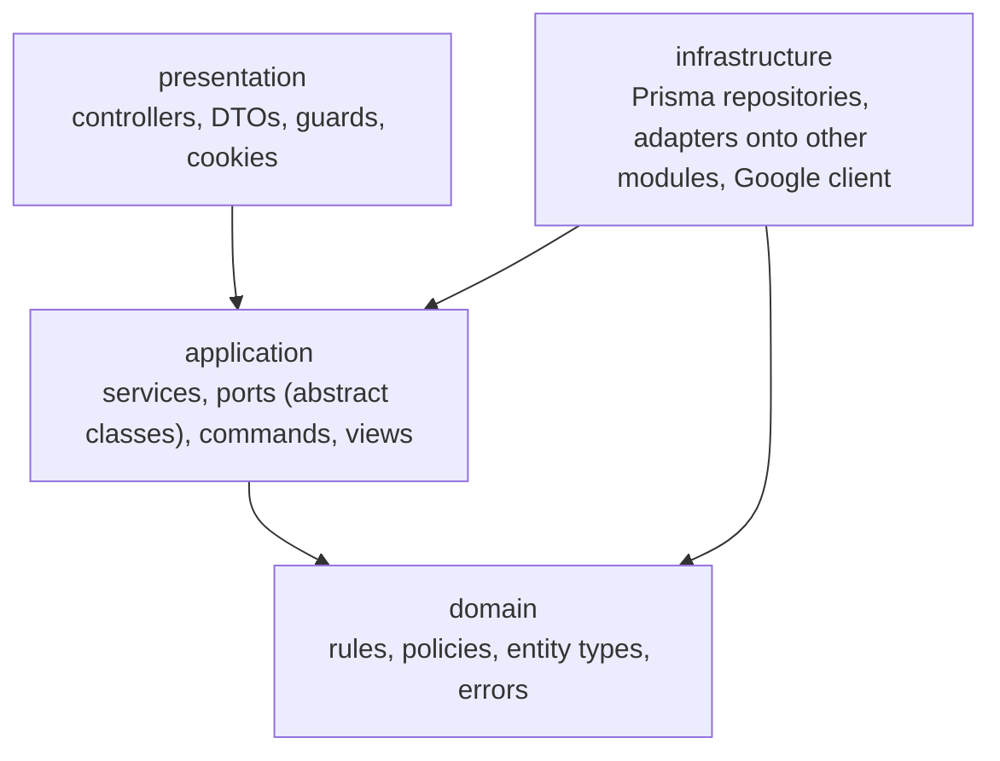

# 7 · API and interfaces

The routes come from the controllers' decorators, read through the TypeScript AST. The error codes come from reading each service's paths.

## 7.1 Layers and the dependency rule

### Layer diagram

Every module has the same layers, and dependencies point inward. The domain depends on nothing. `infrastructure` implements ports owned by `application`.



**Where in the code:** `backend/src/teams/presentation/`, `backend/src/teams/application/`, `backend/src/teams/domain/`, `backend/src/teams/infrastructure/`

### The rule, and how it's enforced

**`application/`, `domain/` and `infrastructure/` never import `presentation/`.** Services take plain commands and return domain objects or views. DTOs implement the
commands, and controllers map the results.

`npm run lint` enforces it with `no-restricted-imports` in `backend/eslint.config.mjs`, and `backend/test/layering.e2e.ts` proves the rule refuses a planted violation in each of the
three layers and that every file in `src` passes today.

```js
            {
              group: ["**/presentation", "**/presentation/**"],
              message:
                "application, domain and infrastructure never import presentation: pass plain commands and views instead.",
            },
```

**Between modules:** a module reaches another only through an adapter calling that module's exported service, never its tables. `IdeasSubmissionTeams`, in
`infrastructure/`, is the only place submissions touch `IdeaService`.

**Limits, stated plainly:**

- `admin/` is flat, with a controller and a service and no `application/` folder. It imports nothing from any `presentation/`.
- `audit/` and `users/` have `domain/` and `infrastructure/`, with their service at the module root.
- The rule only covers `presentation`. Nothing mechanically stops `domain/` importing `infrastructure/`, though a review of the code finds no case of it.
- Modules share some domain types directly, for example `TeamActor` in `submissions` and `CycleRoster` in `teams`. These are types and pure classes, not services or tables.

## 7.2 Routes

All routes are under `/api`: 66 in total. **Every protected route can also answer** `401 UNAUTHENTICATED`, `TOKEN_REVOKED` or `ACCOUNT_DEACTIVATED`, `403 FORBIDDEN_ROLE` or
`FACULTY_APPROVAL_PENDING`, `400 VALIDATION_FAILED` and `BODY_TOO_DEEP`, and `503 SERVICE_UNAVAILABLE`. **Every authenticated write** can also answer `429 TOO_MANY_REQUESTS` (120 per user
per minute). The tables list only what each route adds. "S", "F" and "A" mean student, faculty and admin.

### Auth

| Method | Path | Role | Request | Response | Status | Error codes |
| --- | --- | --- | --- | --- | --- | --- |
| GET | `/auth/google` | public | none | redirect | 302 | `TOO_MANY_REQUESTS` (per IP) |
| GET | `/auth/google/callback` | public | query `code`, `state`, `error` | redirect | 302 | Sent as `/login?error=CODE`: `SIGN_IN_CANCELLED`, `INVALID_OAUTH_STATE`, `INVALID_ID_TOKEN`, `EMAIL_NOT_VERIFIED`, `WRONG_HOSTED_DOMAIN`, `EMAIL_NOT_ELIGIBLE`, `INVALID_BATCH_YEAR`, `ACCOUNT_DEACTIVATED`, `IDENTITY_CONFLICT`, `TOO_MANY_REQUESTS` |
| POST | `/auth/dev-login` | public, `DevLoginGuard`, `OriginGuard` | `DevLoginDto` | none, sets the cookie | 204 | `DEV_LOGIN_DISABLED`, `ORIGIN_NOT_ALLOWED`, the sign-in denials above, `TOO_MANY_REQUESTS` |
| GET | `/auth/dev-login/accounts` | public, `DevLoginGuard` | none | `DemoAccountDto[]` | 200 | `DEV_LOGIN_DISABLED` |
| POST | `/auth/refresh` | public, `OriginGuard` | cookie | `AccessTokenResponseDto` | 200 | `ORIGIN_NOT_ALLOWED`, `INVALID_REFRESH_TOKEN`, `TOKEN_REVOKED`, `REFRESH_TOKEN_REUSED`, `ACCOUNT_DEACTIVATED`, `TOO_MANY_REQUESTS` |
| POST | `/auth/logout` | public, `OriginGuard` | cookie | none | 204 | `ORIGIN_NOT_ALLOWED` |
| POST | `/auth/logout-all` | all roles | none | none | 204 | none |
| GET | `/auth/me` | all roles | none | `MeResponseDto` | 200 | none |

### Health

| Method | Path | Role | Request | Response | Status | Error codes |
| --- | --- | --- | --- | --- | --- | --- |
| GET | `/health` | public | none | `HealthReport` | 200 | `503 SERVICE_UNAVAILABLE` |

### Course cycles

"Schedule codes" means `INVALID_DEADLINE`, `INVALID_TEAM_SIZE`, `INVALID_TEAM_DEADLINE`, `INVALID_IDEA_DEADLINE`, `INVALID_MILESTONE`, `INVALID_MILESTONE_COUNT`, `DUPLICATE_MILESTONE_NAME`,
`INVALID_MILESTONE_SCHEDULE`, `INVALID_ACADEMIC_YEAR` and `INVALID_LINK_REQUIREMENT`.

| Method | Path | Role | Request | Response | Status | Error codes |
| --- | --- | --- | --- | --- | --- | --- |
| POST | `/course-cycles` | F | `CreateCycleDto` | `CycleResponseDto` | 201 | Schedule codes, `MILESTONE_NOT_FOUND` |
| GET | `/course-cycles` | S, A | none | `CycleResponseDto[]` | 200 | none |
| GET | `/course-cycles/my` | F | none | `CycleResponseDto[]` | 200 | none |
| GET | `/course-cycles/:id` | S, F, A | none | `CycleResponseDto` | 200 | `CYCLE_NOT_FOUND` |
| PATCH | `/course-cycles/:id` | F | `UpdateCycleDto` | `CycleResponseDto` | 200 | `CYCLE_NOT_FOUND`, `CYCLE_FIELD_LOCKED`, `CYCLE_ALREADY_CLOSED`, `MILESTONES_LOCKED`, `MILESTONE_LOCKED`, `MILESTONE_NOT_FOUND`, `INVALID_STATUS_TRANSITION`, schedule codes |
| GET | `/course-cycles/:id/publish-checks` | F | none | `PublishChecksDto` | 200 | `CYCLE_NOT_FOUND`, `INVALID_STATUS_TRANSITION`, `CYCLE_ALREADY_CLOSED` |
| POST | `/course-cycles/:id/publish` | F | none | `PublishResponseDto` | 200 | `CYCLE_NOT_FOUND`, `PUBLISH_BLOCKED` (with `details`), `INVALID_STATUS_TRANSITION`, `CYCLE_ALREADY_CLOSED` |
| POST | `/course-cycles/:id/close` | F | none | `CycleResponseDto` | 200 | `CYCLE_NOT_FOUND`, `INVALID_STATUS_TRANSITION`, `CYCLE_ALREADY_CLOSED` |
| GET | `/course-cycles/:cycleId/batch-students` | F | none | `BatchStudentDto[]` | 200 | `CYCLE_NOT_FOUND`, `CYCLE_NOT_CORE` |
| POST | `/course-cycles/:cycleId/batch-students` | F | `AddEnrollmentsDto` | `BatchImportResultDto` | 201 | `CYCLE_NOT_FOUND`, `CYCLE_NOT_CORE`, `CYCLE_ALREADY_CLOSED` |
| GET | `/course-cycles/:cycleId/enrollments` | F | none | `EnrolledStudentDto[]` | 200 | `CYCLE_NOT_FOUND`, `CYCLE_NOT_ELECTIVE` |
| POST | `/course-cycles/:cycleId/enrollments` | F | `AddEnrollmentsDto` | `EnrollmentResultDto` | 201 | `CYCLE_NOT_FOUND`, `CYCLE_NOT_ELECTIVE`, `CYCLE_ALREADY_CLOSED` |
| DELETE | `/course-cycles/:cycleId/enrollments/:email` | F | none | none | 204 | `CYCLE_NOT_FOUND`, `CYCLE_NOT_ELECTIVE`, `CYCLE_ALREADY_CLOSED`, `ENROLLMENT_NOT_FOUND`, `ENROLLED_STUDENT_IN_TEAM` |
| GET | `/me/upcoming` | S | none | `UpcomingEventDto[]` | 200 | none |

**Where in the code:** `backend/src/course-cycles/presentation/course-cycle.controller.ts`, `backend/src/course-cycles/presentation/cycle-batch.controller.ts`,
`backend/src/course-cycles/presentation/cycle-enrollment.controller.ts`, `backend/src/course-cycles/presentation/me.controller.ts`

### Teams

| Method | Path | Role | Request | Response | Status | Error codes |
| --- | --- | --- | --- | --- | --- | --- |
| POST | `/course-cycles/:cycleId/teams` | S | `CreateTeamDto` | `TeamResponseDto` | 201 | `CYCLE_NOT_FOUND`, `TEAM_FORMATION_CLOSED`, `TEAM_SIZE_OUT_OF_RANGE`, `INELIGIBLE_TEAM_MEMBER`, `STUDENT_ALREADY_IN_TEAM` |
| GET | `/course-cycles/:cycleId/teams` | S, F, A | none | `TeamResponseDto[]` | 200 | `CYCLE_NOT_FOUND` |
| GET | `/course-cycles/:cycleId/team-candidates` | S | `TeamCandidatesQueryDto` | `TeamCandidateDto[]` | 200 | `CYCLE_NOT_FOUND`, `TEAM_FORMATION_CLOSED` |
| GET | `/course-cycles/:cycleId/looking-for-team` | S | none | `TeamCandidateDto[]` | 200 | `CYCLE_NOT_FOUND`, `TEAM_FORMATION_CLOSED` |
| PUT | `/course-cycles/:cycleId/looking-for-team` | S | `LookingForTeamDto` | none | 204 | `CYCLE_NOT_FOUND`, `TEAM_FORMATION_CLOSED`, `STUDENT_ALREADY_IN_TEAM` |
| DELETE | `/course-cycles/:cycleId/looking-for-team` | S | none | none | 204 | `CYCLE_NOT_FOUND` |
| GET | `/course-cycles/:cycleId/team-completion` | F, A | none | `CompletionOverviewDto` | 200 | `CYCLE_NOT_FOUND` |
| POST | `/course-cycles/:cycleId/team-completion/teams` | F | `FacultyTeamDto` | `TeamResponseDto` | 201 | `CYCLE_NOT_FOUND`, `TEAM_COMPLETION_CLOSED`, `TEAM_SIZE_OUT_OF_RANGE`, `INELIGIBLE_TEAM_MEMBER`, `STUDENT_ALREADY_IN_TEAM` |
| POST | `/course-cycles/:cycleId/team-completion/auto-group/preview` | F | none | `AutoGroupPreviewDto` | 200 | `CYCLE_NOT_FOUND`, `TEAM_COMPLETION_CLOSED` |
| POST | `/course-cycles/:cycleId/team-completion/auto-group` | F | `ApplyAutoGroupDto` | `TeamResponseDto[]` | 201 | The codes of the manual team route, `DUPLICATE_TEAM_MEMBER` |
| GET | `/teams/mine` | S | none | `TeamResponseDto[]` | 200 | none |
| GET | `/teams/:teamId` | S, F, A | none | `TeamResponseDto` | 200 | `TEAM_NOT_FOUND` |
| PATCH | `/teams/:teamId` | S | `UpdateTeamDto` | `TeamResponseDto` | 200 | `TEAM_NOT_FOUND`, `NOT_TEAM_LEADER`, `TEAM_FORMATION_CLOSED`, `TEAM_SIZE_OUT_OF_RANGE`, `INELIGIBLE_TEAM_MEMBER`, `STUDENT_ALREADY_IN_TEAM` |
| DELETE | `/teams/:teamId` | S | none | none | 204 | `TEAM_NOT_FOUND`, `NOT_TEAM_LEADER`, `TEAM_FORMATION_CLOSED` |
| POST | `/teams/:teamId/members` | F | `AddTeamMemberDto` | `TeamResponseDto` | 200 | `TEAM_NOT_FOUND`, `TEAM_COMPLETION_CLOSED`, `TEAM_FULL`, `INELIGIBLE_TEAM_MEMBER`, `STUDENT_ALREADY_IN_TEAM` |

**Where in the code:** `backend/src/teams/presentation/cycle-teams.controller.ts`, `backend/src/teams/presentation/teams.controller.ts`,
`backend/src/teams/presentation/team-completion.controller.ts`

### Ideas

| Method | Path | Role | Request | Response | Status | Error codes |
| --- | --- | --- | --- | --- | --- | --- |
| GET | `/teams/:teamId/idea` | S, F, A | none | `TeamIdeaDto` | 200 | `TEAM_NOT_FOUND` |
| PUT | `/teams/:teamId/idea` | S | `SubmitIdeaDto` | `IdeaResponseDto` | 200 | `TEAM_NOT_FOUND`, `NOT_TEAM_LEADER`, `PROPOSALS_NOT_ALLOWED`, `IDEA_SUBMISSION_CLOSED`, `IDEA_RESUBMISSION_CLOSED`, `IDEA_ALREADY_APPROVED`, `IDEA_CHANGED`, `MISSING_REQUIRED_LINK`, `LINK_NOT_ALLOWED`, `INVALID_LINK` |
| POST | `/teams/:teamId/idea/pick` | S | `PickIdeaDto` | `IdeaResponseDto` | 200 | `TEAM_NOT_FOUND`, `NOT_TEAM_LEADER`, `CATALOG_NOT_ALLOWED`, `CATALOG_IDEA_NOT_FOUND`, `IDEA_SUBMISSION_CLOSED`, `IDEA_RESUBMISSION_CLOSED`, `IDEA_ALREADY_APPROVED`, `IDEA_CHANGED` |
| POST | `/teams/:teamId/idea/review` | F | `ReviewIdeaDto` | `IdeaResponseDto` | 200 | `TEAM_NOT_FOUND`, `IDEA_NOT_FOUND`, `IDEA_FEEDBACK_REQUIRED`, `IDEA_REVIEW_CLOSED`, `IDEA_NOT_AWAITING_REVIEW`, `IDEA_CHANGED` |
| GET | `/course-cycles/:cycleId/ideas` | F, A | none | `CycleIdeaDto[]` | 200 | `CYCLE_NOT_FOUND` |
| GET | `/course-cycles/:cycleId/idea-catalog` | S, F, A | none | `CatalogIdeaDto[]` | 200 | `CYCLE_NOT_FOUND` |
| POST | `/course-cycles/:cycleId/idea-catalog` | F | `CatalogIdeaRequestDto` | `CatalogIdeaDto` | 201 | `CYCLE_NOT_FOUND`, `CATALOG_IDEA_NOT_FOUND`, `CATALOG_CLOSED`, `CATALOG_NOT_ALLOWED`, `INVALID_LINK` |
| PUT | `/course-cycles/:cycleId/idea-catalog/:ideaId` | F | `CatalogIdeaRequestDto` | `CatalogIdeaDto` | 200 | `CYCLE_NOT_FOUND`, `CATALOG_IDEA_NOT_FOUND`, `CATALOG_CLOSED`, `INVALID_LINK` |
| DELETE | `/course-cycles/:cycleId/idea-catalog/:ideaId` | F | none | none | 204 | `CYCLE_NOT_FOUND`, `CATALOG_IDEA_NOT_FOUND`, `CATALOG_CLOSED`, `CATALOG_IDEA_PICKED` |

**Where in the code:** `backend/src/ideas/presentation/ideas.controller.ts`, `backend/src/ideas/presentation/cycle-ideas.controller.ts`,
`backend/src/ideas/presentation/idea-catalog.controller.ts`

### Submissions

| Method | Path | Role | Request | Response | Status | Error codes |
| --- | --- | --- | --- | --- | --- | --- |
| GET | `/teams/:teamId/milestones/:milestoneId/submissions` | S, F, A | `SubmissionHistoryQueryDto` | `SubmissionDto[]` | 200 | `TEAM_NOT_FOUND`, `MILESTONE_NOT_FOUND` |
| POST | `/teams/:teamId/milestones/:milestoneId/submissions` | S | `SubmitWorkDto` | `SubmissionDto` | 201 | `TEAM_NOT_FOUND`, `MILESTONE_NOT_FOUND`, `SUBMISSION_NOT_OPEN`, `SUBMISSION_CLOSED`, `IDEA_NOT_APPROVED`, `MISSING_REQUIRED_LINK`, `LINK_NOT_ALLOWED`, `INVALID_LINK`, `TOO_MANY_REQUESTS`, `VERSION_LIMIT_REACHED`, `SUBMISSION_CHANGED` |
| GET | `/course-cycles/:cycleId/milestones/:milestoneId/submissions` | F, A | none | `CycleSubmissionDto[]` | 200 | `CYCLE_NOT_FOUND`, `MILESTONE_NOT_FOUND` |

**Where in the code:** `backend/src/submissions/presentation/submissions.controller.ts`, `backend/src/submissions/presentation/cycle-submissions.controller.ts`

### Evaluations

The prefix is `/course-cycles/:cycleId/milestones/:milestoneId`.

| Method | Path | Role | Request | Response | Status | Error codes |
| --- | --- | --- | --- | --- | --- | --- |
| GET | `/grading` | S, F, A (students reach the policy, and get 404) | none | `GradingDto` | 200 | `CYCLE_NOT_FOUND`, `MILESTONE_NOT_FOUND`, `TEAM_NOT_FOUND` |
| PUT | `/grading` | F | `MaxMarksDto` | `GradingDto` | 200 | `CYCLE_NOT_FOUND`, `MILESTONE_NOT_FOUND`, `TEAM_NOT_FOUND`, `MARKS_DISABLED`, `GRADING_CLOSED`, `INVALID_MAX_MARKS`, `MAX_MARKS_BELOW_EXISTING` |
| POST | `/grading/release` | F | none | `GradingDto` | 200 | `CYCLE_NOT_FOUND`, `MILESTONE_NOT_FOUND`, `TEAM_NOT_FOUND`, `GRADING_CLOSED`, `GRADING_NOT_OPEN`, `ALREADY_RELEASED`, `NOTHING_TO_RELEASE` |
| PUT | `/teams/:teamId/evaluation` | F | `SaveEvaluationDto` | `TeamEvaluationDto` | 200 | `CYCLE_NOT_FOUND`, `MILESTONE_NOT_FOUND`, `TEAM_NOT_FOUND`, `GRADING_CLOSED`, `GRADING_NOT_OPEN`, `MARKS_DISABLED`, `EMPTY_EVALUATION`, `MAX_MARKS_NOT_SET`, `INVALID_MARKS`, `EVALUATION_CHANGED` |
| GET | `/teams/:teamId/evaluations` | S, F, A | none | `TeamEvaluationDto[]` | 200 | `CYCLE_NOT_FOUND`, `MILESTONE_NOT_FOUND`, `TEAM_NOT_FOUND` |

**Where in the code:** `backend/src/evaluations/presentation/evaluations.controller.ts`

### Dashboard

| Method | Path | Role | Request | Response | Status | Error codes |
| --- | --- | --- | --- | --- | --- | --- |
| GET | `/me/dashboard` | S | none | `StudentDashboardDto` | 200 | none |

**Where in the code:** `backend/src/dashboard/presentation/dashboard.controller.ts`

### Admin

| Method | Path | Role | Request | Response | Status | Error codes |
| --- | --- | --- | --- | --- | --- | --- |
| GET | `/admin/faculty-allowlist` | A | none | `AllowlistEntryDto[]` | 200 | none |
| POST | `/admin/faculty-allowlist` | A | `AddAllowlistEntryDto` | `AllowlistEntryDto` | 201 | `ALLOWLIST_ENTRY_EXISTS`, `STUDENT_EMAIL_CANNOT_BE_ELEVATED`, `INVALID_STAFF_EMAIL` |
| DELETE | `/admin/faculty-allowlist/:id` | A | none | none | 204 | `ALLOWLIST_ENTRY_NOT_FOUND` |
| GET | `/admin/faculty-requests` | A | `ListFacultyRequestsQueryDto` | `FacultyRequestDto[]` | 200 | none |
| POST | `/admin/faculty-requests/:id/approve` | A | none | `FacultyRequestDto` | 200 | `FACULTY_REQUEST_NOT_FOUND`, `FACULTY_REQUEST_ALREADY_DECIDED`, `STUDENT_EMAIL_CANNOT_BE_ELEVATED`, `INVALID_STAFF_EMAIL` |
| POST | `/admin/faculty-requests/:id/reject` | A | none | `FacultyRequestDto` | 200 | `FACULTY_REQUEST_NOT_FOUND`, `FACULTY_REQUEST_ALREADY_DECIDED` |
| GET | `/admin/users` | A | `ListUsersQueryDto` | `UserPageDto` | 200 | none |
| PATCH | `/admin/users/:id/batch` | A | `CorrectBatchDto` | `AdminUserDto` | 200 | `USER_NOT_FOUND`, `USER_NOT_A_STUDENT`, `INVALID_BATCH_YEAR` |
| POST | `/admin/users/:id/deactivate` | A | none | `AdminUserDto` | 200 | `USER_NOT_FOUND`, `CANNOT_DEACTIVATE_SELF` |
| POST | `/admin/users/:id/reactivate` | A | none | `AdminUserDto` | 200 | `USER_NOT_FOUND` |

**Where in the code:** `backend/src/admin/admin.controller.ts`, `backend/src/admin/dto/admin-requests.dto.ts`, `backend/src/admin/dto/admin-responses.dto.ts`

## 7.3 Key signatures

Copied from the code.

### Services

`backend/src/teams/application/team-formation.service.ts`:

```ts
  async create(
    actor: TeamActor,
    cycleId: string,
    input: CreateTeamInput,
  ): Promise<Team> {
```

`backend/src/submissions/application/submission.service.ts`:

```ts
  async submit(
    actor: TeamActor,
    teamId: string,
    milestoneId: string,
    content: SubmissionContent,
  ): Promise<Submission> {
```

`backend/src/evaluations/application/evaluation.service.ts`:

```ts
  async saveEvaluation(
    actor: Actor,
    cycleId: string,
    milestoneId: string,
    teamId: string,
    command: SaveEvaluationCommand,
  ): Promise<TeamEvaluationView> {
```

`backend/src/course-cycles/application/course-cycle.service.ts`:

```ts
  async publish(actor: CycleActor, id: string): Promise<PublishedCycle> {
```

`backend/src/auth/application/session.service.ts`:

```ts
  async rotate(
    presented: string,
    userAgent: string | null,
  ): Promise<RotatedSession> {
```

### Ports

`backend/src/submissions/application/ports/submission.repository.ts`:

```ts
  abstract lockLatestVersion(
    teamId: string,
    milestoneId: string,
    tx: Transaction,
  ): Promise<number>;
```

`backend/src/auth/application/ports/refresh-token.repository.ts`:

```ts
  abstract revokeIfActive(
    id: string,
    at: Date,
    tx: Transaction,
  ): Promise<boolean>;
```

`backend/src/auth/application/ports/identity-provider.ts`:

```ts
export abstract class IdentityProvider {
  abstract authorizationUrl(): AuthorizationRequest;
```

`backend/src/common/transaction.ts`:

```ts
export abstract class TransactionRunner {
  abstract run<T>(work: (tx: Transaction) => Promise<T>): Promise<T>;
}
```

All 27 ports and their implementations are in [generated/ports.md](generated/ports.md).

## 7.4 The error contract

Every error, of any kind, has one shape. `backend/src/common/errors/api-exception.filter.ts`:

```ts
export interface ApiErrorBody {
  code: string;
  message: string;
  /** Present when the error reports several problems at once. */
  details?: readonly ErrorDetail[];
}
```

`details` appears only for `PUBLISH_BLOCKED`, each entry a `{code, message}`. A response never carries a stack, SQL, a file path or a driver message.

### Code to HTTP status

`backend/src/common/errors/error-status.ts` maps each code. `satisfies Record<DomainErrorCode, HttpStatus>` makes the build fail if a code has no status.

| Status | Meaning | Codes |
| --- | --- | --- |
| 400 | The request is wrong | `VALIDATION_FAILED`, `BODY_TOO_DEEP`, `INVALID_TEXT`, `INVALID_BATCH_YEAR`, `STUDENT_EMAIL_CANNOT_BE_ELEVATED`, `INVALID_STAFF_EMAIL`, `INVALID_DEADLINE`, `INVALID_ACADEMIC_YEAR`, `INVALID_TEAM_SIZE`, `INVALID_TEAM_DEADLINE`, `INVALID_IDEA_DEADLINE`, `INVALID_MILESTONE_COUNT`, `INVALID_MILESTONE`, `DUPLICATE_MILESTONE_NAME`, `INVALID_MILESTONE_SCHEDULE`, `TEAM_SIZE_OUT_OF_RANGE`, `INELIGIBLE_TEAM_MEMBER`, `DUPLICATE_TEAM_MEMBER`, `IDEA_FEEDBACK_REQUIRED`, `MISSING_REQUIRED_LINK`, `LINK_NOT_ALLOWED`, `INVALID_LINK`, `INVALID_LINK_REQUIREMENT`, `INVALID_MAX_MARKS`, `INVALID_MARKS`, `MARKS_DISABLED`, `EMPTY_EVALUATION` |
| 401 | Who is calling is unknown or over | `UNAUTHENTICATED`, `INVALID_OAUTH_STATE`, `SIGN_IN_CANCELLED`, `INVALID_ID_TOKEN`, `INVALID_REFRESH_TOKEN`, `REFRESH_TOKEN_REUSED`, `TOKEN_REVOKED`, `ACCOUNT_DEACTIVATED` |
| 403 | Known, and not allowed by role or origin | `FORBIDDEN_ROLE`, `FACULTY_APPROVAL_PENDING`, `ORIGIN_NOT_ALLOWED`, `EMAIL_NOT_VERIFIED`, `WRONG_HOSTED_DOMAIN`, `EMAIL_NOT_ELIGIBLE`, `NOT_TEAM_LEADER`, `NOT_CYCLE_OWNER` |
| 404 | Doesn't exist, or the caller may not know | `CYCLE_NOT_FOUND`, `TEAM_NOT_FOUND`, `IDEA_NOT_FOUND`, `CATALOG_IDEA_NOT_FOUND`, `MILESTONE_NOT_FOUND`, `ENROLLMENT_NOT_FOUND`, `USER_NOT_FOUND`, `ALLOWLIST_ENTRY_NOT_FOUND`, `FACULTY_REQUEST_NOT_FOUND`, `DEV_LOGIN_DISABLED` |
| 409 | Valid, but conflicts with the current state | `IDENTITY_CONFLICT`, `ALLOWLIST_ENTRY_EXISTS`, `FACULTY_REQUEST_ALREADY_DECIDED`, `USER_NOT_A_STUDENT`, `CANNOT_DEACTIVATE_SELF`, `INVALID_STATUS_TRANSITION`, `CYCLE_ALREADY_CLOSED`, `CYCLE_FIELD_LOCKED`, `CYCLE_NOT_ELECTIVE`, `CYCLE_NOT_CORE`, `NO_MILESTONES`, `MILESTONES_LOCKED`, `MILESTONE_LOCKED`, `PUBLISH_BLOCKED`, `TEAM_FORMATION_CLOSED`, `TEAM_FULL`, `STUDENT_ALREADY_IN_TEAM`, `TEAM_COMPLETION_CLOSED`, `ENROLLED_STUDENT_IN_TEAM`, `IDEA_SUBMISSION_CLOSED`, `IDEA_RESUBMISSION_CLOSED`, `IDEA_ALREADY_APPROVED`, `IDEA_NOT_AWAITING_REVIEW`, `IDEA_CHANGED`, `IDEA_REVIEW_CLOSED`, `CATALOG_IDEA_PICKED`, `CATALOG_CLOSED`, `PROPOSALS_NOT_ALLOWED`, `CATALOG_NOT_ALLOWED`, `SUBMISSION_NOT_OPEN`, `SUBMISSION_CLOSED`, `IDEA_NOT_APPROVED`, `SUBMISSION_CHANGED`, `VERSION_LIMIT_REACHED`, `GRADING_NOT_OPEN`, `GRADING_CLOSED`, `MAX_MARKS_BELOW_EXISTING`, `MAX_MARKS_NOT_SET`, `EVALUATION_CHANGED`, `ALREADY_RELEASED`, `NOTHING_TO_RELEASE` |
| 429 | Too many, try later | `TOO_MANY_REQUESTS` |
| 500 | A bug; the details go only to the log | `INTERNAL_ERROR` |
| 503 | The database can't be reached; try again | `SERVICE_UNAVAILABLE` |

`INVALID_TEXT`, `VALIDATION_FAILED` and `INTERNAL_ERROR` come only from the filter, not from a `DomainError`. Another `HttpException` maps to `FORBIDDEN`, `NOT_FOUND` or `HTTP_ERROR`.

### Why hidden resources return 404

**A 403 confirms that something exists.** If another team's id answered 403, a student could learn which ids are real, and which teams, projects and evaluations exist. So
a resource the caller can't see answers exactly as one that doesn't exist. `backend/src/teams/domain/team-access.policy.ts`:

```ts
  assertCanRead(actor: TeamActor, team: Team, cycle: TeamCycle): void {
    if (!this.canRead(actor, team, cycle)) {
      throw new TeamDomainError("TEAM_NOT_FOUND", "Team not found");
    }
  }
```

**403 is still used when nothing is revealed:**

- `FORBIDDEN_ROLE`: the role guard runs first, and reveals nothing about any one resource.
- `NOT_TEAM_LEADER`: a member already knows the team exists.

`tests/security/access.spec.ts` checks the rule across 46 routes.

## 7.5 Idempotency and concurrency for every write

"Retry" means the same request sent again after a lost response, or a double click. There are no idempotency keys, so a route is idempotent only through its own logic. Where a retry makes a
second row, the table says so.

| Write | Retry gives | Concurrency guard |
| --- | --- | --- |
| `POST /auth/dev-login`, Google callback | A new session family. Harmless. A used Google code fails | `claim` compare-and-set; unique `googleSub` |
| `POST /auth/refresh` | Within 10 s, a sibling token; later, `REFRESH_TOKEN_REUSED` | `revokeIfActive` compare-and-set |
| `POST /auth/logout`, `logout-all` | The same result, 204 | `updateMany` on live tokens |
| `POST /course-cycles` | **A second draft.** Not idempotent; a draft is harmless, and the frontend disables its button | None needed |
| `PATCH /course-cycles/:id` | The same values saved again; audited again | `FOR UPDATE`, `expectedStatus` |
| `POST .../publish`, `.../close` | `409 INVALID_STATUS_TRANSITION` or `CYCLE_ALREADY_CLOSED` | `FOR UPDATE`, `expectedStatus` (`tests/concurrency/races.spec.ts` CON-5) |
| `POST .../enrollments`, `.../batch-students` | Idempotent: reported as already enrolled or existing | `skipDuplicates` on the primary key |
| `DELETE .../enrollments/:email` | `404 ENROLLMENT_NOT_FOUND` | Removal checks in the transaction |
| `POST .../teams` | `409 STUDENT_ALREADY_IN_TEAM` | Unique `(cycleId, userId)` (CON-3b) |
| `PATCH /teams/:teamId` | Idempotent: no change and no audit row if nothing differs | `FOR UPDATE` on `Team` |
| `DELETE /teams/:teamId` | `404 TEAM_NOT_FOUND` | `FOR UPDATE` on `Team` |
| `PUT`, `DELETE .../looking-for-team` | Idempotent: an upsert and a `deleteMany` | Primary key |
| `POST .../team-completion/teams`, `/auto-group` | `409 STUDENT_ALREADY_IN_TEAM`; for auto-group, all or none | Unique keys, one transaction |
| `POST /teams/:teamId/members` | `409 STUDENT_ALREADY_IN_TEAM` | `FOR UPDATE` on `Team`, unique key (CON-2) |
| `PUT /teams/:teamId/idea` | **A new version with the same content.** Harmless | `FOR SHARE` on `Team`, `FOR UPDATE` on the idea (CON-7) |
| `POST /teams/:teamId/idea/pick` | `409 IDEA_ALREADY_APPROVED` | The same locks, `FOR SHARE` on the catalog row |
| `POST /teams/:teamId/idea/review` | `409 IDEA_NOT_AWAITING_REVIEW` | The same locks, plus the named `version` |
| `POST`, `PUT .../idea-catalog` | `POST` makes **a second entry**, and `PUT` saves the same values | Audited in the same transaction |
| `DELETE .../idea-catalog/:ideaId` | `404 CATALOG_IDEA_NOT_FOUND` | `RESTRICT` foreign key |
| `POST .../submissions` | **A new version.** Harmless and immutable, limited to 10 a minute and 50 in all | `FOR UPDATE` on `Team`, unique version (CON-1) |
| `PUT .../grading` | The same scale | `FOR UPDATE` on `MilestoneGrading` |
| `PUT .../evaluation` | `409 EVALUATION_CHANGED`: the retry names an old version | `expectedVersion`, `FOR SHARE`, unique key (CON-4) |
| `POST .../grading/release` | `409 ALREADY_RELEASED` | `FOR UPDATE`, `WHERE releasedAt IS NULL` (CON-5b) |
| `POST /admin/faculty-allowlist` | `409 ALLOWLIST_ENTRY_EXISTS` | Unique `email` |
| `DELETE /admin/faculty-allowlist/:id` | `404 ALLOWLIST_ENTRY_NOT_FOUND` | Transaction |
| `POST .../approve`, `.../reject` | `409 FACULTY_REQUEST_ALREADY_DECIDED` | Re-read inside the transaction |
| `PATCH /admin/users/:id/batch` | The same batch saved; `tokenVersion` is bumped again | Transaction |
| `POST .../deactivate`, `.../reactivate` | Idempotent: an already-changed user is returned, with no audit row | Transaction |
