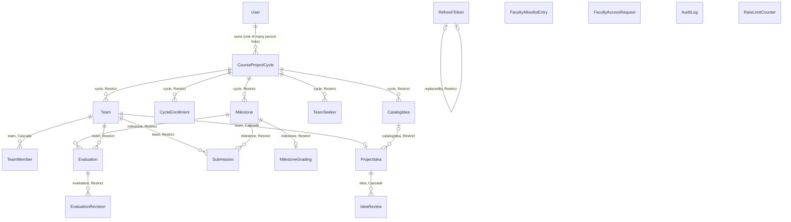
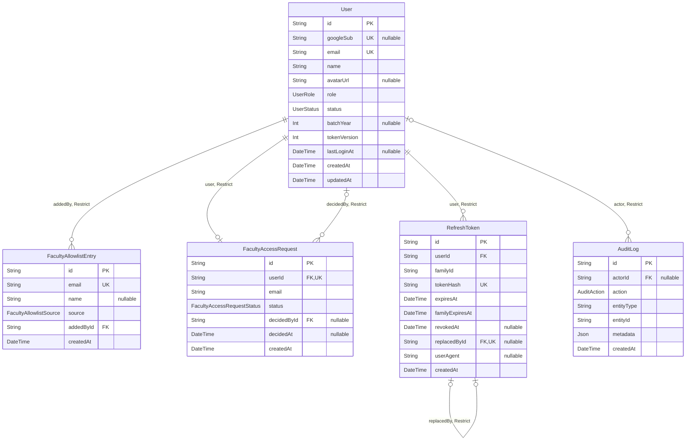
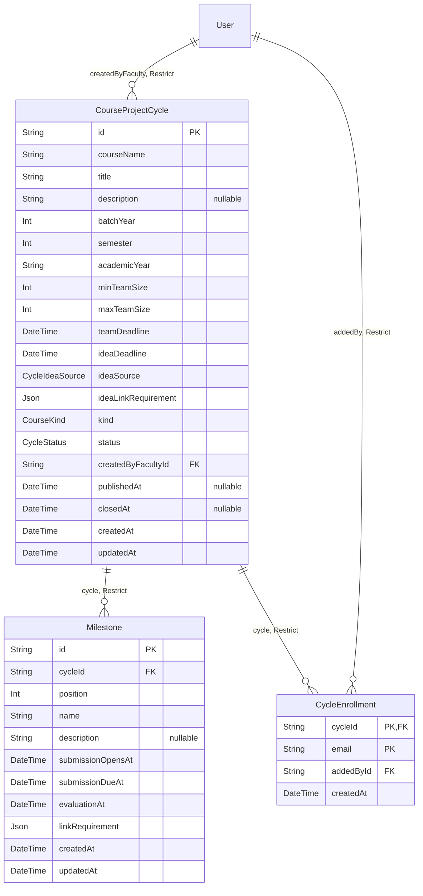
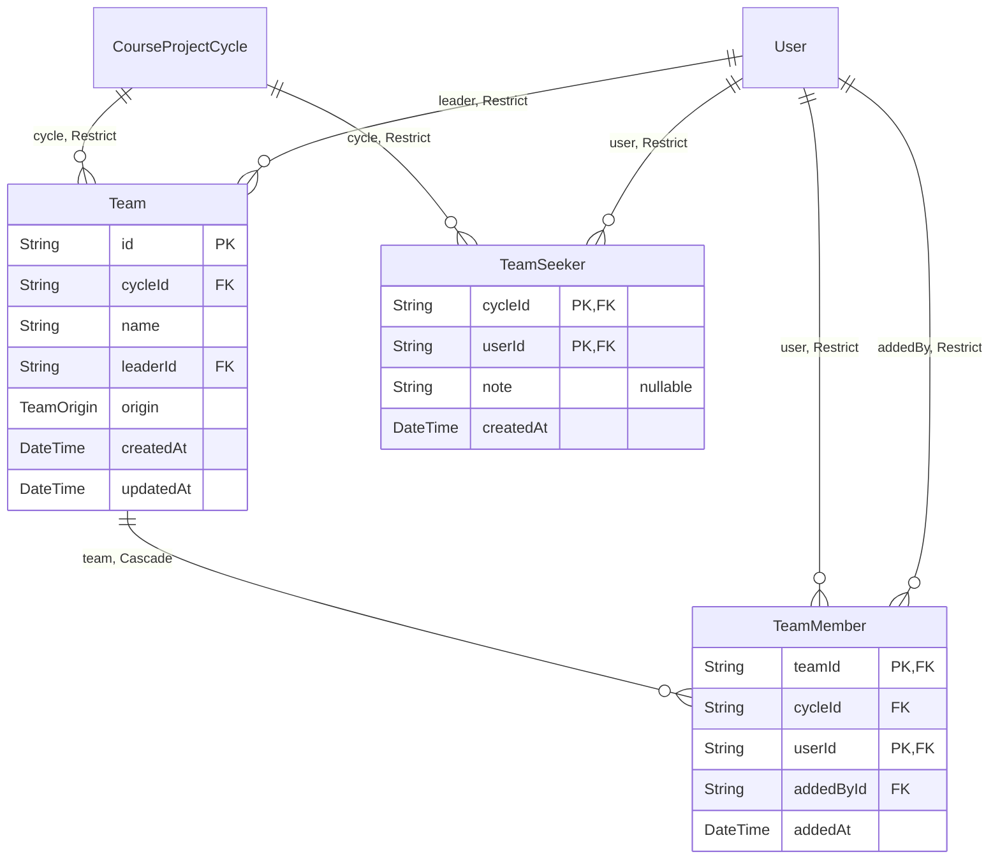
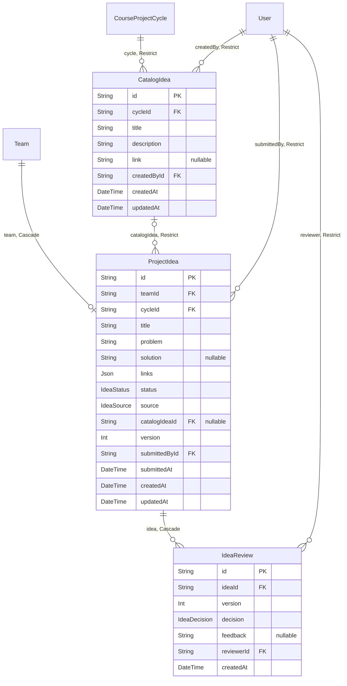
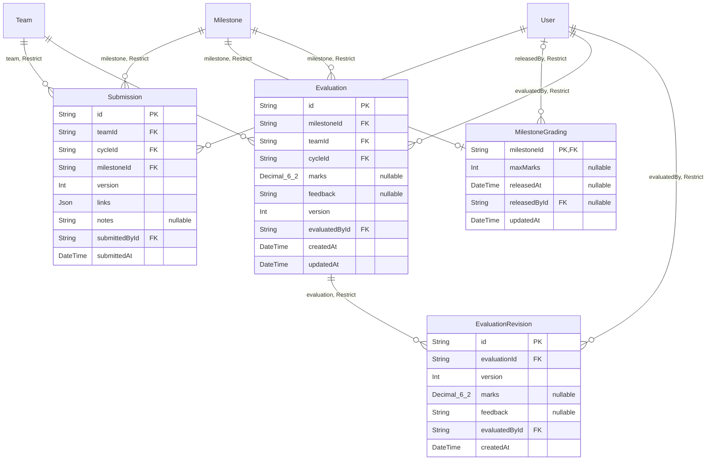
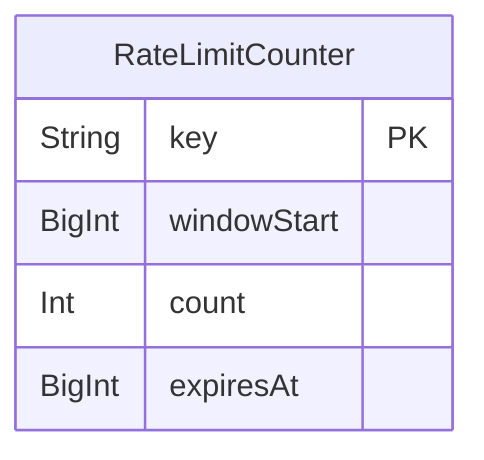

# 8 · Database

PostgreSQL 18 through Prisma 7. Everything here was checked against `backend/prisma/schema.prisma`, the
migrations in `backend/prisma/migrations/`, and the live catalog of a migrated `flowforge_test`
(`pg_constraint`, `pg_indexes`, `pg_trigger`).

**At a glance:** 19 tables, 12 enums, 54 declared primary keys, unique keys and indexes, 12 CHECK constraints,
2 append-only triggers, 1 UNLOGGED table, 10 migrations.

## 8.1 Entity-relationship diagrams

Run `cd backend && npm run docs:erd` to regenerate these from Prisma's DMMF
(`docs/design/scripts/generate-erd.ts`). The full output, with the key and enum tables, is in
[generated/erd.md](generated/erd.md). `npm run docs:erd -- --check` fails if they are out of date.

<!-- erd:start (generated by npm run docs:erd) -->
### All tables and how they connect

Every table and foreign key except those pointing at `User`, so the diagram stays readable. The area diagrams below show the `User` links. Each label is the relation's field name and its `onDelete` rule.

**Where in the code:** `backend/prisma/schema.prisma`

### Identity and access

Who can sign in, with which role, and every session and audit row. A box without columns belongs to another area.

**Where in the code:** `backend/prisma/schema.prisma`

### Cycles

A project cycle, its milestones and its roster. A box without columns belongs to another area.

**Where in the code:** `backend/prisma/schema.prisma`

### Teams

The teams formed in a cycle, their members, and students looking for one. A box without columns belongs to another area.

**Where in the code:** `backend/prisma/schema.prisma`

### Ideas

The faculty's catalog, each team's one current idea, and every review of it. A box without columns belongs to another area.

**Where in the code:** `backend/prisma/schema.prisma`

### Work and evaluations

Versioned submissions per milestone, private evaluations and their history. A box without columns belongs to another area.

**Where in the code:** `backend/prisma/schema.prisma`

### Operations

Rate-limit counters shared by every API process. No foreign keys; the table is UNLOGGED. A box without columns belongs to another area.

**Where in the code:** `backend/prisma/schema.prisma`
<!-- erd:end -->

## 8.2 Conventions for every table

- **Ids** are random UUIDs stored as `text`, created by Prisma (`@default(uuid())`).
- **Times** are `TIMESTAMP(3)` in UTC. The API takes "now" from the injected `Clock`
  (`backend/src/common/clock.ts`), so the database's `DEFAULT CURRENT_TIMESTAMP` only fills `createdAt` on rows
  where the code doesn't set it.
- **`onDelete`:** every foreign key is `RESTRICT` except three `CASCADE`s: `TeamMember → Team`,
  `ProjectIdea → Team` and `IdeaReview → ProjectIdea`. All foreign keys are also `ON UPDATE CASCADE`, Prisma's
  default.
- **Nothing is deleted in normal use**, except a team before its deadline and the rows that go with it. Users are
  deactivated, not deleted.

## 8.3 The tables

### Identity and access

#### `User`

The register of every person: students, faculty, admins and staff waiting for approval.

| Aspect | Detail |
| --- | --- |
| PK | `id` |
| FKs | none |
| Unique | `googleSub` (null until a pre-registered student's first sign-in), `email` |
| CHECK | none |
| `User_googleSub_key` | `UsersRepository.findByGoogleSub`, the first lookup of every sign-in |
| `User_email_key` | `findByEmail`, `findByEmails`: claiming a pre-registered account, enrollment lists |
| `User_role_idx`, `User_status_idx`, `User_batchYear_idx` | `list`: the admin's user filters. `batchYear` also serves `listActiveStudents` for a core batch |
| `onDelete` | referenced by 18 foreign keys, all `RESTRICT` |

#### `FacultyAllowlistEntry`

Who may be faculty. Staff emails only; `RoleResolver.assertCanBeElevated` refuses student emails.

| Aspect | Detail |
| --- | --- |
| PK | `id` |
| FKs | `addedById → User` (`RESTRICT`) |
| Unique | `email`: `FacultyDirectory.isApproved`, read at each staff sign-in |
| CHECK, indexes | none beyond the keys |

#### `FacultyAccessRequest`

A staff member waiting for approval, one per user.

| Aspect | Detail |
| --- | --- |
| PK | `id` |
| FKs | `userId → User`, `decidedById → User` (both `RESTRICT`) |
| Unique | `userId`: `createRequestIfAbsent`, `findRequestForUser` |
| `FacultyAccessRequest_status_idx` | `listRequests`: the admin's pending list |

#### `RefreshToken`

One row per issued refresh token. Only the SHA-256 hash is stored (`hashRefreshToken`).

| Aspect | Detail |
| --- | --- |
| PK | `id` |
| FKs | `userId → User`, `replacedById → RefreshToken` (both `RESTRICT`) |
| Unique | `tokenHash`: `findByHash`, every refresh. `replacedById`: a token has one successor |
| `RefreshToken_familyId_idx` | `revokeFamily`, `hasActiveToken` |
| `RefreshToken_userId_idx` | `revokeAllForUser`: sign out everywhere, deactivation |

#### `AuditLog`

What happened, written in the same transaction as the change. A trigger (`AuditLog_append_only`) rejects `UPDATE`
and `DELETE`.

| Aspect | Detail |
| --- | --- |
| PK | `id` |
| FKs | `actorId → User` (`RESTRICT`, nullable: nobody is signed in yet for a denied login) |
| `AuditLog_entityType_entityId_createdAt_idx` | Reading one entity's history. No API route reads the log today: `AuditRepository` only has `append`. The integration tests and manual SQL use this index |

`entityType` and `entityId` deliberately have no foreign key: a row can name a login attempt (`LoginAttempt`, keyed
by email) or a team that has since been disbanded.

### Cycles and teams

#### `CourseProjectCycle`

A course's project: its dates, team rules and idea rules.

| Aspect | Detail |
| --- | --- |
| PK | `id` |
| FKs | `createdByFacultyId → User` (`RESTRICT`) |
| CHECK | `team_size_check`: `1 <= min <= max <= 10`. `team_idea_deadline_check`: `teamDeadline <= ideaDeadline` (strict in `MilestoneSchedule`) |
| `..._createdByFacultyId_createdAt_idx` | `listByOwner`: a faculty member's projects, newest first |
| `..._batchYear_status_publishedAt_idx` | `listPublishedForStudent`: published core cycles of a batch, newest first |

#### `Milestone`

One checkpoint of a cycle. Saved, locked and published with its cycle.

| Aspect | Detail |
| --- | --- |
| PK | `id` |
| FKs | `cycleId → CourseProjectCycle` (`RESTRICT`) |
| Unique | `(cycleId, position)`: one milestone at each place, and the order they are read in. `(id, cycleId)`: the target of the composite foreign keys from `Submission` and `Evaluation` |
| CHECK | `position_check`: `position >= 1`. `window_check`: `submissionOpensAt < submissionDueAt <= evaluationAt`. The order between milestones and unique names are checked in `MilestoneSchedule`, because a row-level CHECK can't see other rows |

#### `CycleEnrollment`

An elective's roster, keyed by email, because a student may be enrolled before they have an account.

| Aspect | Detail |
| --- | --- |
| PK | `(cycleId, email)`: an email is enrolled once; `isEnrolled`, `listEnrollments` |
| FKs | `cycleId → CourseProjectCycle`, `addedById → User` (both `RESTRICT`) |
| `CycleEnrollment_email_idx` | `listPublishedForStudent`: the electives this email is enrolled in |

#### `Team`

| Aspect | Detail |
| --- | --- |
| PK | `id` |
| FKs | `cycleId → CourseProjectCycle`, `leaderId → User` (both `RESTRICT`) |
| Unique | `(id, cycleId)`: the target of every composite foreign key below. `(cycleId, leaderId)`: a student leads at most one team in a cycle |
| `Team_cycleId_createdAt_idx` | `listByCycle`: the teams list, oldest first |

#### `TeamMember`

The leader has a row too, so one unique key covers leaders and members alike.

| Aspect | Detail |
| --- | --- |
| PK | `(teamId, userId)` |
| FKs | `(teamId, cycleId) → Team(id, cycleId)` (`CASCADE`), `userId → User`, `addedById → User` (`RESTRICT`) |
| Unique | `(cycleId, userId)`: **one team per student per cycle** (ADR 008). It also serves `findMemberships` |
| `TeamMember_userId_idx` | `listByMember`: a student's teams |

**Why the composite foreign key:** `cycleId` is copied onto the member row so `(cycleId, userId)` can be unique, and
the foreign key to `(id, cycleId)` means the copy can never differ from the team's real cycle.

#### `TeamSeeker`

"Looking for a team", removed when the student joins one.

| Aspect | Detail |
| --- | --- |
| PK | `(cycleId, userId)`: one entry per student per cycle; `list` reads by the `cycleId` prefix |
| FKs | `cycleId → CourseProjectCycle`, `userId → User` (both `RESTRICT`) |

### Ideas

#### `CatalogIdea`

An idea the faculty offer. Any number of teams can pick it.

| Aspect | Detail |
| --- | --- |
| PK | `id` |
| FKs | `cycleId → CourseProjectCycle`, `createdById → User` (both `RESTRICT`) |
| Unique | `(id, cycleId)`: the target of `ProjectIdea`'s composite foreign key, so a team can only pick from its own cycle's list |
| `CatalogIdea_cycleId_createdAt_idx` | `IdeaCatalogRepository.list`, in the order the faculty wrote them |

#### `ProjectIdea`

A team's one current idea.

| Aspect | Detail |
| --- | --- |
| PK | `id` |
| FKs | `(teamId, cycleId) → Team` (`CASCADE`), `(catalogIdeaId, cycleId) → CatalogIdea` (`RESTRICT`), `submittedById → User` (`RESTRICT`) |
| Unique | `(teamId, cycleId)`: one idea per team; `findByTeam` reads by the `teamId` prefix |
| CHECK | `version_check`: `version >= 1`. `source_check`: a catalog source if and only if `catalogIdeaId` is set; a pick is always `APPROVED`; a proposal always has a `solution` |
| `ProjectIdea_cycleId_status_idx` | `listByCycle`, through its `cycleId` prefix. No current query filters on `status`; the faculty's "needs attention" list is computed from the listed rows |
| `ProjectIdea_catalogIdeaId_idx` | Each catalog idea's pick count, and the foreign-key check when one is removed |

#### `IdeaReview`

One decision on one version of an idea. History survives a resubmission.

| Aspect | Detail |
| --- | --- |
| PK | `id` |
| FKs | `ideaId → ProjectIdea` (`CASCADE`), `reviewerId → User` (`RESTRICT`) |
| Unique | `(ideaId, version)`: one decision per version; reviews are read newest first through it |
| CHECK | `version_check`: `version >= 1`. `feedback_check`: a rejection needs non-blank feedback |

### Work and evaluations

#### `Submission`

One immutable version of a team's work for one milestone.

| Aspect | Detail |
| --- | --- |
| PK | `id` |
| FKs | `(teamId, cycleId) → Team`, `(milestoneId, cycleId) → Milestone`, `submittedById → User` (all `RESTRICT`) |
| Unique | `(teamId, milestoneId, version)`: no duplicate version. Serves `listByTeam` and the `MAX(version)` in `lockLatestVersion` |
| CHECK | `version_check`: `version >= 1` |
| `Submission_cycleId_milestoneId_submittedAt_idx` | **Unused by current queries (see the finding below).** It dates from when lists were per cycle |

**Finding: an index that doesn't match its query.** `listLatestByMilestone` filters on `milestoneId` alone, and no
index leads with that column. `EXPLAIN` on the QA database (874 submissions) shows a sequential scan followed by a
sort. That's fine at this size, and the query budget test holds it to one statement, but an index on
`(milestoneId, teamId, version DESC)` would suit it better. It isn't changed here because this work makes no schema
changes.

#### `MilestoneGrading`

A milestone's scale and its one-way release. Created on first use (`lockGrading`, `shareGrading`).

| Aspect | Detail |
| --- | --- |
| PK | `milestoneId` (also the foreign key, so at most one per milestone) |
| FKs | `milestoneId → Milestone`, `releasedById → User` (both `RESTRICT`) |
| CHECK | `max_marks_check`: null, or from 1 to 1000 |

#### `Evaluation`

One team's current feedback (and marks, when enabled) for one milestone.

| Aspect | Detail |
| --- | --- |
| PK | `id` |
| FKs | `(milestoneId, cycleId) → Milestone`, `(teamId, cycleId) → Team`, `evaluatedById → User` (all `RESTRICT`) |
| Unique | `(milestoneId, teamId)`: one evaluation per team and milestone; `findByTeam`, and `listByMilestone` through its prefix |
| CHECK | `content_check`: marks null or `>= 0`; marks or feedback given; `version >= 1` |
| `Evaluation_teamId_idx` | `listReleasedForMember`: a student's released results |

**Why two composite foreign keys:** together they guarantee the milestone and the team belong to the same cycle.

#### `EvaluationRevision`

Every saved version of an evaluation. A trigger (`EvaluationRevision_append_only`) rejects `UPDATE` and `DELETE`.

| Aspect | Detail |
| --- | --- |
| PK | `id` |
| FKs | `evaluationId → Evaluation`, `evaluatedById → User` (both `RESTRICT`) |
| Unique | `(evaluationId, version)`: no duplicate version |
| CHECK | `content_check`: the same rule as `Evaluation` |

### Operations

#### `RateLimitCounter`

Fixed-window counters shared by every API process (ADR 023). `UNLOGGED`: a crash forgets them, they rebuild within
a minute, and each hit skips the write-ahead log.

| Aspect | Detail |
| --- | --- |
| PK | `key`: the target of the single `INSERT … ON CONFLICT` in `PostgresRateLimiter.hit` |
| `RateLimitCounter_expiresAt_idx` | `PostgresRateLimiter.sweep`: deletes ended windows every minute |

## 8.4 Class → table mapping

| Domain type | Table(s) | Mapped in |
| --- | --- | --- |
| `User` | `User` | `backend/src/users/infrastructure/prisma-users.repository.ts` |
| `FacultyAllowlistEntry`, `FacultyAccessRequest` | `FacultyAllowlistEntry`, `FacultyAccessRequest` | `backend/src/auth/infrastructure/prisma-faculty-directory.ts` |
| `RefreshTokenRecord` | `RefreshToken` | `backend/src/auth/infrastructure/prisma-refresh-token.repository.ts` |
| `AuditEvent` | `AuditLog` (write only) | `backend/src/audit/infrastructure/prisma-audit.repository.ts` |
| `Cycle` (aggregate), `Milestone`, `Enrollment` | `CourseProjectCycle`, `Milestone`, `CycleEnrollment` | `backend/src/course-cycles/infrastructure/prisma-cycle.repository.ts` |
| `Team`, `TeamMember`, `Membership` | `Team` joined with `TeamMember` and the member's `User` name and email | `backend/src/teams/infrastructure/prisma-team.repository.ts` |
| `TeamSeeker` | `TeamSeeker` | `backend/src/teams/infrastructure/prisma-team-seeker.repository.ts` |
| `Idea`, `IdeaReview` | `ProjectIdea` with its `IdeaReview` rows | `backend/src/ideas/infrastructure/prisma-idea.repository.ts` |
| `CatalogIdea` | `CatalogIdea`, with a count of its picks | `backend/src/ideas/infrastructure/prisma-idea-catalog.repository.ts` |
| `Submission` | `Submission`, with the submitter's name | `backend/src/submissions/infrastructure/prisma-submission.repository.ts` |
| `MilestoneGrading`, `Evaluation` | `MilestoneGrading`, `Evaluation`. `EvaluationRevision` has no domain type: the repository writes one with every save | `backend/src/evaluations/infrastructure/prisma-evaluation.repository.ts` |
| `RateLimitDecision` | computed from `RateLimitCounter` | `backend/src/prisma/postgres-rate-limiter.ts` |

### Value objects stored as JSON

| Value | Column | Why JSON |
| --- | --- | --- |
| `LinkRequirement` (`required`, `optional`) | `CourseProjectCycle.ideaLinkRequirement`, `Milestone.linkRequirement` | It's always read and written whole, with no identity of its own, and no query looks inside it. Two lists in join tables would add tables and joins for nothing. `LinkRequirement.from` re-validates the shape when it's read back (ADR 018) |
| `Link[]` (`type`, `url`) | `ProjectIdea.links`, `Submission.links` | A version's links are immutable and only ever shown with that version. Which types are allowed is set per milestone, so the type list changes without a migration (ADR 018) |
| `AuditMetadata` | `AuditLog.metadata` | Each of the 39 audit actions has its own details, and nothing queries them |

`LinkRequirement` is a real class (private constructor, `readonly` fields, `equals`); `Link` is a plain interface.

**Rule these columns follow:** nothing inside the JSON is filtered, joined or constrained by the database. The
trade-off is that the database can't validate them, so `LinkRequirement.check` and `LinkRequirement.from` do.

## 8.5 Normalization

The schema is in third normal form apart from the deliberate choices below. Each one has a reason and a guard.

| Denormalization | Where | Why | What keeps it correct |
| --- | --- | --- | --- |
| `cycleId` copied onto child rows | `TeamMember`, `ProjectIdea`, `Submission`, `Evaluation` | Lets the database enforce rules spanning tables: one team per student per cycle, a milestone and team of the same cycle | Composite foreign keys to `(id, cycleId)` |
| A pick copies the catalog idea's text | `ProjectIdea.title`, `problem` | A faculty edit must not change what a team already picked (ADR 014) | `IdeaRules.pickContent`, and the `source_check` |
| Current row plus history | `Evaluation` and `EvaluationRevision` | The latest is read constantly; the history is an audit trail | Both written in one transaction by `PrismaEvaluationRepository.save`; the revision is append-only |
| `familyExpiresAt` on every token | `RefreshToken` | Rotation needs it without a family table | Copied by `SessionService.issue` |
| `email` on the request | `FacultyAccessRequest.email` | Approving acts on the address that asked, even if the profile changes | Written once by `createRequestIfAbsent` |

**The opposite choice, computed rather than stored:** a cycle's stage and upcoming events (`CycleTimeline`, ADR 017),
a submission's window (`SubmissionRules.window`), a student's to-dos (`StudentTodoRules`, ADR 021), and a team's size.
Stored copies could go stale; these can't.

**Known limit:** `ProjectIdea` keeps only the current content. Reviews record each decision and version number, but
the text of an earlier version isn't kept.

## 8.6 Locking per use case

| Use case | Mechanism | Why this one |
| --- | --- | --- |
| Edit, publish or close a cycle | Row lock: `CycleRepository.lockById` (`FOR UPDATE`). The write also checks `expectedStatus` | The checks read several rows (milestones, roster), so they must not change until the commit |
| Create a team | Unique: `(cycleId, userId)`, `(cycleId, leaderId)`. `mapConflict` turns a violation into `409 STUDENT_ALREADY_IN_TEAM` | No shared row to lock: two leaders racing for one student meet only at the membership row |
| Change or disband a team, faculty adds a member | Row lock: `findByIdForUpdate` (`FOR UPDATE` on `Team`) | Size and members are read, then changed, so changes to one team must take turns. This protects the last slot |
| Auto-group | Unique constraints, in one transaction | A stale preview hits a constraint and every team in the batch rolls back |
| Submit, change or review an idea | Row locks: `FOR SHARE` on `Team` (a disband waits), `FOR UPDATE` on `ProjectIdea`. Plus an optimistic version: `IDEA_CHANGED` | The faculty's decision must apply to the version they read |
| First idea of a team | Unique: `(teamId, cycleId)`, mapped to `IDEA_CHANGED` | There's no idea row to lock yet |
| Pick a catalog idea, remove one | Row lock: `FOR SHARE` on `CatalogIdea`. The removal relies on the `RESTRICT` foreign key, mapped to `CATALOG_IDEA_PICKED` | Many teams may pick at once, so they must not block each other |
| Submit work | Row lock: `FOR UPDATE` on `Team`, then `MAX(version)`. Unique: `(teamId, milestoneId, version)`, mapped to `SUBMISSION_CHANGED`, as the last guard | Versions must be numbered without gaps; team-wide, because any member can submit |
| Save an evaluation | Optimistic: `expectedVersion`, with `updateMany … WHERE version = n-1`. Row lock: `FOR SHARE` on `MilestoneGrading`. Unique: `(milestoneId, teamId)` for the first save | Two tabs shouldn't block each other: the second should be told, not silently overwrite. The shared lock keeps the scale fixed during the save, and saves never block each other |
| Set the scale, release results | Row lock: `FOR UPDATE` on `MilestoneGrading`, plus `updateMany … WHERE releasedAt IS NULL` | Release is one-way and happens once |
| Rotate a refresh token | Compare-and-set: `revokeIfActive` (`updateMany … WHERE revokedAt IS NULL`) | The loser reads what the winner did and takes the grace path |
| First sign-in claims a pre-registered account | Compare-and-set: `claim` (`updateMany … WHERE googleSub IS NULL`), plus the unique `googleSub` | A double sign-in must produce one account |
| Enroll students | `createMany` with `skipDuplicates` on the primary key | Importing the same list twice is harmless |
| Rate limit | One atomic upsert (`INSERT … ON CONFLICT DO UPDATE`) | No read-then-write race, and no held row lock |
| Audit | Same transaction as the change; append-only trigger | A change never commits without its audit row (`test/course-cycles.e2e.ts`, `test/evaluations.e2e.ts`) |

`FOR UPDATE` and `FOR SHARE` are raw SQL, because Prisma has no API for them. Each query is one line in a repository:
`backend/src/course-cycles/infrastructure/prisma-cycle.repository.ts`,
`backend/src/teams/infrastructure/prisma-team.repository.ts`,
`backend/src/ideas/infrastructure/prisma-idea.repository.ts`,
`backend/src/ideas/infrastructure/prisma-idea-catalog.repository.ts`,
`backend/src/submissions/infrastructure/prisma-submission.repository.ts`,
`backend/src/evaluations/infrastructure/prisma-evaluation.repository.ts`.

## 8.7 Migrations

| Migration | What it does |
| --- | --- |
| `20260930000000_init_user_identity` | The first `User` table |
| `20260930122159_add_course_project_cycles` | `CourseProjectCycle`, with its first date CHECK |
| `20261023120000_google_sign_in_rbac_sessions_audit` | Phase 3: Google sign-in replaces passwords; roles, faculty allowlist and requests, `RefreshToken`, and the append-only `AuditLog` |
| `20261027120000_teams` | Phase 4: `Team`, `TeamMember` with the composite foreign key, team sizes and the formation deadline |
| `20261028090000_team_completion_electives` | Phase 5: electives (`CycleEnrollment`), the completion window, team origin, `TeamSeeker` |
| `20261028120000_ideas_and_pre_registration` | Phase 6: `ProjectIdea`, `IdeaReview`, and `googleSub` becomes nullable for pre-registered students |
| `20261028150000_idea_catalog_and_submissions` | Phase 7: `CatalogIdea`, picks, and versioned `Submission` |
| `20261029120000_milestones_and_links` | Phase 8: `Milestone` replaces the single window, JSON links replace URL columns. Keeps existing rows |
| `20261030120000_evaluations` | Phase 9: `MilestoneGrading`, `Evaluation`, append-only `EvaluationRevision` |
| `20261031120000_rate_limit_counters` | Phase 10: the UNLOGGED `RateLimitCounter` |

**Where in the code:** `backend/prisma/schema.prisma`, `backend/prisma/migrations/`.
