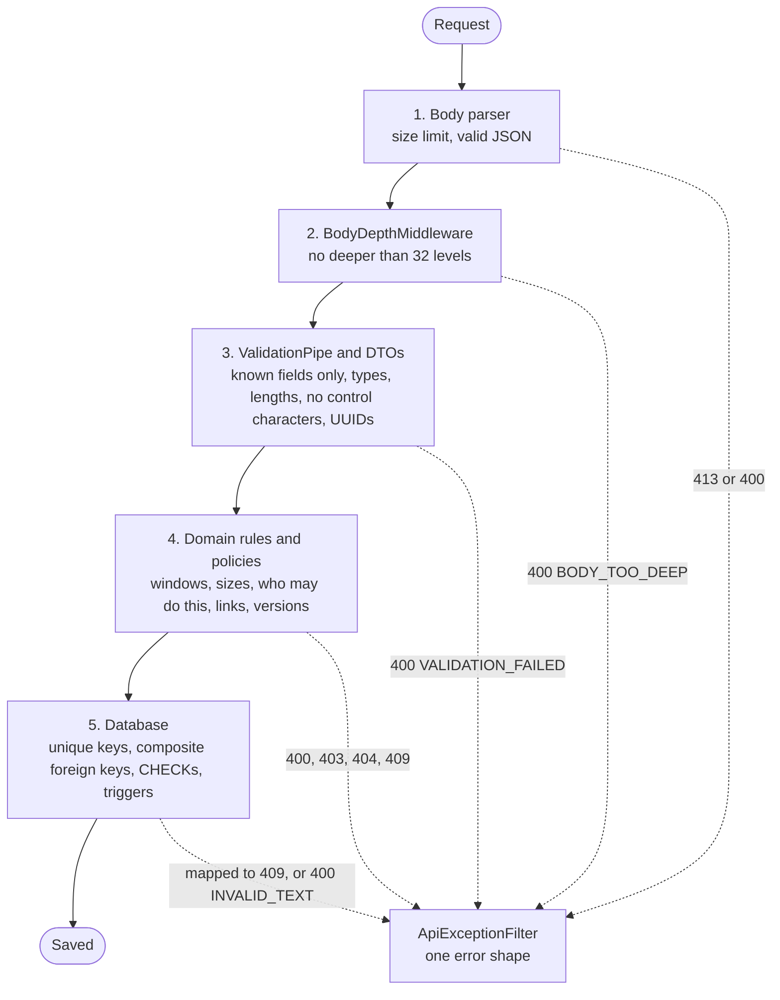

# 9 · Errors and edge cases

## 9.1 The validation layers

A request meets five checks, cheapest first. Each catches what the one before it can't see, and the last two hold even if a bug gets past the others.

**Where in the code:** `backend/src/main.ts`, `backend/src/common/http/body-depth.middleware.ts`, `backend/src/common/validation/clean-text.ts`,
`backend/src/teams/domain/team-rules.ts`, `backend/prisma/migrations/`, `backend/src/common/errors/api-exception.filter.ts`

| Layer | What it catches | Example | Proved by |
| --- | --- | --- | --- |
| **1. Body parser** | A body over Express's default limit, or malformed JSON | A 2 MB body answers 413 | `tests/security/input.spec.ts` (SEC-INJ-3) |
| **2. Body depth** | Nesting that would overflow the validation pipe's stack | 5,000 levels answers `400 BODY_TOO_DEEP`, one log line, no stack | `backend/test/body-depth.e2e.ts` |
| **3. DTOs** | Unknown fields, wrong types, lengths, malformed UUIDs, control characters. `whitelist` and `forbidNonWhitelisted` refuse `status` or `createdByFacultyId` in a body | A 61-character team name; a NUL in text | `tests/security/access.spec.ts` (SEC-MASS-1), `backend/test/clean-text.e2e.ts` |
| **4. Domain rules** | Anything that needs state or the clock: windows, ownership, size ranges, link rules, version checks | `TEAM_FORMATION_CLOSED`, `EVALUATION_CHANGED` | Each module's `*.spec.ts` |
| **5. Database** | Races that pass the rules, and any bug in them: one team per student, `Evaluation_content_check`, `AuditLog_append_only` | Two leaders adding one student | `backend/test/teams.e2e.ts`, `backend/test/ideas.e2e.ts`, `backend/test/submissions.e2e.ts` ("database guarantees") |

**One safety net below them:** a text value PostgreSQL itself refuses (SQLSTATE 22021) becomes `400 INVALID_TEXT`, not a 500 (`backend/src/common/errors/database-errors.ts`).

## 9.2 Edge cases

"Exactly on it" counts as past: every window closes at its deadline, because each check is `now < deadline`.

### Deadlines

| Scenario | Behaviour | Error code | Test |
| --- | --- | --- | --- |
| Rename a team 1 min before the team deadline | Saved | none | `backend/test/edge-cases.e2e.ts`, `tests/e2e/lifecycle.spec.ts` |
| Exactly on it, and 1 min after | Refused | `409 TEAM_FORMATION_CLOSED` | `backend/test/edge-cases.e2e.ts` |
| Propose an idea 1 min before the idea deadline | Saved | none | `backend/test/edge-cases.e2e.ts`, `tests/e2e/lifecycle.spec.ts` |
| Exactly on it, and 1 min after | Refused | `409 IDEA_SUBMISSION_CLOSED` | `backend/test/edge-cases.e2e.ts` |
| Submit 1 min before a milestone opens | Refused | `409 SUBMISSION_NOT_OPEN` | `backend/test/edge-cases.e2e.ts` |
| Exactly when it opens | Saved | none | `backend/test/edge-cases.e2e.ts` |
| Submit 1 min before it's due | Saved | none | `backend/test/edge-cases.e2e.ts`, `tests/e2e/lifecycle.spec.ts` |
| Exactly on it, and 1 min after | Refused, nothing saved | `409 SUBMISSION_CLOSED` | `backend/test/edge-cases.e2e.ts` |
| Grade 1 min before the due time | Refused | `409 GRADING_NOT_OPEN` | `backend/test/edge-cases.e2e.ts` |
| Exactly on the due time | Saved | none | `backend/test/edge-cases.e2e.ts` |
| A submission racing the due time: 20 teams every 100 ms, 3 s either side | Everything before is saved, everything after is refused, no 5xx | `409 SUBMISSION_CLOSED` | `tests/concurrency/races.spec.ts` (CON-6) |

### Double clicks and retries

| Scenario | Behaviour | Error code | Test |
| --- | --- | --- | --- |
| "Create team" clicked three times | One team | `409 STUDENT_ALREADY_IN_TEAM` for the others | `tests/concurrency/races.spec.ts` (CON-3b) |
| "Publish" or "Close" double-clicked | One transition, one audit row | `409 INVALID_STATUS_TRANSITION` or `CYCLE_ALREADY_CLOSED` | `tests/concurrency/races.spec.ts` (CON-5), `backend/test/course-cycles.e2e.ts` |
| "Release" double-clicked | One release, one audit row | `409 ALREADY_RELEASED` | `backend/test/edge-cases.e2e.ts`, `tests/concurrency/races.spec.ts` (CON-5b) |
| "Submit" double-clicked | **Two versions**, both kept and numbered in order. Not an error: versions are immutable and the newest counts. The button is also disabled while saving | none, capped by `TOO_MANY_REQUESTS` | `tests/concurrency/races.spec.ts` (CON-1), `backend/test/write-limits.e2e.ts` |
| Two tabs refresh at once with one cookie | Both stay signed in | none | `backend/test/sessions.e2e.ts`, `tests/e2e/journey.spec.ts` (E2E-AUTH) |

### Teams

| Scenario | Behaviour | Error code | Test |
| --- | --- | --- | --- |
| Two leaders add one student at the same moment | The student ends up in exactly one team; the database decides | `409 STUDENT_ALREADY_IN_TEAM` | `backend/test/teams.e2e.ts`, `tests/concurrency/races.spec.ts` (CON-3) |
| A leader drops a member while another team claims them | One wins cleanly | `409 STUDENT_ALREADY_IN_TEAM` | `tests/concurrency/races.spec.ts` (CON-3b) |
| 10 faculty placements into a team's last slot | One succeeds; the team stops at its maximum | `409 TEAM_FULL` for 9 | `tests/concurrency/races.spec.ts` (CON-2), `backend/test/team-completion.e2e.ts` |
| Two leaders' changes to one team at once | They take turns on the row lock; the size limit holds | `400 TEAM_SIZE_OUT_OF_RANGE` | `backend/test/teams.e2e.ts` |

### Evaluations

| Scenario | Behaviour | Error code | Test |
| --- | --- | --- | --- |
| The owning faculty saves one evaluation from two tabs | One wins; the other is told to reload, with nothing overwritten | `409 EVALUATION_CHANGED` | `backend/test/evaluations.e2e.ts`, `tests/concurrency/races.spec.ts` (CON-4) |
| A **second faculty member** tries to edit it | **A cycle has one owner**, so there are no two editing faculty: anyone else gets 404 | `404 TEAM_NOT_FOUND` | `backend/test/evaluations.e2e.ts` |
| A release racing saves | One release; saves are kept in one continuous history; a student sees the latest | `409 ALREADY_RELEASED` for the second release | `backend/test/edge-cases.e2e.ts`, `tests/concurrency/races.spec.ts` (CON-5b) |
| A student reads feedback before release | An empty list, not an error. The query filters on `releasedAt` | none | `backend/test/evaluations.e2e.ts`, `tests/security/access.spec.ts` (SEC-LEAK-1) |
| A mark sent while marks are off | Refused; no response carries marks or a scale, for any role | `400 MARKS_DISABLED` | `backend/test/evaluations-feedback-only.e2e.ts` |

### Sessions and tokens

| Scenario | Behaviour | Error code | Test |
| --- | --- | --- | --- |
| An expired or tampered access token | Refused | `401 UNAUTHENTICATED` | `tests/security/auth.spec.ts` (SEC-AUTH-3), `backend/test/sessions.e2e.ts` |
| An access token after sign out everywhere, or a role change | Refused on the next request | `401 TOKEN_REVOKED` | `backend/test/sessions.e2e.ts`, `backend/test/admin-users.e2e.ts` |
| A refresh token past its day | Refused, cookie cleared | `401 INVALID_REFRESH_TOKEN` | `backend/test/sessions.e2e.ts` |
| A rotated refresh token replayed after 10 s | The whole family ends, audited | `401 REFRESH_TOKEN_REUSED` | `backend/test/sessions.e2e.ts`, `tests/security/auth.spec.ts` (SEC-AUTH-9b) |
| A deactivated user's token | Refused at once | `401 ACCOUNT_DEACTIVATED` | `backend/test/admin-users.e2e.ts` |
| A refresh from another site | Refused | `403 ORIGIN_NOT_ALLOWED` | `backend/test/sessions.e2e.ts` |

### Access to other people's data

| Scenario | Behaviour | Error code | Test |
| --- | --- | --- | --- |
| Another team's id, on any route | As if it didn't exist | `404 TEAM_NOT_FOUND` | `tests/security/access.spec.ts` (SEC-IDOR-1), `backend/test/teams.e2e.ts` |
| Another batch's project | As if it didn't exist | `404 CYCLE_NOT_FOUND` | `tests/security/access.spec.ts` (SEC-IDOR-2), `backend/test/teams.e2e.ts` |
| Another faculty member's project | As if it didn't exist | `404` | `tests/security/access.spec.ts` (SEC-IDOR-3) |
| A team id from one project with a milestone from another | Refused | `404` | `tests/security/access.spec.ts` (SEC-IDOR-4), `backend/test/submissions.e2e.ts` |
| A malformed id | Refused, never a 500 | `400 VALIDATION_FAILED` | `tests/security/access.spec.ts` (SEC-IDOR-5) |
| A member trying a leader's action | Refused | `403 NOT_TEAM_LEADER` | `tests/security/access.spec.ts` (SEC-ROLE-3) |

### Oversized or malicious input

| Scenario | Behaviour | Error code | Test |
| --- | --- | --- | --- |
| A 2 MB body | Refused by the body parser | `413` | `tests/security/input.spec.ts` (SEC-INJ-3) |
| A body nested 5,000 levels | Refused before validation, one log line | `400 BODY_TOO_DEEP` | `backend/test/body-depth.e2e.ts` |
| A NUL or control character in text | Refused | `400 VALIDATION_FAILED`; `INVALID_TEXT` as the net | `backend/test/clean-text.e2e.ts` |
| SQL injection strings | Stored as text or refused, never executed | none or 400 | `tests/security/input.spec.ts` (SEC-INJ-1) |
| Stored XSS payloads | Shown as plain text; no dialog in the browser | none | `tests/security/input.spec.ts` (SEC-INJ-2) |
| Forged fields such as `status`, `role`, `leaderId` | Refused | `400 VALIDATION_FAILED` | `tests/security/access.spec.ts` (SEC-MASS-1) |
| `javascript:`, internal addresses, a password in a link | Refused | `400 INVALID_LINK` | `tests/security/input.spec.ts` (SEC-LINK), `backend/src/common/links/link-requirement.spec.ts` |
| CRLF in a header, a forged Host | No change to redirects or cookies | none | `tests/security/input.spec.ts` (SEC-INJ-5) |
| Notes at 4,000 and at 4,001 characters | Accepted, refused | `400 VALIDATION_FAILED` | `tests/security/input.spec.ts` (SEC-ABUSE-3) |
| A huge page size, or a very short or very long search | Bounded or refused | `400 VALIDATION_FAILED` | `tests/security/input.spec.ts` (SEC-ABUSE-2) |

### Rate limits on a shared campus IP

| Scenario | Behaviour | Error code | Test |
| --- | --- | --- | --- |
| 3,000 students sign in from one IP over 5 minutes | All sign in; only a 601st within one minute is refused | `429 TOO_MANY_REQUESTS` | `backend/test/rate-limit.e2e.ts` |
| One session refreshes 11 times in a minute, with 500 other sessions on the same IP | Only that session's 11th is refused, and it keeps its cookie | `429 TOO_MANY_REQUESTS` | `backend/test/rate-limit.e2e.ts` |
| A client forges `X-Forwarded-For` | Ignored unless a proxy is trusted | `429` as usual | `backend/test/rate-limit.e2e.ts`, `tests/security/config.spec.ts` (SEC-ABUSE-4) |
| Two API processes | Share one budget | `429 TOO_MANY_REQUESTS` | `backend/test/rate-limit.e2e.ts`, `backend/test/cluster.e2e.ts` |
| One member submits 11 times in a minute | The 11th is refused; other members aren't affected | `429 TOO_MANY_REQUESTS` | `backend/test/write-limits.e2e.ts` |

### Outages

| Scenario | Behaviour | Error code | Test |
| --- | --- | --- | --- |
| The database goes down during a session | Requests answer 503 with no details. The cookie stays, and the app shows a retry banner | `503 SERVICE_UNAVAILABLE` | `backend/test/database-outage.e2e.ts`, `tests/e2e/resilience.spec.ts` (RES-1) |
| The database comes back | Next retry succeeds. No API restart, and nobody signed out | none | The same tests |
| A write during the outage | Not half-applied | `503` | `tests/e2e/resilience.spec.ts` (RES-1) |
| The database is too busy to start a transaction within 2 s | Requests answer 503 with no details, and the cookie stays. A later retry succeeds | `503 SERVICE_UNAVAILABLE` | `backend/test/database-outage.e2e.ts`, `backend/test/error-filter.e2e.ts` |
| A session really ended during that time | Still ended: an answer about the session clears the cookie | `401` | `backend/test/database-outage.e2e.ts` |
| An API worker dies | The primary starts a new one, and the others keep serving | none | `backend/test/cluster.e2e.ts` |

**Tests added for this document:** `backend/test/edge-cases.e2e.ts` covers exact-moment and ±1 minute at the API for all five windows, and a release racing saves. The rest already
had tests. **Limit:** the browser checks at ±1 minute are on a real clock in `tests/e2e/lifecycle.spec.ts`, while exact-moment checks use the fixed clock.

## 9.3 Summary of results

The counts and load numbers are from the final run, in [doc 10](10-implementation.md).

| Area | Result | Evidence |
| --- | --- | --- |
| **Concurrency** | 10 of 10 races pass: no lost, duplicate or late writes. Each loser gets a 409 with a real code, and none gets a 5xx | `tests/concurrency/races.spec.ts` |
| **Security** | 58 of 58 checks pass. No Critical or High finding, and all 8 findings of the first QA pass were fixed in Phase 10 | `tests/security/` |
| **Integrity** | 21 of 21 database checks pass after the functional suites: no gaps in versions, no double membership, nothing after a deadline | `tests/support/integrity.cjs` |
| **Load** | 3,000 users on one laptop, after Phase 10: 1,244,459 requests, p95 4.64 s (5.94 s before), and capacity up about 40%. **The latency target is still missed.** 2,952 submissions accepted and 2,952 saved. A 1,500-user spike: p95 12 ms, no failures. 25 requests answered 500 under overload; [that's fixed to 503](10-implementation.md#what-the-numbers-mean), and the load wasn't rerun | `tests/load/`, `tests/results/load/` |
