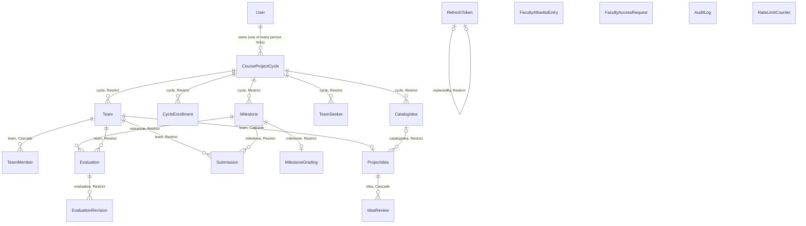
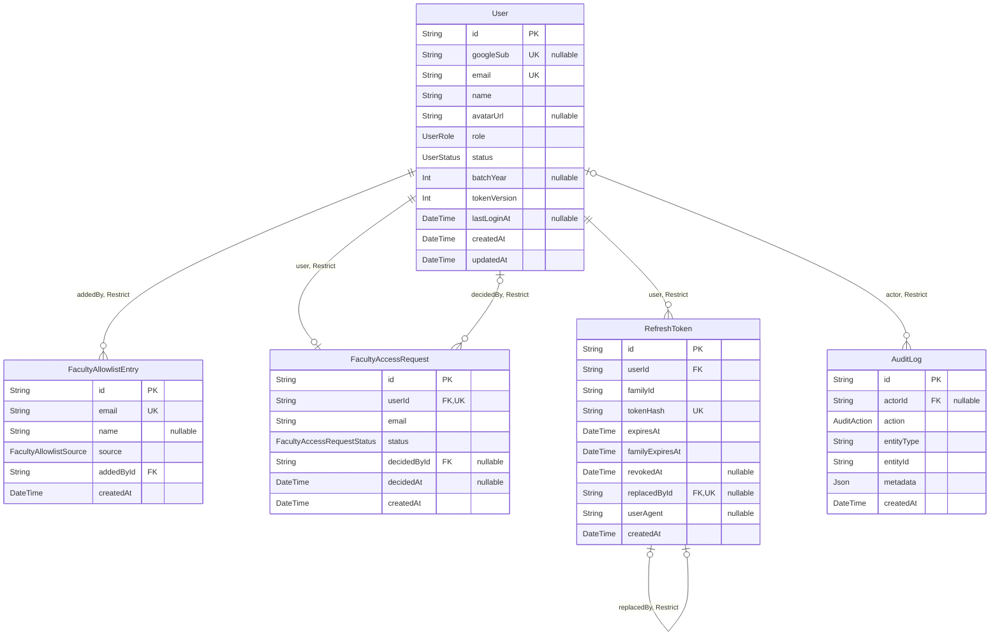
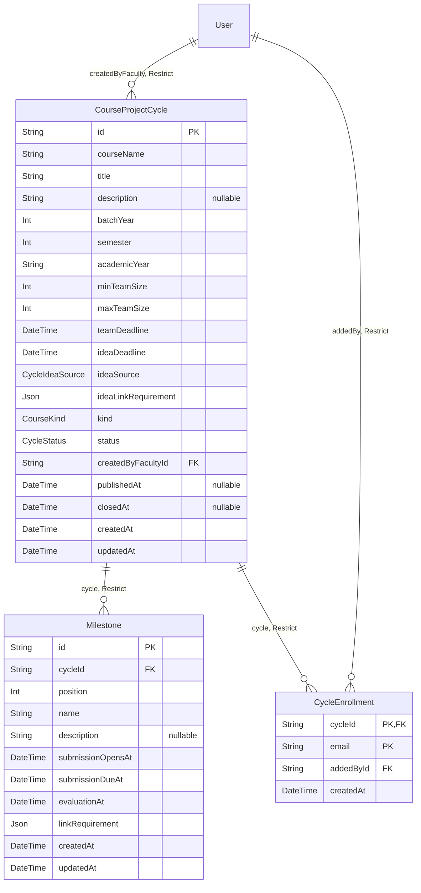
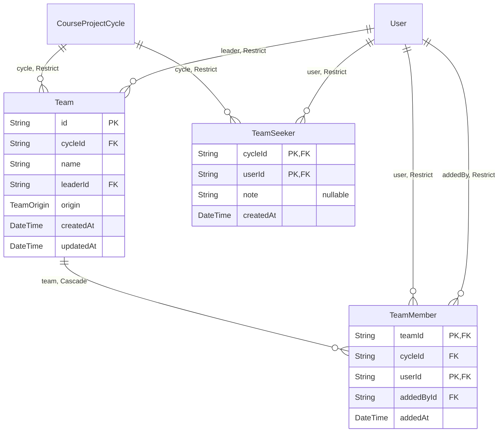
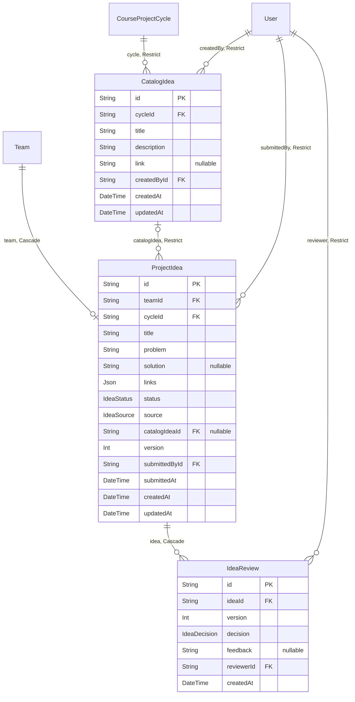
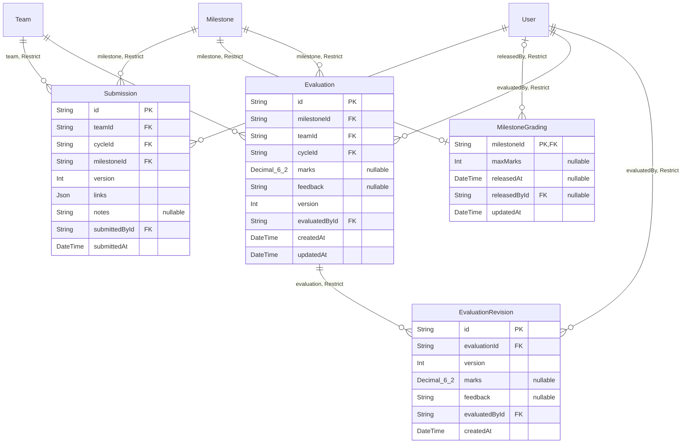
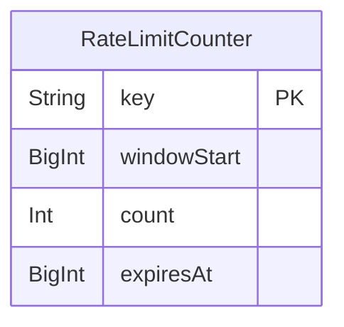

# Entity-relationship diagrams

Generated from `backend/prisma/schema.prisma` by `npm run docs:erd`. Do not edit by hand.

19 tables, 12 enums, 54 primary keys, unique keys and indexes declared in the schema.

## All tables and how they connect

Every table and foreign key except those pointing at `User`, so the diagram stays readable. The area diagrams below show the `User` links. Each label is the relation's field name and its `onDelete` rule.

**Where in the code:** `backend/prisma/schema.prisma`

## Identity and access

Who can sign in, with which role, and every session and audit row. A box without columns belongs to another area.

**Where in the code:** `backend/prisma/schema.prisma`

## Cycles

A project cycle, its milestones and its roster. A box without columns belongs to another area.

**Where in the code:** `backend/prisma/schema.prisma`

## Teams

The teams formed in a cycle, their members, and students looking for one. A box without columns belongs to another area.

**Where in the code:** `backend/prisma/schema.prisma`

## Ideas

The faculty's catalog, each team's one current idea, and every review of it. A box without columns belongs to another area.

**Where in the code:** `backend/prisma/schema.prisma`

## Work and evaluations

Versioned submissions per milestone, private evaluations and their history. A box without columns belongs to another area.

**Where in the code:** `backend/prisma/schema.prisma`

## Operations

Rate-limit counters shared by every API process. No foreign keys; the table is UNLOGGED. A box without columns belongs to another area.

**Where in the code:** `backend/prisma/schema.prisma`

## Keys and indexes declared in the schema

CHECK constraints and triggers are written by hand in the migrations; see [08-database.md](../08-database.md).

| Table | Kind | Columns |
| --- | --- | --- |
| User | primary key | id |
| User | unique | googleSub |
| User | unique | email |
| User | index | role |
| User | index | batchYear |
| User | index | status |
| FacultyAllowlistEntry | primary key | id |
| FacultyAllowlistEntry | unique | email |
| FacultyAccessRequest | primary key | id |
| FacultyAccessRequest | unique | userId |
| FacultyAccessRequest | index | status |
| RefreshToken | primary key | id |
| RefreshToken | unique | tokenHash |
| RefreshToken | unique | replacedById |
| RefreshToken | index | userId |
| RefreshToken | index | familyId |
| AuditLog | primary key | id |
| AuditLog | index | entityType, entityId, createdAt |
| CourseProjectCycle | primary key | id |
| CourseProjectCycle | index | createdByFacultyId, createdAt |
| CourseProjectCycle | index | batchYear, status, publishedAt |
| Milestone | primary key | id |
| Milestone | unique | cycleId, position |
| Milestone | unique | id, cycleId |
| CycleEnrollment | primary key | cycleId, email |
| CycleEnrollment | index | email |
| Team | primary key | id |
| Team | index | cycleId, createdAt |
| Team | unique | id, cycleId |
| Team | unique | cycleId, leaderId |
| TeamMember | primary key | teamId, userId |
| TeamMember | index | userId |
| TeamMember | unique | cycleId, userId |
| TeamSeeker | primary key | cycleId, userId |
| CatalogIdea | primary key | id |
| CatalogIdea | index | cycleId, createdAt |
| CatalogIdea | unique | id, cycleId |
| ProjectIdea | primary key | id |
| ProjectIdea | index | cycleId, status |
| ProjectIdea | index | catalogIdeaId |
| ProjectIdea | unique | teamId, cycleId |
| IdeaReview | primary key | id |
| IdeaReview | unique | ideaId, version |
| Submission | primary key | id |
| Submission | index | cycleId, milestoneId, submittedAt |
| Submission | unique | teamId, milestoneId, version |
| MilestoneGrading | primary key | milestoneId |
| Evaluation | primary key | id |
| Evaluation | index | teamId |
| Evaluation | unique | milestoneId, teamId |
| EvaluationRevision | primary key | id |
| EvaluationRevision | unique | evaluationId, version |
| RateLimitCounter | primary key | key |
| RateLimitCounter | index | expiresAt |

## Enums

| Enum | Values |
| --- | --- |
| UserRole | STUDENT, FACULTY, ADMIN, PENDING_STAFF |
| UserStatus | ACTIVE, DEACTIVATED |
| FacultyAllowlistSource | MANUAL, APPROVED_REQUEST, CSV_IMPORT |
| FacultyAccessRequestStatus | PENDING, APPROVED, REJECTED |
| AuditAction | LOGIN_SUCCEEDED, LOGIN_DENIED, USER_CREATED, ROLE_ASSIGNED, FACULTY_REQUEST_CREATED, FACULTY_REQUEST_APPROVED, FACULTY_REQUEST_REJECTED, FACULTY_ALLOWLIST_ADDED, FACULTY_ALLOWLIST_REMOVED, ELEVATION_DENIED, USER_BATCH_CORRECTED, USER_DEACTIVATED, USER_REACTIVATED, LOGOUT, LOGOUT_ALL, REFRESH_TOKEN_REUSE_DETECTED, TEAM_CREATED, TEAM_UPDATED, TEAM_DISBANDED, ENROLLMENT_ADDED, ENROLLMENT_REMOVED, AUTO_GROUP_APPLIED, USER_CLAIMED, IDEA_SUBMITTED, IDEA_UPDATED, IDEA_APPROVED, IDEA_REJECTED, CATALOG_IDEA_ADDED, CATALOG_IDEA_UPDATED, CATALOG_IDEA_REMOVED, IDEA_PICKED, SUBMISSION_CREATED, CYCLE_CREATED, CYCLE_UPDATED, CYCLE_PUBLISHED, CYCLE_CLOSED, EVALUATION_SAVED, EVALUATION_RELEASED, GRADING_SCALE_SET |
| CycleStatus | DRAFT, PUBLISHED, CLOSED |
| CourseKind | CORE, ELECTIVE |
| CycleIdeaSource | STUDENT_PROPOSALS, FACULTY_LIST, BOTH |
| TeamOrigin | STUDENT, FACULTY, AUTO_GROUP |
| IdeaStatus | SUBMITTED, APPROVED, REJECTED |
| IdeaDecision | APPROVED, REJECTED |
| IdeaSource | PROPOSAL, CATALOG |
